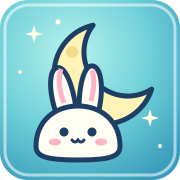

::: {.profile}
{.profile-avatar fig-alt="月兔头像"}

::: {.profile-copy}
## Quark Liu

AI · Reasoning · Multimodal Learning

自我介绍准备中……

[GitHub](https://github.com/negativegluon){.retro-button} [RSS](writing.xml){.retro-button}
:::
:::

## 研究兴趣

- 抽象推理与 ARC-AGI
- 多模态学习与具身智能
- 研究工程
