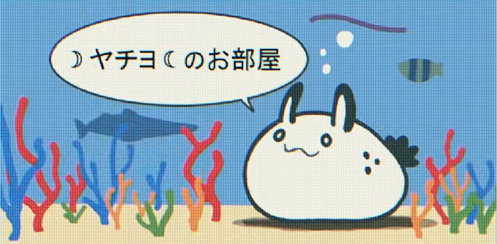

::: {.home}

You are visitor你是第 001337 !位访客！

::: {.home-top}
<figure class="win art-win">

<i class="win-btns" aria-hidden="true"></i>

</figure>

::: {.home-side}
::: {.win .log-win}

updates.txt更新记录.txt<i class="win-btns" aria-hidden="true"></i>

::: {#log}
:::
:::

<button class="web-clap" type="button">☆ Web Clap ☆☆ Web拍手 ☆</button>

:::
:::

<section class="notice">
<h2>◆ Notice ◆◆站长公告◆</h2>

Welcome to <b>Quark's Lunar Room</b>!

欢迎来到 <b>Quark 的月面通信室</b>！

Notes, projects and a bit of everyday life are moving in. Drop by again sometime.

笔记、项目和一点日常正在陆续搬进来，常来看看哦。

★ Link freely — bookmarks welcome ★★ 本站链接自由，欢迎收藏 ★

</section>

<table class="directory">
<thead><tr><th>Room房间</th><th>What's inside内容</th></tr></thead>
<tbody>
<tr><td><a href="about.html">About关于我</a></td><td>Bio, CV and contact自我介绍、简历与联系方式</td></tr>
<tr><td><a href="writing.html">Blog博客文章</a> NEW!</td><td>Study notes, research logs and essays学习笔记、研究日志与随笔</td></tr>
<tr><td><a href="projects.html">Projects项目记录</a></td><td>Things I'm building and have built正在做和做过的项目</td></tr>
<tr><td><a href="writing.xml">RSS</a></td><td>Subscribe to new posts订阅文章更新</td></tr>
</tbody>
</table>

<h2 class="section-title">Latest Posts最新文章</h2>

::: {#recent}
:::

:::
