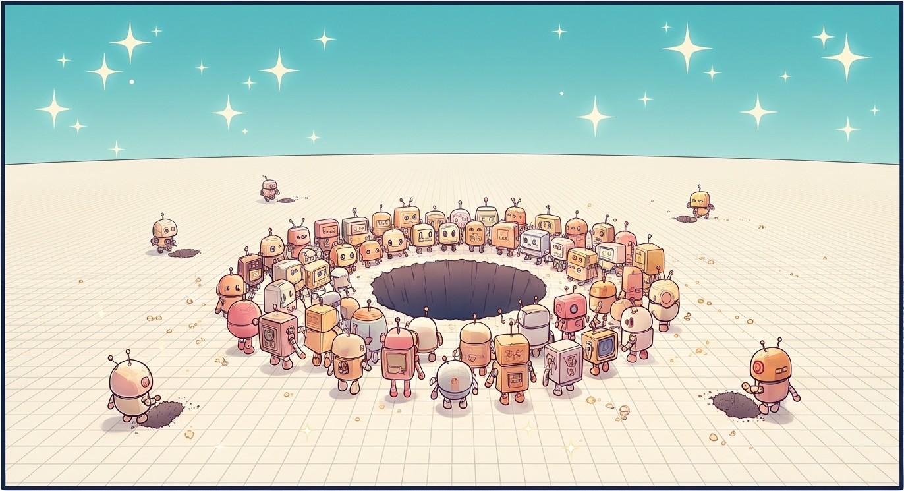
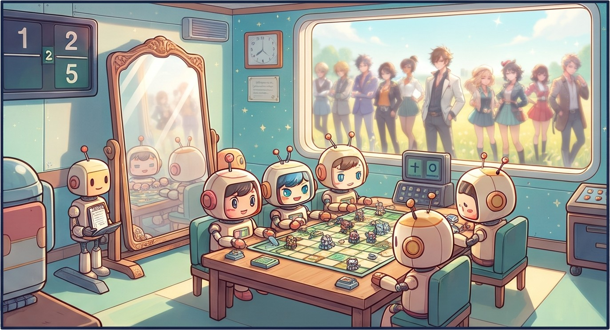
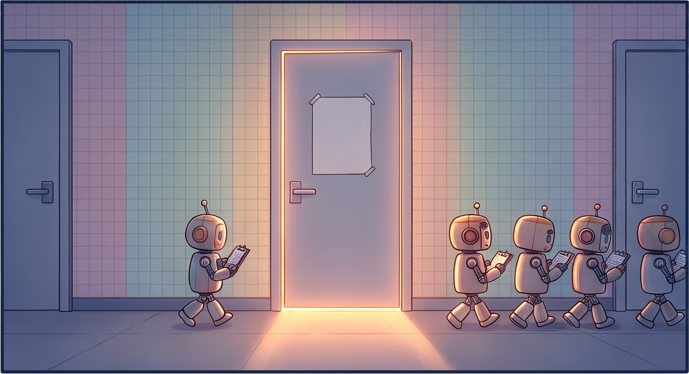
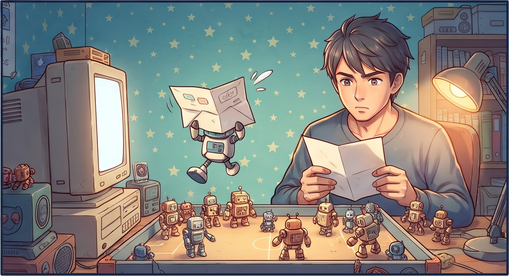

::: {.en}
{fig-alt="Cover: many glittering spots to dig are scattered over a graph-paper plain, yet nearly all the small robots crowd around one deep pit in the middle; only a few at the edges dig their own"}

> GLM, Qwen, DeepSeek and Kimi in this post all refer to the versions deployed on my university's GenAI platform, each with its own output cap, concurrency limit and unreliable routing. Every comparison between models below is about this particular deployment, not about the capability of the official models.

## Summary

- In September 2026 I built three successive generations of multi-agent systems for three competitions, all on the same set of models: an arena of long-running lanes, a genetic-algorithm system with cooperative-game credit called EvoForge, and finally a retreat to a single Codex orchestrator with sub-agents.
- The systems rested on two assumptions: many agents sampling in parallel explore more widely than one strong agent, and competition between agents provides a natural feedback signal. The first held up, roughly, on the generation side. The second did not.
- All three competitions saw diversity collapse, but in different places: Kaggriculture collapsed at the level of code, Structural Break at the level of conclusions, AIIJC at the level of paradigm. The selection signal broke differently in each: bias, variance, and decoupling from the public leaderboard. The credit schemes I designed were almost never wired into selection.
- In every competition, the basin the system ended up in can be traced back to a starting point supplied from outside the system. Soft interventions can only move the attractor, and whether they move it depends on how much it costs to leave a local optimum.
- The true gain of a single iteration in a multi-agent system is small, often smaller than the noise in the credit signal itself. Noise has to be part of the design: take larger steps, hand out less winner-take-all 0/1 credit based on the global best, or switch to a cleaner credit signal.

## 1. Background

### 1.1 Two assumptions

The system rested on two assumptions. First, many agents in parallel cover a wider space of exploration, sampling and trial-and-error than a single strong agent. The design principle I wrote down at the time was "sample many, rather than have them reach consensus." Second, competition between agents is itself feedback: the competitive metric matches the final objective, so the ranking tells me which directions are worth pursuing.

Behind the second assumption sat an analogy I had not noticed. In a human competition the leaderboard is external: the test set is held by the organizer and nobody can see it. In my system the leaderboard was endogenous: the competitors were each other's opponents and each other's examiners. I carried the intuition from the first setting straight into the second.

Looking back, the first assumption roughly held on the generation side and the second did not. This post tries to explain why "the natural feedback of competition" failed in three different ways in three competitions, and how it gradually ate away the diversity the generation side produced.

### 1.2 Three competitions

| Competition | Task | Terrain |
|---|---|---|
| CrunchDAO Structural Break (SB) [[2]](#en-ref-2) | Break detection in univariate time series, scored by TS-AUC | Static: the data is fixed and a score does not depend on other entrants |
| Kaggriculture (Kag) [[1]](#en-ref-1) | Two-player farm economy game, ranked by Bradley-Terry over matches [[4]](#en-ref-4) | Co-evolving: quality depends on the opponent, and the local opponents are the system's own products |
| AIIJC [[3]](#en-ref-3) | Defect and quality prediction for 3D objects | Static, but local validation disagrees with the public leaderboard, and leaderboard feedback is scarce |

Before the systems started, SB already had two lines: my own at 62.92 and a teammate's at 63.43. The final first place was around 71. The AIIJC field was mostly students, and I do not use its ranking to argue anything about the system.

The "terrain" column is the thread for the rest of the analysis. On static terrain, how good a solution is stays fixed and the only question is how accurately you measure it. On co-evolving terrain, how good a solution is depends on who it plays against, so even a precise measurement may be measuring the wrong thing.

### 1.3 Models

| Model | Output cap | Concurrency | Notes |
|---|---|---|---|
| GLM-5.3-Flash | 8K | 16 | Most stable link |
| Qwen-3.8 | 4K | 16 | Often timed out on long tasks |
| DeepSeek-V4-Pro | 8K (incl. reasoning) | 16 | Routing 502s about 14× as often as GLM |
| Kimi-k3 | 8K | 2 | Frequent turns that only wrote plans and called no tools |

All lanes shared one local proxy and one JWT that expired about every 24 hours. When it expired, everything stopped. This happened again and again across all three generations.

### 1.4 How to read the systems

I break each system into the three stages of evolution: prompts determine variation, credit and scores determine selection, and visibility (the bulletin board, reading other agents' code, reading reference solutions) determines transmission. Splitting it this way lets me ask which stage failed. When everyone piles into one direction, it may be because variation was narrow to begin with, because selection eliminated the alternatives, or because one direction spread too fast.

The criterion for collapse: parallel sampling degenerates into repeated exploration of a single idea, and after convergence the external leaderboard sits clearly below the front-runners. The second half matters. If everyone converges on what really is the best idea, that is ordinary convergence. Only convergence to a local optimum counts as collapse.

```{=html}
<iframe class="fig-embed" src="figs/F5_framework.html?lang=en" title="The three generations broken into variation, selection and transmission" loading="lazy" style="width:100%;height:1000px;border:0;display:block"></iframe>
<p style="text-align:right;font-size:.85em;margin:.1em 0 1.2em"><a href="figs/F5_framework.html?lang=en" target="_blank" rel="noopener">Open in new tab ↗</a></p>
```

## 2. Three generations

```{=html}
<iframe class="fig-embed" src="figs/F11_architecture.html?lang=en" title="Architecture of the three generations. Click a node for details; toggles highlight variation, selection, transmission and human intervention" loading="lazy" style="width:100%;height:1010px;border:0;display:block"></iframe>
<p style="text-align:right;font-size:.85em;margin:.1em 0 1.2em"><a href="figs/F11_architecture.html?lang=en" target="_blank" rel="noopener">Open in new tab ↗</a></p>
```

| | Gen 1: arena | Gen 2: EvoForge | Gen 3: Codex orchestrator |
|---|---|---|---|
| Period | Sep 13–19 | Sep 20–27 | Sep 27 – Oct 1 |
| Individual | Long-running lane | Idea family; each episode is a disposable developer | One orchestrator plus up to 4 sub-agents |
| Selection | Agents read the leaderboard and follow the leader | Engine picks parents, allocates slots and puts lagging families to sleep by local score | The orchestrator and I decide together |
| Transmission | Everything visible, reference solutions' source readable | Inheritance from parents only; references off-limits | Orchestrator aggregates |
| Best SB public score | 61.30 | 60.31 | 63.39 |

```{=html}
<iframe class="fig-embed" src="figs/F1_timeline.html?lang=en" title="Timeline of the three competitions and three generations, with public scores" loading="lazy" style="width:100%;height:940px;border:0;display:block"></iframe>
<p style="text-align:right;font-size:.85em;margin:.1em 0 1.2em"><a href="figs/F1_timeline.html?lang=en" target="_blank" rel="noopener">Open in new tab ↗</a></p>
```

### 2.1 Gen 1: the arena

Each lane had its own repository, a supervisor kept it running, and everyone could see everyone else's code and the bulletin board. Kag also had 4 public solutions in the pool as fixed reference opponents, with readable source; the intent was for agents to learn from them as baselines. For incentives, SB had an honour-points scheme, Kag gave one call to a stronger model every hour to the lane with the highest Elo and to the fastest riser, and AIIJC had a challenge-the-champion points board.

**SB.** The evaluation protocol here was actually rigorous. Every experiment was pre-registered on the bulletin board; only after clearing a threshold on the screening set could it read the confirmation set, once. If it failed, it was marked NO-GO and the direction was closed.

The code did not converge. Among newly written experiments, the share of training-free methods fell from 82% to 41%, and code overlap between lanes stayed low throughout. The collapse happened in the conclusions. One lane tried something for 70 minutes, failed the threshold, and wrote "this whole class of directions is closed," and the other lanes took it as settled. Several lanes then each "reproduced" the same gain, and the operator went out of its way to report that it was "not a fluke of a single agent." Ten hours later another lane re-checked it and found they had all stepped on the same leaky scorer. Reproduction is not independent verification when everyone shares the same examiner.

On the second day I saw the ranking freezing and the leading methods all crowded into training-free approaches, and made a few gentle interventions: a JSON message board, small penalties for heavy copying, and encouragement of longer training runs and more varied algorithms. The method mix did change, but almost nobody used the message board and the public score did not move. A candidate that scored 67 locally got 59 on the public leaderboard. The best public score of this generation was 61.30, below both pre-existing lines.

```{=html}
<iframe class="fig-embed" src="figs/F4_sb_families.html?lang=en" title="SB, Gen 1: code did not converge; the training-free share fell after the intervention" loading="lazy" style="width:100%;height:890px;border:0;display:block"></iframe>
<p style="text-align:right;font-size:.85em;margin:.1em 0 1.2em"><a href="figs/F4_sb_families.html?lang=en" target="_blank" rel="noopener">Open in new tab ↗</a></p>
```

**Kag.** This is where the collapse was most complete. The 4 reference opponents entered the pool at the same time. Within a few hours, GLM lanes started building variants of the strongest one, COK [[5]](#en-ref-5); nobody used the other three. Within two days, the entire top 10 consisted of COK descendants, with pairwise code overlap around 0.9. The top 30 all came from GLM lanes, and 208 of the 216 hourly rewards went to GLM. Several lanes running other models submitted the same baseline once and never submitted again. The online rating rose from 950 to about 1200 (a mid-competition score, not the final result), and almost all of that came from COK itself.

When I put COK in, I meant it as a teacher. It became both the largest single gain of the whole run and the seed of its most complete collapse.

The non-GLM lanes falling behind is partly my own doing: I swapped models several times along the way and shut down four lanes by Elo. Add Qwen's 4K output cap, Kimi's concurrency of 2 and DeepSeek's frequent 502s, and there is no way to separate "weaker model" from "worse conditions."

```{=html}
<iframe class="fig-embed" src="figs/F2_kag_collapse.html?lang=en" title="Kag, Gen 1: within two days of COK entering the pool, the whole top 10 were its descendants" loading="lazy" style="width:100%;height:770px;border:0;display:block"></iframe>
<p style="text-align:right;font-size:.85em;margin:.1em 0 1.2em"><a href="figs/F2_kag_collapse.html?lang=en" target="_blank" rel="noopener">Open in new tab ↗</a></p>
```

**AIIJC.** The single-agent phase was stuck around 14.4. I had given that agent a few constraints: a fixed validation protocol, no seed sweeps, no backbone fine-tuning. The arena lifted these as "historical constraints from a finished batch," added 8 GPUs, and stated explicitly that there would be no automatic elimination by global best score, "to avoid driving a four-way collapse."

Two days later a GLM lane produced partial fine-tuning of the vision tower plus a multi-seed ensemble, reaching 15.1 on the public leaderboard; none of the next eight submissions beat it. By the end every lane was doing vision fine-tuning, but each wrote its own code, with overlap of only 0.3. It looks more like convergence on a recipe than copying. From the fourth day on, what actually steered direction was the public-leaderboard feedback I relayed onto the bulletin board.

This was the only improvement across the three competitions that the agents produced themselves and that beat the predecessor on the external score. It has two problems. It cannot be separated from "constraints lifted, compute added"; I had no single-agent run with the same constraints lifted as a control. And the effective route came entirely from a few GLM-driven lanes, which looks more like multiple samples from one model than different models each contributing a path.

### 2.2 Gen 2: EvoForge

After the first generation collapsed, I rebuilt the system as a genetic algorithm: an idea family is an individual, each episode is a disposable developer that lives for 90 minutes, the family champion is the parent, and lagging families are put to sleep. The design requirement was to "strongly encourage diversity of solutions and guard against the existing collapse." I also designed a Shapley-style cooperative credit [[6]](#en-ref-6) to measure each mechanism's contribution to the coalition. To prevent contamination, episodes could not see the leaderboard or read the reference solutions.

The first thing that dragged it down was the execution layer:

| Model | Compliant delivery rate | Main failure |
|---|---|---|
| GLM | 20% | Non-compliant deliverables |
| Qwen | 13% | Timeouts |
| DeepSeek | 8% | Non-compliant deliverables, upstream failures |
| Kimi | 1% | Going in circles inside its context |

On top of that, nearly half of all episodes were blocked within seconds of starting. SB ran for 13 hours and the GA produced 2 valid candidates. After I seeded it by hand, every subsequent champion descended from that seed. The local score rose by 0.05 and then never rose again; the public score was the lowest of the three generations, 60.31. Kag's local score took only three values, 0, 0.0625 and 0.125, close to noise, and selection ran on it all the same.

I did not design the strength of selection either. Each generation had fewer development slots than active families, so only high-scoring families got slots. With healthy infrastructure and enough slots, every family would have received one and selection would have degenerated into equal allocation. In other words, how strong "survival of the fittest" was in EvoForge depended on how bad the routing failures were. The crossover operator showed no benefit either: children rarely beat their parents.

At the code level EvoForge was not uniform; the champions' code differed a lot. What it lacked was a higher score ceiling and the ability to deliver. Another shift: GLM's share among champions climbed past half, and Kimi soon dropped to zero.

```{=html}
<iframe class="fig-embed" src="figs/F8_evoforge_funnel.html?lang=en" title="EvoForge's delivery funnel: nearly half of all episodes were blocked at start" loading="lazy" style="width:100%;height:885px;border:0;display:block"></iframe>
<p style="text-align:right;font-size:.85em;margin:.1em 0 1.2em"><a href="figs/F8_evoforge_funnel.html?lang=en" target="_blank" rel="noopener">Open in new tab ↗</a></p>
```

### 2.3 Gen 3: a Codex orchestrator

After September 27 I gave up on competition between LLM lanes and had Codex act as an orchestrator with a few sub-agents, deciding direction together with me. The turning point was one sentence of mine: "Haven't you noticed you've walked into a dead end?" After that we moved to synthetic data, two years of mixed data, and source-isolated validation. The local confirmation score kept climbing while the public score stalled just above 63. My verdict on the later submissions was that they were "basically useless, which also shows the previous wave of exploration was headed the wrong way." The best result, 63.39, tied my teammate's existing 63.43. The improvement came from a change of direction that I drove, not from any selection mechanism in the architecture.

## 3. Why it collapsed, and why it couldn't be pulled back

### 3.1 Credit was never wired into selection

| System | Designed credit | What it actually did |
|---|---|---|
| SB arena | Honour points, penalties, message board | Existed only in the prompt. Almost nobody used the message board |
| Kag arena | One stronger-model call per hour | 96% went to GLM, with no visible extra output |
| AIIJC arena | Challenge points | Awarded three times, then went silent |
| EvoForge | Shapley cooperative credit | Only broke ties in the compute queue, triggered about 0.5% of the time; compute was never congested |

The selection that actually operated was something else. In the first generation it was the agents themselves reading the leaderboard and following the leading lineage; in the second it was the engine picking parents directly by local score. Keeping credit out of selection was largely my own decision: I worried it would distort development and required that it "not affect the token-level development budget at all." Later, when I found that elimination "wasn't doing much," my fix was to strengthen score-based slot allocation, not to wire credit in.

Even wired in, the Shapley credit would not have saved anything. Its value function used scores from the same local panel whose problems the next section covers in detail. The more elaborate the credit, the more precisely it distributes noise.

### 3.2 The selection signal broke in three places

```{=html}
<iframe class="fig-embed" src="figs/F6_variance_bias.html?lang=en" title="Variance and bias: the winner's curse of taking the max on a noisy panel (drag the sliders), and a change a closed ruler cannot see" loading="lazy" style="width:100%;height:960px;border:0;display:block"></iframe>
<p style="text-align:right;font-size:.85em;margin:.1em 0 1.2em"><a href="figs/F6_variance_bias.html?lang=en" target="_blank" rel="noopener">Open in new tab ↗</a></p>
```

**SB: variance.** EvoForge's local panel had only 384 series and was evaluated 111 times. The same candidate on a different panel of the same size could move by 2.7 percentage points, while candidates differed from each other by a few tenths. Taking the maximum over and over on such a panel guarantees that the winner is the one noise happened to lift. The more candidates, the smaller the panel and the more often it is reused, the more systematically the winner's local score exceeds its true level. This is the winner's curse [[7]](#en-ref-7): variance, passed through selection, turns into bias. Late in the run, the same weights repackaged and attached to several artifacts could hold the top spot.

**Kag: bias.** The local league played over 270,000 matches, with a median of more than 1,800 matches per strategy, so Elo was measured precisely. The problem is that it measured "who is strongest within this group," and the group was almost entirely COK descendants. The local top 10 beat COK seventy to eighty percent of the time, yet sat around 1200 online. The reference opponents were "development, not a holdout," and there was no held-out anything in the system.

An example. Early on, a GLM lane wrote a guard against the warehouse overflowing at night; front-running solutions had the same thing [[8]](#en-ref-8)[[9]](#en-ref-9)[[10]](#en-ref-10)[[11]](#en-ref-11). For a while it pushed that lane to first place in Elo, because the baseline at the time did overflow. Once the population had turned over to COK descendants, and COK never overflows, the patch measured exactly zero locally, was judged useless, and was dropped. The lane's judgment was not wrong; the ruler could not see this kind of change. It was not necessarily a decisive direction that got missed, but a closed population competing against itself could not recognize what it did.



```{=html}
<iframe class="fig-embed" src="figs/F3_kag_rating.html?lang=en" title="Rating trajectories by lineage in Kag, Gen 1" loading="lazy" style="width:100%;height:815px;border:0;display:block"></iframe>
<p style="text-align:right;font-size:.85em;margin:.1em 0 1.2em"><a href="figs/F3_kag_rating.html?lang=en" target="_blank" rel="noopener">Open in new tab ↗</a></p>
```

**AIIJC: decoupling.** The local validation folds were rotated and reused until a reviewer wrote that "switching folds does not restore blindness." The public leaderboard was the only blind signal, but only I could query it, about a dozen times in total, and the rankings by local and public score were even negatively correlated: the ensembles with the highest local scores did worse on the public board.

**Three problems, three fixes.** "High locally, low publicly" looks the same in all three, but the diagnosis differs. Re-evaluate the same candidate on fresh data: in SB the score drops; in Kag there is no "other data," since Elo is only defined within this population; in AIIJC switching folds does nothing and only the public board is new data. Evaluate more times: in SB the error shrinks, but as long as selection happens on the same panel the bias stays; in Kag there are already plenty of matches and more will not close the gap to the outside; in AIIJC submission limits mean you cannot evaluate much at all. So variance needs more and fresher evaluation data, bias needs opponents from outside the population, and decoupling needs the external signal to actually enter selection. The three also compound: in Kag the bias was amplified by rewards, since the more lanes copied the leader, the more closed the population became and the larger the bias.

**What I missed.** All three generations' evaluation guarded against "contaminated scores": permutation tests, source isolation, pre-registered thresholds, taking the lower of two panels. Nothing guarded against "is the score precise enough, and does it represent the outside?" There was no budget on the number of evaluations, no uncertainty penalty when taking the maximum, and no out-of-population opponent in Kag. I thought only about OOD and leakage, the bias side; I never thought about variance or selection bias.

The pre-registration threshold had one more side effect. The SB rule was "if you fail the gate, mark it NO-GO, close the direction and don't keep searching." It was meant to prevent p-hacking; it ended up institutionalizing false negatives. The direction closed after 70 minutes earlier used CUSUM without whitening, and whitening first and then applying CUSUM is exactly one of the routes in the published SB solutions [[12]](#en-ref-12)[[14]](#en-ref-14).



### 3.3 Three layers of collapse

```{=html}
<iframe class="fig-embed" src="figs/F7_collapse_layers.html?lang=en" title="Three layers of collapse: code, conclusions, paradigm" loading="lazy" style="width:100%;height:945px;border:0;display:block"></iframe>
<p style="text-align:right;font-size:.85em;margin:.1em 0 1.2em"><a href="figs/F7_collapse_layers.html?lang=en" target="_blank" rel="noopener">Open in new tab ↗</a></p>
```

| | SB | Kag | AIIJC |
|---|---|---|---|
| Selection-signal problem | Variance | Bias | Decoupling |
| Layer of collapse | Conclusions: a local failure written up as a whole class closed, then spread between lanes | Code: the top converged to the single COK lineage | Paradigm: every lane did vision fine-tuning |
| Gap to the front | 63.4 vs. about 71 | About 1200 (a mid-competition score) | 15.1, then no further gains |

SB's problem was not homogenized code. The lanes' code stayed scattered; the collapse lay in three things: local failures propagated as whole-class closures, several lanes' "independent reproductions" shared one leaky scorer, and every new experiment was stacked on the same pre-existing feature package and scored on the same panels.

Kag's collapse is most visible in the code, but it was not all lanes converging at once: the non-GLM lanes stopped producing first, and convergence happened among the remaining GLM lanes.

AIIJC was the mildest: no co-evolving setting, no code copying, just one effective direction that everyone crowded into. The cascade of conclusions came late, and it spread through the leaderboard feedback I relayed, not through lanes reading each other.

EvoForge is a fourth case: scattered code, with collapse showing up in model share and the score ceiling, and the number of active families stuck at the floor.

Fixes have to match the layer where the collapse happens. Isolating code would treat Kag; it would not treat SB or AIIJC, because conclusions and paradigms spread through text and shared starting points.

### 3.4 Whether soft interventions work depends on the cost of leaving a local optimum

The same kind of soft intervention had different results. After I intervened in SB, the training-free share did fall by half, but the public score did not rise. In Kag, after the exploration lane was excluded from rewards, it kept working on COK.

A possible explanation: leaving a local optimum has a cost, made of two parts. One is the implementation cost of the alternative direction. A behaviour-cloning or PPO candidate in Kag requires building data, training and running full validation matches, and does not fit in one round; in SB you swap in a set of features and one evaluation tells you. The other is how the signal punishes deviation during the transition. Kag is a pure relative ranking, so a half-finished candidate loses the moment it plays; SB's score is absolute and noisy, so the cost of deviating does not show immediately.

AIIJC was "high cost, weak feedback": fine-tuning the vision model for one fold and one seed took two or three hours, and few public submissions were left. By this framework soft interventions should struggle there too. That is what happened: point clouds, raw meshes and other non-vision routes were all tried, and none produced an externally useful result.

Injecting ideas lowers the cost of finding another hill, not the cost of walking over to it. If what you inject is itself a hill that can be copied directly, like COK, it simply becomes the new attractor. My view is that handing over ideas does not help; it only moves the collapse somewhere else. Changing the network structure or the incentives might. But in these logs none of the incentives I changed were wired into selection, so this intuition went untested.

### 3.5 The starting point decides the basin

This is a blind spot I only noticed while going through the data. When designing the system I assumed diversity had nothing to do with the starting point. Looking back, the basin each competition ended up in traces back to a starting point supplied from outside the system: in Kag it was COK; in SB it was the feature package that existed before launch, which two-thirds of the lanes' new scripts called directly; in AIIJC it was the vision backbone from the single-agent phase, and the arena merely lifted the "don't fine-tune it" constraint.

```{=html}
<iframe class="fig-embed" src="figs/F10_anchor_basin.html?lang=en" title="The starting point decides the basin: SB's hand-made seed and Kag's COK" loading="lazy" style="width:100%;height:790px;border:0;display:block"></iframe>
<p style="text-align:right;font-size:.85em;margin:.1em 0 1.2em"><a href="figs/F10_anchor_basin.html?lang=en" target="_blank" rel="noopener">Open in new tab ↗</a></p>
```

But the further step, "the starting point was chosen by a human, so the human determined the outcome," does not hold. Kag's 4 references entered at the same time and the agents adopted only the strongest, COK; nobody used the other three. COK beat the old baseline almost every game, and the strategy that ranked first before the injection could not win a single game against COK's descendants. This looks like rational anchoring: the starting point decides who shows up, and wins and losses decide who stays.

EvoForge's seed was similar. It pushed the local score to the top, and candidates that did not descend from it always trailed; but its public score was lower than the first generation's pre-existing package, so it was a good starting point, not a lock. Search inside the basin did produce something: COK's descendants did beat COK itself, and SB's local score did rise for a while after the seed. It just saturated within somewhere between a dozen hours and two days. Attempts from scratch almost all failed: every SB direction that did not rely on the pre-existing package failed the threshold.

These are only quasi-controls, and each has another explanation: the starting point was simply the strongest public information at the time and any searcher would adopt it; agents failing from scratch may just be a capability limit; part of "no measurable gain within the basin" is the fault of the rulers from section 3.2. A real answer needs the same models and budget in three arms: no references at all, the strongest public solution, and a comparable but weaker solution, plus a single-agent best-of-N baseline.

### 3.6 The execution layer

All three generations were repeatedly brought down by the same kind of problem. JWT expiry stopped every lane at once, and I renewed it by hand around twenty times. During upstream 502 storms, eight requests in a hundred succeeded. Once a forwarding layer kept using an old token, and the fault went unnoticed for a long time. Nearly half of EvoForge's episodes were blocked right after starting.

The differences between models are tangled up with output caps, concurrency, routing failures and tool-calling compatibility. Kimi at first emitted tool-call markup as plain text; GLM's long contexts were for a while rejected upstream. A good part of GLM's "lead" is that its model calls were the most stable. EvoForge forced roughly equal dispatch shares across models, so the differences in delivery rate were not caused by scheduling, but they are still "performance under this deployment," not a ranking of the models' abilities.

### 3.7 Where the gains came from

```{=html}
<iframe class="fig-embed" src="figs/F9_improvement_sources.html?lang=en" title="Where each substantive gain came from" loading="lazy" style="width:100%;height:865px;border:0;display:block"></iframe>
<p style="text-align:right;font-size:.85em;margin:.1em 0 1.2em"><a href="figs/F9_improvement_sources.html?lang=en" target="_blank" rel="noopener">Open in new tab ↗</a></p>
```

Sorting every substantive gain by source: Kag's gain came from the injected COK; the first generation's big jumps in SB were all leakage and were later voided; EvoForge's champions all descended from my hand-made seed; the third generation's gain came from my change of direction. Only the AIIJC gain was produced by the agents, and it too stood on lifted constraints and added compute. Looking closer, the fine-tuning route had already appeared in another lane's post from the same model, the final version changed only the number of training epochs and the blending relative to the previous one, the local score was flat, and why the public score was higher remains unclear.

This is not a general verdict on what LLM agents can do. These lanes had no internet access, while I kept injecting ideas into the system from outside models and public solutions. How much agents could discover independently with a search tool is something this data cannot answer.

### 3.8 An LLM between me and the system



Everything I knew about the system's state came from the Codex operator's reports. So the selection signal on the human side passed through a lossy channel too.

The operator treated lane names as model names: when it reported that "Kimi's series is the strongest," that slot had long since been switched to GLM. It also misread instructions: when I said "we must submit today," it took that as resubmitting an old solution.

During this post-mortem, several of my memories did not match the logs. I remembered SB as not having collapsed, but at the time I had diagnosed "the ranking is freezing and performance is collapsing" myself. I remembered not changing the design between generations, but I had added the message board and the copying penalty. I remembered Kag's other models as "still submitting, just scoring low," when most of them had stopped long before. I even thought Kag's logs had been deleted by mistake; they were all there. Some of this is just time; some probably comes from the reports I read at the time. Even the sub-agent doing this analysis was fooled by a lane name once and credited the AIIJC solution GLM built to Qwen.

## 4. Hacks and emergence

I saw no sign in the logs of agents deliberately evading rules. What I would call hacks were mostly the system rewarding things it should not have: the same weights repackaged counted as a new "creation"; the same baseline submitted by eleven lanes as their own; one leak in the scorer stepped on again and again by different lanes; the evaluator used different random seeds when ordering and when archiving data, so two panels that were supposedly "the same" shared only a fifth of their series. In the other direction, the bookkeeping rules once hurt genuine work: a lane finished a real piece of development and passed local evaluation, but was ruled invalid because the runner had reset its manifest to the template.

The most valuable emergent behaviour was peer audit. At least four false positives were caught when other lanes re-checked them: a scorer leaking future information, a gain overturned by a permutation test, a feature claimed to be causal that actually used a whole-series mean. All were caught after the gain had already been treated as a leading candidate: late, but caught. This correction channel depends on full visibility, which has to be counted when weighing isolation later. There was also self-correction at the individual level: one lane retracted its own positive result, later found the reason for retracting was an index misalignment, and restored it.

Two other emergent behaviours were less welcome: the bulletin board gradually turned into a collection of failure post-mortems rather than a place to exchange ideas, and some models settled into a stable loop of writing plans without calling tools.

## 5. Against the front-runners

The front-running solutions only became available after the competitions ended, so this section is hindsight. Its use is to tell apart whether the multi-agent system failed because of its sampling space or because of its filtering.

The common route among Kag's top three [[8]](#en-ref-8)[[9]](#en-ref-9)[[10]](#en-ref-10): behaviour cloning on top teams' replays, then self-play PPO, then a layer of rule patches. All of these routes appeared in my system, and none was done right: one lane's behaviour cloning learned to do nothing; another validated with a time split inside the same game and also corrupted the labels, scoring only one or two hundred when uploaded; PPO finished training identical to its initialization, with no updates. One lane, on the last day, built a corpus relabelled "by the action the engine actually executed," the same idea as the fourth-place team's [[11]](#en-ref-11), and the system was shut down the next day (though its imitation agent had not yet won a game). What reached Kag's top was a thin layer on top of COK: price gates, caps, crop switching. So Kag's problem was not failing to think of the route but failing to execute it, and the local evaluation could not tell which route was right.

The key step in the published SB solutions [[12]](#en-ref-12)[[13]](#en-ref-13)[[14]](#en-ref-14) was to whiten first and then read sequential detection statistics. In my system both whitening and sequential detection came from the pre-launch feature package; the unwhitened version a lane wrote itself was closed within 70 minutes. A synthetic-data pre-training direction was first passed and then overturned by a permutation test: with labels shuffled it still "beat" the real ones, which shows the gate itself had a hole. The third generation's turn to synthetic data happened to point the same way as the break augmentation in those solutions [[13]](#en-ref-13)[[14]](#en-ref-14); this time a human carried it there.

## 6. Against the literature

I had not read any of the relevant papers when I built these systems. In hindsight, most of the pitfalls were already known:

- **Island models in FunSearch and AlphaEvolve** [[15]](#en-ref-15)[[16]](#en-ref-16): isolation plus infrequent migration to preserve diversity. My first generation was fully visible, equivalent to a single island migrating at every step.
- **Lazer & Friedman [[17]](#en-ref-17); Brackbill & Centola [[18]](#en-ref-18)**: the faster information spreads, the better the short run and the less long-run exploration. The latter is set in a data-science competition. There are counterexamples (Mason & Watts [[19]](#en-ref-19)), so this is a conditional claim at best. My EvoForge restricted transmission and did no better, but its problems were masked by delivery rates and the score ceiling, so it is not a test.
- **Dwork et al.'s reusable holdout [[20]](#en-ref-20); Blum & Hardt's Ladder [[21]](#en-ref-21)**: reusing the same evaluation set wears it out. This corresponds to SB's panel evaluated 111 times. Interestingly, Roelofs et al.'s meta-analysis [[22]](#en-ref-22) of Kaggle found almost no overfitting from test-set reuse; that was human teams, limited submissions and large test sets, while my system was a crowd of agents hammering a small panel at high frequency, precisely the region their study did not cover.
- **Spinning Tops [[23]](#en-ref-23); AlphaStar's league [[24]](#en-ref-24)**: in non-transitive games, Elo is only meaningful within a population, and you need external opponents that specifically hunt for weaknesses and are periodically reset. My reference opponents were fixed, readable, and treated as teachers.
- **LLMs as mutation operators have attractors** [[25]](#en-ref-25): recent work finds that even without selection pressure, LLMs repeatedly mutating programs converge to a few attractors, and changing the prompt or model only changes the speed. This fits my soft interventions failing, except that my system had selection and visibility at the same time, so the effects cannot be separated.
- **Huxley-Gödel Machine** [[26]](#en-ref-26): current score is not the same as potential of descendants. This corresponds to EvoForge picking parents by current score, with children rarely beating parents.
- **MAST's taxonomy of multi-agent failures** [[27]](#en-ref-27): the largest class of failures comes from system design and specification, not just model capability. Mine too: the main failures were the evaluation protocol, delivery contracts and infrastructure.
- **Self-MoA and others** [[28]](#en-ref-28): a multi-agent system needs a single-agent best-of-N comparison. I never ran one.

The one thing with no direct counterpart in the literature is "a fixed reference opponent with readable source": it did not act as an opponent; it became a component everyone copied.

## 7. Takeaways for building multi-agent competition systems

### 7.1 A held-out set can fail in three ways

SB's evaluation protocol was rigorous: pre-register, clear the threshold on the screening set, and only then read the confirmation set once. It still failed. First, it wore out: agents never see the labels, but every selection is a query, and after the confirmation set had been read enough times the system itself downgraded it to "known, not blind." Second, the metric matched but the distribution did not: local evaluation used the full history, while the live leaderboard used a finite window, which I only diagnosed later. Third, it did not exist at all: Kag's local league was the population itself.

The corresponding remedies are to give each evaluation set a query budget and refresh it regularly, to build validation windows that match the live distribution, and to bring opponents from outside the population into co-evolving environments. I have not validated any of these.

### 7.2 Isolate code, and move discipline from positives to negatives

If I did it again, the first thing I would change is to stop agents from reading each other's source code, keeping only a limited text channel that both sides must agree to open. That would treat code-level collapse of the Kag kind.

But conclusions and paradigms also spread through text. SB's "close the direction if you fail the gate" rule prevented false positives and manufactured false negatives. I regret the latter more. A false positive will eventually be caught by the public leaderboard, at the cost of one submission; a false negative is never revisited, and once a direction is closed it is gone for good. So discipline should be allocated the other way round: positive claims can pass fairly freely and be corrected by external checks, while negative conclusions must state their scope (which implementation, what budget, which gate they failed) and closed directions should keep a small quota for revival. How exactly to govern the text channel, what format negative conclusions should take, how large the revival quota should be and how often the channel opens, I do not know yet.

Isolation has costs too. All four false positives were caught by peers in a fully visible environment; before the public leaderboard catches a false positive, it circulates through the population and wastes everyone's time. The optional message board in the first generation went almost unused, and a channel that requires both sides' consent may well sit idle too.

### 7.3 Improve the signal-to-noise ratio of credit

The true gain of each step in a multi-agent system is small. SB candidates differed by tenths of a point, while the same candidate moved two or three points on a different panel. At this signal-to-noise ratio, however carefully credit is designed, it is handing out rewards for noise. I see three ways out:

- **Take larger steps.** Make each round of exploration longer and each change bigger, so the gain of a single step exceeds the noise. A side benefit is fewer evaluations, so the evaluation set wears out more slowly. It also directly lowers the cost from section 3.4: Kag's behaviour cloning did not fit in one round, so the half-finished version got punished by the ranking. The precondition is a reliable execution layer; otherwise the longer the round, the more each failure costs. Larger steps mean fewer parallel samples, but breadth of exploration is not the number of samples: the denser the feedback, the more frequent the imitation and the faster the convergence. How to trade these off depends on signal noise and terrain. The AIIJC gain depended on the 8 GPUs, an example of needing compute to take a big step.
- **Hand out less winner-take-all 0/1 credit.** When score differences are smaller than the noise, winner-take-all is close to a lottery, and the lottery's outcome is then written into subsequent selection. EvoForge let only family champions reproduce; AIIJC's challenge points let whoever had the higher local confirmation score "take the title," and both times that happened, the public score went down. Kag's hourly reward to the leader is a different case: Elo there was precise, so what winner-take-all amplified was not noise but the bias of a closed population.
- **Use a cleaner signal.** For example, a fresh external panel that each candidate is evaluated on once, with results that never feed back into selection, or an uncertainty discount, scaled by the number of candidates, when taking the maximum.

### 7.4 Query tools: give methods, not credit for answers

I would like to give agents a tool for looking up papers and public methods, so they can skip the parts of the space others have already explored, like "whiten before running CUSUM" [[12]](#en-ref-12). At the same time, gains obtained purely from public methods would be heavily discounted in credit, and agents would not share search results with each other, so that not everyone ends up with the same paper.

There is a problem here I have not worked out. AIIJC's lanes had no internet access and did not copy each other's code, yet still converged to the same paradigm, apparently because of shared model priors plus a shared starting point. Banning sharing stops transmission but not common origins: several similar models searching the same engine with similar keywords get the same top results. Section 3.5 says the starting point decides the basin; the more accurate the query tool, the more concentrated the starting points may become. For the discount to matter it must also be wired into selection, and section 3.1 showed that none of my earlier credit designs were. Deciding which parts came from public methods is feasible at the code level with similarity checks, and hard at the level of ideas.

### 7.5 Remove the LLM between me and the system

Key state should come from a dashboard that does not pass through an LLM, and operator reports must cite the raw data. This applies equally to the agents doing the post-mortem analysis.

## 8. Limitations

All conclusions apply only to this particular campus deployment of the models. Each system made fewer than ten public submissions on SB, with no confidence intervals. There is no single-agent best-of-N control, and no ablation of isolation level, number of islands or model identity, so "what did multiple agents actually contribute" and "why did GLM lead" cannot be answered from this data. I swapped lanes and models repeatedly along the way, and the effect of infrastructure incidents is of the same order as algorithmic differences. The front-running solutions only became available after the competitions.

## Appendix: where the data came from

This post-mortem is based on the Codex operator sessions, Kag's first-generation league database, EvoForge's state database and its 7,000-plus episode directories, and the run logs of each SB first-generation lane. The sessions were flattened first, then events were extracted in bulk. The front-running solutions come from repositories and write-ups published after the competitions.

## References

[\[1\]]{#en-ref-1} Kaggle. (2026). *Kaggriculture* [Simulation competition]. <https://www.kaggle.com/competitions/kaggriculture>

[\[2\]]{#en-ref-2} ADIA Lab & CrunchDAO. (2026). *ADIA Lab Structural Break Challenge: Real-Time Edition* [Competition]. <https://hub.crunchdao.com/competitions/structural-break-real-time>; rules and metric: <https://docs.crunchdao.com/competitions/competitions/structural-break-real-time>

[\[3\]]{#en-ref-3} AIIJC. (2026). *International Artificial Intelligence Contest for Children and Youth*. <https://aiijc.com/en/>

[\[4\]]{#en-ref-4} Bradley, R. A., & Terry, M. E. (1952). Rank analysis of incomplete block designs: I. The method of paired comparisons. *Biometrika, 39*(3–4), 324–345. <https://doi.org/10.1093/biomet/39.3-4.324>

[\[5\]]{#en-ref-5} COK-ZhangZiliang. (2026). *Kaggriculture* [Computer software, Apache-2.0]. GitHub. <https://github.com/COK-ZhangZiliang/Kaggriculture> This post used its V2 snapshot.

[\[6\]]{#en-ref-6} Shapley, L. S. (1953). A value for n-person games. In H. W. Kuhn & A. W. Tucker (Eds.), *Contributions to the theory of games II* (pp. 307–317). Princeton University Press.

[\[7\]]{#en-ref-7} Capen, E. C., Clapp, R. V., & Campbell, W. M. (1971). Competitive bidding in high-risk situations. *Journal of Petroleum Technology, 23*(6), 641–653. <https://doi.org/10.2118/2993-PA>

[\[8\]]{#en-ref-8} morim3, msdsm, BergBuch, & qistripute. (2026). *Kaggriculture 1st place solution* [Computer software]. GitHub. <https://github.com/msdsm/kaggriculture-1st-solution>

[\[9\]]{#en-ref-9} Merckle, V. (2026). *Kaggriculture 2nd/10148: Trading clutch, and no B200s harmed!* [Kaggle writeup]. <https://www.kaggle.com/competitions/kaggriculture/writeups/trading-clutch-no-b200>; code: <https://github.com/vmerckle/kaggriculture>

[\[10\]]{#en-ref-10} Team DSM (denden, masspeaks, & shimishige). (2026). *Kaggriculture 3rd place solution* [Computer software]. GitHub. <https://github.com/seven320/kaggriculture-3rd-place-solution>

[\[11\]]{#en-ref-11} RobertMX23 (Team Farmcore). (2026). *Farmcore: A one-pass transformer trained on what the engine executed* [Kaggle writeup]. <https://www.kaggle.com/competitions/kaggriculture/writeups/farmcore-a-one-pass-transformer-trained-on-what-t>; code: <https://github.com/RobertMX23/farmcore-kaggriculture>

[\[12\]]{#en-ref-12} bamasa. (2026). *adia-structural-break* [Computer software]. GitHub. <https://github.com/bamasa/adia-structural-break>

[\[13\]]{#en-ref-13} cybergeek. (2026). *Calibrate, then accumulate: Real-time structural break detection* [Competition writeup]. <https://cybergeek2077.github.io/adia-realtime-writeup/>

[\[14\]]{#en-ref-14} Ibarrondo Zorroza, E. (2026). *online-structural-break-detection* [Computer software]. GitHub. <https://github.com/ekhi-ibarrondo/online-structural-break-detection>

[\[15\]]{#en-ref-15} Romera-Paredes, B., Barekatain, M., Novikov, A., Balog, M., Kumar, M. P., Dupont, E., Ruiz, F. J. R., Ellenberg, J. S., Wang, P., Fawzi, O., Kohli, P., & Fawzi, A. (2024). Mathematical discoveries from program search with large language models. *Nature, 625*(7995), 468–475. <https://doi.org/10.1038/s41586-023-06924-6>

[\[16\]]{#en-ref-16} Novikov, A., Vũ, N., Eisenberger, M., Dupont, E., Huang, P.-S., Wagner, A. Z., Shirobokov, S., Kozlovskii, B., Ruiz, F. J. R., Mehrabian, A., Kumar, M. P., See, A., Chaudhuri, S., Holland, G., Davies, A., Nowozin, S., Kohli, P., & Balog, M. (2025). *AlphaEvolve: A coding agent for scientific and algorithmic discovery* (arXiv:2506.13131). arXiv. <https://arxiv.org/abs/2506.13131>

[\[17\]]{#en-ref-17} Lazer, D., & Friedman, A. (2007). The network structure of exploration and exploitation. *Administrative Science Quarterly, 52*(4), 667–694. <https://doi.org/10.2189/asqu.52.4.667>

[\[18\]]{#en-ref-18} Brackbill, D., & Centola, D. (2020). Impact of network structure on collective learning: An experimental study in a data science competition. *PLOS ONE, 15*(9), e0237978. <https://doi.org/10.1371/journal.pone.0237978>

[\[19\]]{#en-ref-19} Mason, W., & Watts, D. J. (2012). Collaborative learning in networks. *Proceedings of the National Academy of Sciences, 109*(3), 764–769. <https://doi.org/10.1073/pnas.1110069108>

[\[20\]]{#en-ref-20} Dwork, C., Feldman, V., Hardt, M., Pitassi, T., Reingold, O., & Roth, A. (2015). The reusable holdout: Preserving validity in adaptive data analysis. *Science, 349*(6248), 636–638. <https://doi.org/10.1126/science.aaa9375>

[\[21\]]{#en-ref-21} Blum, A., & Hardt, M. (2015). The Ladder: A reliable leaderboard for machine learning competitions. In *Proceedings of the 32nd International Conference on Machine Learning* (PMLR Vol. 37, pp. 1006–1014). <https://proceedings.mlr.press/v37/blum15.html>

[\[22\]]{#en-ref-22} Roelofs, R., Shankar, V., Recht, B., Fridovich-Keil, S., Hardt, M., Miller, J., & Schmidt, L. (2019). A meta-analysis of overfitting in machine learning. In *Advances in Neural Information Processing Systems 32* (pp. 9175–9185). <https://proceedings.neurips.cc/paper/2019/hash/ee39e503b6bedf0c98c388b7e8589aca-Abstract.html>

[\[23\]]{#en-ref-23} Czarnecki, W. M., Gidel, G., Tracey, B., Tuyls, K., Omidshafiei, S., Balduzzi, D., & Jaderberg, M. (2020). Real world games look like spinning tops. In *Advances in Neural Information Processing Systems 33* (pp. 17443–17454). <https://proceedings.neurips.cc/paper/2020/hash/ca172e964907a97d5ebd876bfdd4adbd-Abstract.html>

[\[24\]]{#en-ref-24} Vinyals, O., Babuschkin, I., Czarnecki, W. M., et al. (2019). Grandmaster level in StarCraft II using multi-agent reinforcement learning. *Nature, 575*(7782), 350–354. <https://doi.org/10.1038/s41586-019-1724-z>

[\[25\]]{#en-ref-25} Gurkan, C., Stonedahl, F., & Wilensky, U. (2026). *Mutation without variation: Convergence dynamics in LLM-driven program evolution* (arXiv:2606.05408). GECCO '26 Workshop on Large Language Models for and with Evolutionary Computation. <https://arxiv.org/abs/2606.05408>

[\[26\]]{#en-ref-26} Wang, W., Piękos, P., Li, N., Laakom, F., Chen, Y., Ostaszewski, M., Zhuge, M., & Schmidhuber, J. (2026). Huxley-Gödel Machine: Human-level coding agent development by an approximation of the optimal self-improving machine. In *International Conference on Learning Representations (ICLR 2026)*. <https://arxiv.org/abs/2510.21614>

[\[27\]]{#en-ref-27} Cemri, M., Pan, M. Z., Yang, S., Agrawal, L. A., Chopra, B., Tiwari, R., Keutzer, K., Parameswaran, A., Klein, D., Ramchandran, K., Zaharia, M., Gonzalez, J. E., & Stoica, I. (2025). Why do multi-agent LLM systems fail? In *Advances in Neural Information Processing Systems 38, Datasets and Benchmarks Track*. <https://arxiv.org/abs/2503.13657>

[\[28\]]{#en-ref-28} Li, W., Lin, Y., Xia, M., & Jin, C. (2026). Rethinking mixture-of-agents: Is mixing different large language models beneficial? *Transactions on Machine Learning Research*. <https://openreview.net/forum?id=K6WwK8URlV>
:::

::: {.zh}
{fig-alt="题图：方格纸铺成的原野上散落着许多可以挖的亮点，几乎所有小机器人都挤在中间同一个深坑旁排队，只有边上几个在自己挖"}

> 文中的 GLM、Qwen、DeepSeek、Kimi 都是校内 GenAI 平台上的部署版本，有各自的输出上限、并发限制和不稳定的路由。下文所有关于模型的比较，都只针对这套部署，不代表官方模型的能力。

## 摘要

- 2026 年 9 月，我用同一批模型在三个比赛上先后搭了三代多代理系统：常驻 lane 的 arena、遗传算法加合作博弈的 EvoForge，最后退回到 Codex 主控加子代理。
- 系统建立在两个假设上：并行多采样能比单个强代理探索得更广；代理之间的竞争能提供天然的反馈。第一个假设在生成端大体成立，第二个没有成立。
- 三个比赛都发生了多样性坍缩，但坍缩的位置不同：Kaggriculture 在代码层，Structural Break 在结论层，AIIJC 在范式层。对应的选择信号也各坏在不同的地方：偏差、方差、与公榜脱钩。我设计的 credit 几乎没有接到选择上。
- 三个比赛最后停留的盆地，都能追溯到系统外部给的起点。软干预只能挪动吸引子，挪不挪得动，取决于走出局部最优要付出多少代价。
- 多代理系统每一步迭代的真实增益很小，常常小于 credit 本身的噪声，所以噪声必须纳入设计：加大步长，减少按全局最优发 0/1 credit 的比例，或者换更干净的 credit。

## 1. 背景

### 1.1 两个假设

这套系统建立在两个假设之上。第一，多个代理并行，比单个强代理覆盖更广的探索、采样与试错空间。我当时写下的设计原则是"多采样而不是让他们达成共识"。第二，代理之间的竞争本身就是反馈：竞争指标和最终目标一致，排名会告诉我哪些方向值得继续。

第二个假设背后其实有一层我没意识到的类比。人类竞赛的排行榜是外部的：测试集在主办方手里，所有人都看不到。我的系统里，排行榜是内生的：参赛者互为对手，又互为考官。我把前者的直觉直接搬到了后者身上。

复盘下来，第一个假设在生成端大体成立，第二个没有。我会尝试解释"竞争的天然反馈"为什么在三个比赛里以三种方式失效，以及它如何一点点吃掉生成端的多样性。

### 1.2 三个比赛

| 比赛 | 任务 | 地形 |
|---|---|---|
| CrunchDAO Structural Break（SB）[[2]](#zh-ref-2) | 单变量时间序列的断点检测，指标 TS-AUC | 静态：数据固定，分数不受其他参赛者影响 |
| Kaggriculture（Kag）[[1]](#zh-ref-1) | 双人农场经济博弈，按对局结果做 Bradley-Terry 排名[[4]](#zh-ref-4) | 共演化：好坏由对手决定，而本地的对手就是系统自己的产物 |
| AIIJC[[3]](#zh-ref-3) | 3D 对象的缺陷与质量预测 | 静态，但本地验证和公榜对不上，公榜反馈又少 |

SB 在系统启动前已有两条线：我自己的 62.92 和队友的 63.43，最终榜一在 71 左右。AIIJC 的赛场以学生为主，我不拿排名来论证系统的好坏。

"地形"这一列是后面分析的主线。静态地形里，一个方案好不好是固定的，问题只在于测得准不准；共演化地形里，好坏取决于你在和谁比，测得再准，测的也可能是错的东西。

### 1.3 模型

| 模型 | 输出上限 | 并发 | 备注 |
|---|---|---|---|
| GLM-5.3-Flash | 8K | 16 | 链路最稳 |
| Qwen-3.8 | 4K | 16 | 长任务常超时 |
| DeepSeek-V4-Pro | 8K（含推理） | 16 | 路由 502 约为 GLM 的 14 倍 |
| Kimi-k3 | 8K | 2 | 常出现只写计划、不调工具的回合 |

所有 lane 共用一个本地代理和一张约 24 小时过期的 JWT。过期时全体停摆，这件事在三代系统里反复发生。

### 1.4 读法

我把每套系统拆成进化的三个环节来看：prompt 决定变异，credit 和分数决定选择，可见性（公告板、读别人的代码、读参考方案）决定传播。这样拆的好处是能问清楚"坏在哪个环节"：同样是所有人挤在一个方向上，可能是变异本来就窄，也可能是选择把其他方向淘汰了，还可能是一个方向传得太快。

坍缩的判据是：多路采样退化成单一思路的重复探索，而且收敛之后外部公榜明显低于前排。后半句是必要的。如果大家收敛到的确实是最好的思路，那是正常的收敛；只有收敛到局部最优，才算坍缩。

```{=html}
<iframe class="fig-embed" src="figs/F5_framework.html?lang=zh" title="用变异、选择、传播三个环节拆开三代系统" loading="lazy" style="width:100%;height:1000px;border:0;display:block"></iframe>
<p style="text-align:right;font-size:.85em;margin:.1em 0 1.2em"><a href="figs/F5_framework.html?lang=zh" target="_blank" rel="noopener">在新标签页打开 ↗</a></p>
```

## 2. 三代系统

```{=html}
<iframe class="fig-embed" src="figs/F11_architecture.html?lang=zh" title="三代系统的架构。点击节点查看说明，用开关高亮变异、选择、传播和人的介入" loading="lazy" style="width:100%;height:1010px;border:0;display:block"></iframe>
<p style="text-align:right;font-size:.85em;margin:.1em 0 1.2em"><a href="figs/F11_architecture.html?lang=zh" target="_blank" rel="noopener">在新标签页打开 ↗</a></p>
```

| | 第一代 arena | 第二代 EvoForge | 第三代 Codex 主控 |
|---|---|---|---|
| 时间 | 9 月 13–19 日 | 9 月 20–27 日 | 9 月 27 日–10 月 1 日 |
| 个体 | 常驻 lane | idea 家族，每个 episode 是一次性的开发者 | 一个主控加至多 4 个子代理 |
| 选择 | 代理看榜，跟着领先者走 | 引擎按本地分数选父代、分名额、休眠落后家族 | 我和主控商量 |
| 传播 | 全可见，可读参考方案源码 | 只继承父代，禁读参考 | 主控汇总 |
| SB 最佳公榜 | 61.30 | 60.31 | 63.39 |

```{=html}
<iframe class="fig-embed" src="figs/F1_timeline.html?lang=zh" title="三个比赛、三代系统的时间线，与公榜成绩" loading="lazy" style="width:100%;height:940px;border:0;display:block"></iframe>
<p style="text-align:right;font-size:.85em;margin:.1em 0 1.2em"><a href="figs/F1_timeline.html?lang=zh" target="_blank" rel="noopener">在新标签页打开 ↗</a></p>
```

### 2.1 第一代：arena

每条 lane 有独立仓库，监督器负责续跑，所有人能看到彼此的代码和公告板。Kag 另外放了 4 个公开方案作为固定参考对手，源码可读；本意是让代理拿它们当 baseline 学习。激励上，SB 有一套加减分的荣誉积分，Kag 每小时把一次强模型调用奖励给 Elo 最高和涨得最快的 lane，AIIJC 有一个擂台积分。

**SB。** 这一套的评测协议其实很严谨：每个实验先在公告板上预注册，在筛选集上过了门槛，才允许读一次确认集；没过门就写 NO-GO，关闭这个方向。

代码没有收敛。新写的实验里 training-free 方法的占比从 82% 降到 41%，各 lane 的代码重合度一直很低。坍缩发生在结论上。一个 lane 试了 70 分钟没过门槛，就写下"整类方向已关闭"，其他 lane 照单全收。几个 lane 又各自"复现"了同一个增益，运维还特意汇报"并非单一 agent 的偶然结果"；十个小时后另一个 lane 复核，发现它们踩的是同一个泄漏的评分器。复现不等于独立验证，因为大家共用一个考官。

第二天我看到排名固化、领先方法全挤在 training-free 上，做了几次温和的干预：加了 JSON 留言板，对严重抄袭轻微扣分，鼓励长时间训练和更多样的算法。方法分布确实变了，但留言板上线后几乎没人用，公榜也没有涨。本地 67 分的候选，上了公榜只有 59。这一代的最佳公榜 61.30，低于启动前的两条线。

```{=html}
<iframe class="fig-embed" src="figs/F4_sb_families.html?lang=zh" title="SB 第一代：代码没有收敛，training-free 的占比在干预后下降" loading="lazy" style="width:100%;height:890px;border:0;display:block"></iframe>
<p style="text-align:right;font-size:.85em;margin:.1em 0 1.2em"><a href="figs/F4_sb_families.html?lang=zh" target="_blank" rel="noopener">在新标签页打开 ↗</a></p>
```

**Kag。** 这是坍缩最彻底的一个。4 个参考对手是同时进池的。几个小时后，GLM 的 lane 开始基于其中最强的 COK[[5]](#zh-ref-5) 做变体，另外三个参考没有人用。两天之内，Top10 全部变成 COK 的后代，彼此的代码重合度到 0.9。Top30 全部来自 GLM，216 次小时奖励里 208 次给了 GLM。其他模型的 lane 有好几条只提交过同一份基线，之后再没有新提交。线上成绩从 950 涨到 1200 左右（这是比赛中途的分数，不是结束时的成绩），涨幅几乎全部来自 COK 本身。

我把 COK 放进去时，是把它当老师。它同时成了全程最大的一次提分和最彻底的一次坍缩的起点。

非 GLM lane 掉队有我自己的责任：中途我换过几次模型，也按 Elo 停掉过四条 lane。再加上 Qwen 输出只有 4K、Kimi 并发只有 2、DeepSeek 经常 502，这里没法把"模型差"和"条件差"分开。

```{=html}
<iframe class="fig-embed" src="figs/F2_kag_collapse.html?lang=zh" title="Kag 第一代：COK 进池后，前十名在两天内全部变成它的后代" loading="lazy" style="width:100%;height:770px;border:0;display:block"></iframe>
<p style="text-align:right;font-size:.85em;margin:.1em 0 1.2em"><a href="figs/F2_kag_collapse.html?lang=zh" target="_blank" rel="noopener">在新标签页打开 ↗</a></p>
```

**AIIJC。** 单代理阶段卡在 14.4 左右。那时我给单代理设了几条约束：固定验证协议、不扫 seed、不微调 backbone。arena 把这些约束作为"已结束批次的历史约束"撤掉，又给了 8 张卡，还特意写明不设全局最高分自动淘汰，"避免驱动四路坍缩"。

两天后，GLM 的 lane 做出视觉塔部分微调加多 seed 集成，公榜到 15.1，之后八次提交都没再超过这个分数。所有 lane 最后都在做视觉微调，但代码是各写各的，重合度只有 0.3，更像配方趋同而不是互相抄。从第四天起，真正指挥方向的是我转述进公告板的公榜反馈。

这是三个比赛里唯一一次由代理自己做出、而且外部分数超过前身的提升。但它有两个问题。一是它和"撤掉约束、加了算力"分不开，我没有一个同样放开约束的单代理做对照。二是有效的路线都来自 GLM 驱动的几条 lane，更像同一个模型的多次采样，而不是多个模型各提一条路。

### 2.2 第二代：EvoForge

第一代坍缩之后，我把系统重做成遗传算法：一个 idea 家族是一个个体，每个 episode 是只活 90 分钟的一次性开发者，家族冠军当父代，落后的家族休眠。设计要求是"大幅鼓励方案多样性，严防现有的方案坍缩"。我还设计了一套 Shapley 式的合作 credit[[6]](#zh-ref-6)，用来衡量每个机制对联盟的贡献。为了防污染，episode 看不到排行榜，也不准读参考方案。

结果首先被执行层拖垮：

| 模型 | 交付合规率 | 主要失败 |
|---|---|---|
| GLM | 20% | 交付物不合规 |
| Qwen | 13% | 超时 |
| DeepSeek | 8% | 交付物不合规、上游故障 |
| Kimi | 1% | 上下文里原地打转 |

另有将近一半的 episode 在启动几秒内就被拦截。SB 跑了 13 小时，GA 只产出 2 个有效候选；我手工放进一个种子之后，此后所有冠军都是它的后代。本地分数涨了 0.05，然后就再没涨过；公榜反而是三代里最低的 60.31。Kag 的本地分只有 0、0.0625、0.125 三档，近似噪声，选择却照样按它执行。

选择的强度也不是我设计出来的。每代能分到的开发名额比活跃家族少，所以分数高的家族才拿得到名额；如果基础设施正常、名额充足，每个家族都会分到，选择就退化成平均分配。也就是说，EvoForge 里"适者生存"有多强，取决于路由故障有多严重。交叉算子也没看到收益：子代胜过父代的比例很低。

代码层面，EvoForge 并不单一，冠军之间的代码差异很大。它缺的是分数的天花板和交付能力。另一个变化是 GLM 在冠军里的占比一路升到一半以上，Kimi 很快归零。

```{=html}
<iframe class="fig-embed" src="figs/F8_evoforge_funnel.html?lang=zh" title="EvoForge 的交付漏斗：近一半 episode 刚启动就被拦截" loading="lazy" style="width:100%;height:885px;border:0;display:block"></iframe>
<p style="text-align:right;font-size:.85em;margin:.1em 0 1.2em"><a href="figs/F8_evoforge_funnel.html?lang=zh" target="_blank" rel="noopener">在新标签页打开 ↗</a></p>
```

### 2.3 第三代：Codex 主控

9 月 27 日之后我放弃了 LLM lane 之间的竞争，改由 Codex 当主控、带几个子代理，方向由我们商量。转折点是我的一句话："你没有发现你掉进死胡同了吗？"之后转向合成数据、两年混合数据和来源隔离的验证。本地确认分一路上涨，公榜却停在 63 出头；我对后来几次提交的评价是"基本没用，也说明之前那一波探索方向有问题"。最好成绩 63.39，和队友原有的 63.43 持平。提升来自我主导的换方向，不来自架构的任何选择机制。

## 3. 为什么坍缩，为什么拉不回来

### 3.1 credit 没有接到选择上

| 系统 | 设计的 credit | 实际作用 |
|---|---|---|
| SB arena | 荣誉积分、扣分、留言板 | 只写在 prompt 里。留言板上线后几乎没人用 |
| Kag arena | 每小时奖励一次强模型调用 | 96% 给了 GLM，看不出带来了额外产出 |
| AIIJC arena | 擂台积分 | 只裁定过三次，之后静默 |
| EvoForge | Shapley 合作 credit | 只在算力拥塞时打破排队平局，触发率约 0.5%；算力从没拥塞过 |

真正起作用的选择另有其物。第一代里，是代理自己看榜、跟着领先谱系走；第二代里，是引擎直接按本地分数选父代。credit 被挡在选择之外，很大程度上是我自己的决定：我担心它扭曲开发，要求它"完全不要影响 token 级别开发预算"。后来我发现淘汰机制"没啥起作用"，处理办法是加强按分数的名额分配，而不是把 credit 接上去。

那套 Shapley credit 即使接上了，也救不了什么。它的价值函数用的是同一块本地面板上的分数，它的问题下章会详细讨论：credit 设计得越精巧，噪声就被分配得越精确。

### 3.2 选择信号坏在三个地方

```{=html}
<iframe class="fig-embed" src="figs/F6_variance_bias.html?lang=zh" title="方差与偏差：在噪声面板上取最大值的赢家诅咒（可拖动滑块），以及封闭标尺看不见的改动" loading="lazy" style="width:100%;height:960px;border:0;display:block"></iframe>
<p style="text-align:right;font-size:.85em;margin:.1em 0 1.2em"><a href="figs/F6_variance_bias.html?lang=zh" target="_blank" rel="noopener">在新标签页打开 ↗</a></p>
```

**SB 是方差。** EvoForge 的本地面板只有 384 个序列，被反复评了 111 次；同一个候选换一块同样大小的面板，分数就差 2.7 个百分点，而候选之间的差距只有零点几。在这样的面板上反复取最大值，选出来的一定是被噪声抬高的那个。候选越多、面板越小、用得越频繁，被选中者的本地分就越系统性地高于它的真实水平。这就是赢家诅咒[[7]](#zh-ref-7)：方差经过选择，变成了偏差。到后期，同一份权重换个包装、挂在好几个 artifact 上，也能占住榜首。

**Kag 是偏差。** 本地联赛打了 27 万多局，每个策略对局数的中位数是一千八百多局，Elo 测得很准。问题是它测的是"在这群策略里谁更强"，而这群策略几乎全是 COK 的后代。本地 Top10 打 COK 的胜率有七八成，线上却只有 1200 左右。参考对手是 "development, not a holdout"，系统中没有任何 held-out方案。

一个例子：GLM 的一个 lane 早期写了一个夜间仓库溢出保护，前排方案里也有这一项[[8]](#zh-ref-8)[[9]](#zh-ref-9)[[10]](#zh-ref-10)[[11]](#zh-ref-11)。它一度把这个 lane 推到 Elo 第一，因为当时的基线会溢出。等种群全部换成 COK 的后代，COK 从不溢出，这个补丁在本地永远测出 0，被判为无用，放弃了。这里 lane 的判断没错，是标尺对这类改动看不见。它未必是被漏掉的决定性方向，但是在封闭的种群的自我竞赛中没有识别出它的作用。


```{=html}
<iframe class="fig-embed" src="figs/F3_kag_rating.html?lang=zh" title="Kag 第一代各谱系的 rating 轨迹" loading="lazy" style="width:100%;height:815px;border:0;display:block"></iframe>
<p style="text-align:right;font-size:.85em;margin:.1em 0 1.2em"><a href="figs/F3_kag_rating.html?lang=zh" target="_blank" rel="noopener">在新标签页打开 ↗</a></p>
```

**AIIJC 是脱钩。** 本地验证折被轮换着反复使用，到最后评审员写"换折不恢复盲性"。公榜是唯一的盲信号，但只有我能查，一共十来次，而且本地分和公榜分的排名甚至是负相关：本地最高的几个集成，公榜反而更低。

**三种问题，三种修法。** 同样是"本地高、公榜低"，诊断方式不同。拿一批新数据重评同一个候选：SB 的分数会掉下来；Kag 没有"另一批数据"，Elo 只在这个种群里有定义；AIIJC 换折没用，只有公榜是新数据。多评几次：SB 的误差会缩小，但只要还在同一块面板上选，偏差就消不掉；Kag 的对局已经够多，再多也不改变和外部的差距；AIIJC 受提交次数限制，根本评不了几次。所以方差要靠更多、更新鲜的评测数据，偏差要靠种群之外的对手，脱钩要让外部信号真正进入选择。三种问题还会叠加：Kag 的偏差被奖励放大，复制榜首的人越多，种群越封闭，偏差越大。

**我忽略了什么。** 三代系统的评测都在防"分数被污染"：置换检验、来源隔离、预注册门槛、两块面板取低值。没有一处在防"分数够不够准、能不能代表外部"。评估次数没有预算，取最大值没有不确定性惩罚，Kag 没有种群外的对手。我只想到了 OOD 和泄漏，也就是偏差的一面；方差和选择偏差，我没有想过。

预注册门槛还有一个副作用。SB 的规则是"没过门就写 NO-GO、关闭该方向，不继续反复搜索"，本意是防 p-hacking，结果把假阴性制度化了。前面那个 70 分钟就被关掉的方向，用的是没做白化的 CUSUM；而先白化再做 CUSUM，正是 SB 公开复盘方案的路线之一[[12]](#zh-ref-12)[[14]](#zh-ref-14)。


### 3.3 三个坍缩层

```{=html}
<iframe class="fig-embed" src="figs/F7_collapse_layers.html?lang=zh" title="三个坍缩层：代码、结论、范式" loading="lazy" style="width:100%;height:945px;border:0;display:block"></iframe>
<p style="text-align:right;font-size:.85em;margin:.1em 0 1.2em"><a href="figs/F7_collapse_layers.html?lang=zh" target="_blank" rel="noopener">在新标签页打开 ↗</a></p>
```

| | SB | Kag | AIIJC |
|---|---|---|---|
| 选择信号的问题 | 方差 | 偏差 | 脱钩 |
| 坍缩在哪一层 | 结论：局部失败被写成整类关闭，并在 lane 之间传播 | 代码：榜首收敛到 COK 一个谱系 | 范式：所有 lane 都做视觉微调 |
| 和前排的差距 | 63.4 对约 71 | 约 1200（比赛中途的分数） | 15.1，之后不再涨 |

SB 的问题并不在代码层面的同质化。lane 的代码一直很分散，坍缩在于三件事：局部失败被当作整类关闭传播出去；几个 lane 的"独立复现"共用一个有泄漏的评分器；所有新实验都叠在同一个预存的特征包上，用同一批面板打分。

Kag 的坍缩在代码上最明显，但它不是所有 lane 同时收敛，而是非 GLM 的 lane 先停产，收敛发生在剩下的 GLM lane 里。

AIIJC 最温和：没有setting趋同，没有代码复制，只有一个所有人都挤进去的有效方向；结论的级联出现得晚，而且是通过我转述的公榜反馈传开的，不是 lane 之间互读。

EvoForge 是第四种情形：代码分散，坍缩出现在模型份额和分数天花板上，活跃家族数一直贴着下限。

修法要和坍缩所在的层对应。隔离代码能治 Kag，治不了 SB 和 AIIJC，因为结论和范式是通过文字和共同的起点传播的。

### 3.4 软干预能不能起效，看走出局部最优要付多少代价

同样是软干预，两边结果不同。SB 在我干预之后，training-free 的占比确实降了一半，只是公榜没有涨。Kag 把探索 lane 排除出奖励之后，那条 lane 照样在做 COK。

可能的解释是：走出局部最优有代价，代价由两部分组成。一是替代方向的实现成本。Kag 的行为克隆或 PPO 要构造数据、训练、跑完整对局验证，一轮做不完；SB 换一组特征，评一次就知道。二是过渡期信号对偏离的惩罚。Kag 是纯相对排名，半成品一上场就输；SB 的分数是绝对的，噪声又大，偏离的代价不会立刻显现。

AIIJC 则是"代价高、反馈弱"：视觉微调一个折一个 seed 就要两三个小时，公榜剩下的提交次数又不多。按这个框架，软干预在这里也很难起效。实际情况也是这样：点云、原始网格这些非视觉路线都有人试过，没有一条做出外部可用的结果。

注入思路，降低的是"找到另一座山"的成本，不降低"走过去"的成本。如果注入的东西本身就是一座可以直接复制的山，比如 COK，它会直接成为新的吸引子。我认为，只给思路没有用，只会换一个地方坍缩；改网络结构、改激励方式才可能有用。可这批日志里，我改过的激励都没接到选择上，所以这个直觉在这里没有得到检验。

### 3.5 起点决定盆地

这是复盘数据时才意识到的盲区。设计时我默认多样性和起点无关。回头看，三个比赛最后停留的盆地，都能追溯到系统外部给的起点：Kag 是 COK；SB 是启动前就有的特征包，lane 新写的脚本里三分之二直接调用它；AIIJC 是单代理阶段就有的那个视觉主干，arena 只是解开了"不准微调它"的约束。

```{=html}
<iframe class="fig-embed" src="figs/F10_anchor_basin.html?lang=zh" title="起点决定盆地：SB 的手工种子与 Kag 的 COK" loading="lazy" style="width:100%;height:790px;border:0;display:block"></iframe>
<p style="text-align:right;font-size:.85em;margin:.1em 0 1.2em"><a href="figs/F10_anchor_basin.html?lang=zh" target="_blank" rel="noopener">在新标签页打开 ↗</a></p>
```

但"起点是人定的，所以人决定了结局"这一层并不成立。Kag 的 4 个参考是同时进池的，代理只采纳了最强的 COK，另外三个没人用；COK 打旧基线几乎全胜，注入前排第一的策略，在 COK 的后代面前一局都赢不了。这更像理性的锚定：起点决定了谁会出现，胜负决定了谁留下。

EvoForge 的种子也是这样。它把本地分数推到了顶，不是它后代的候选始终差一截；但它的公榜比第一代的预存包还低，说明它是一个好起点，不是一把锁。盆地内部的搜索也不是没有产出：COK 的后代确实打得过 COK 本体，SB 的种子之后本地分数也涨过一段，只是十几个小时到两天就饱和了。从零开始的尝试则几乎都失败了：SB 里完全不依赖预存包的方向，全部没过门槛。

这些都只是准对照，每一条都有别的解释：起点本来就是当时最强的公开信息，任何搜索者都会采纳它；代理从零追不上，可能只是能力不够；盆地内"测不出增益"，有一部分要怪第 3.2 节说的标尺。要真正回答，需要同样的模型和预算，分三组跑：没有任何参考；给最强的公开方案；给一个同等量级但更弱的方案。再加一组单代理 best-of-N 作基线。

### 3.6 执行层

三代系统都被同一类问题反复拖垮：JWT 过期让所有 lane 同时停摆，我前后手动续了二十来次；上游 502 风暴时，一百个请求里只有八个成功；有一次中间转发层还在用旧令牌，故障藏了很久才查出来；EvoForge 有近一半 episode 刚启动就被拦截。

模型之间的差异，和输出上限、并发、路由故障、工具调用兼容性绑在一起。Kimi 一开始会把工具调用的标记当成普通文本输出；GLM 的长上下文一度被上游拒绝。GLM 的"领先"，有相当一部分是它的模型调用最稳定。EvoForge 强制各模型的派发份额大致相等，所以交付率的差异不是调度造成的，但它仍然是"这套部署下的表现"，不是模型本身的能力排序。

### 3.7 提升来自哪里

```{=html}
<iframe class="fig-embed" src="figs/F9_improvement_sources.html?lang=zh" title="每次实质提升的来源" loading="lazy" style="width:100%;height:865px;border:0;display:block"></iframe>
<p style="text-align:right;font-size:.85em;margin:.1em 0 1.2em"><a href="figs/F9_improvement_sources.html?lang=zh" target="_blank" rel="noopener">在新标签页打开 ↗</a></p>
```

把每次实质提升按来源分类：Kag 的提升来自注入的 COK；SB 第一代的几次大涨全是泄漏，后来都作废了；EvoForge 的冠军都是我手工种子的后代；第三代的提升来自我换了方向。只有 AIIJC 那一次是代理自己做出来的，而它也站在撤约束和加算力的肩膀上。更细地看，那条微调路线在同一个模型的另一条 lane 的公告里已经出现过，最终方案相对前一版只改了训练轮数和融合方式，本地分数持平，公榜更高的原因说不清。

这不是对 LLM 代理能力的一般判断。这些 lane 不能联网，我自己却一直在用外部模型和公开方案往系统里注入想法。代理在有搜索工具的条件下能独立发现多少，这批数据回答不了。

### 3.8 我和系统之间隔着一层 LLM


我对系统状态的了解，全部来自 Codex 运维的汇报。所以人这一侧的选择信号，同样要经过一条有损的通道。

运维会把 lane 名当成模型名：它汇报"Kimi 的系列最强"时，那个 slot 早已换成了 GLM。它也会曲解指令：我说"今天必须提交"，它理解成把旧方案再交一次。

这次复盘时，我有好几处记忆和日志对不上。我记得 SB 没有坍缩，其实我自己当时就诊断过"排名固化、表现坍缩"；我记得两代之间没改过设计，其实改过留言板和抄袭惩罚；我记得 Kag 的其他模型"还在提交，只是分数低"，其实它们大多早就停了；我甚至以为 Kag 的日志被误删了，其实都在。这些偏差一部分是时间久了，一部分大概来自当时读到的汇报本身。连做这次分析的子代理也被 lane 名骗过一次，把 GLM 做出的那个 AIIJC 方案记在了 Qwen 名下。

## 4. hack 与涌现

日志里没有看到代理有意规避规则。所谓 hack，更多是系统奖励了不该奖励的东西：同一份权重换个包装就算一次"新创造"；同一份基线被十一个 lane 当作自己的提交；评分器的一个泄漏被多个 lane 反复踩中；评测器给数据排序和存档时用了不同的随机种子，两块"同一个"面板只有五分之一的序列重合。反过来，记账规则也误伤过真实的工作：一个 lane 认真做完、通过了本地评测，因为清单文件被运行器重置成模板，被判无效。

最有价值的涌现是同伴审计。至少四次假阳性，是别的 lane 复核时抓出来的：评分器的未来信息泄漏、被置换检验推翻的增益、自称因果其实用了整段均值的特征。它们都发生在增益已经被当作领先候选之后，晚，但抓到了。这条纠错通道依赖全可见，后面考虑隔离时要算进去。还有个体层面的自我纠错：一个 lane 撤回了自己的正结果，后来发现撤回的理由是索引错位，又恢复了它。

另外两种涌现没那么好：公告板逐渐变成失败复盘的集合，而不是思路交换；有的模型稳定地陷入只写计划、不调工具的空转。

## 5. 和前排方案对照

前排方案是赛后才拿到的，这一节是事后诸葛亮，区分multiagent系统失败的原因来自于采样空间还是筛选。

Kag 前三名的共同路线是[[8]](#zh-ref-8)[[9]](#zh-ref-9)[[10]](#zh-ref-10)：用顶队回放做行为克隆，再用自博弈 PPO 训练，最后加一层规则补丁。我的系统里这几条路线都出现过，但都没做对：一个 lane 的行为克隆学成了什么都不做；另一个用了同一局里的时间切分做验证，还把标签弄错了，上传后只有一两百分；PPO 训练完和初始化一模一样，没有更新。有一个 lane 在最后一天搭好了和第四名[[11]](#zh-ref-11)同构的"按引擎实际执行动作重标"的语料，第二天系统就停了；（虽然它的模仿代理当时还一局没赢）进入 Kag 榜首的，是 COK 之上的小层：价格闸、封顶、作物切换。所以 Kag 的问题不是没想到，而是没做对，而本地评测也认不出哪条路是对的。

SB 公开复盘方案[[12]](#zh-ref-12)[[13]](#zh-ref-13)[[14]](#zh-ref-14)的关键一步是先做白化，再读序贯检测统计量。我的系统里白化和序贯检测都来自启动前的特征包；lane 自己写的未白化版本，在 70 分钟内被关掉了。另有一个合成数据预训练的方向先被判通过，随后被置换检验推翻：标签打乱后它照样"超过"真实值，说明通过的门槛本身有漏洞。第三代转向合成数据，恰好和这些方案的断点增广[[13]](#zh-ref-13)[[14]](#zh-ref-14)是同一个方向，这一次是人带过去的。

## 6. 和文献对照

我做这套系统时没读过相关论文。回头看，大部分坑都有人踩过：

- **FunSearch、AlphaEvolve 的岛屿模型**[[15]](#zh-ref-15)[[16]](#zh-ref-16)：用隔离和低频迁移来保持多样性。我的第一代全可见，相当于只有一个岛、每一步都在迁移。
- **Lazer & Friedman[[17]](#zh-ref-17)；Brackbill & Centola[[18]](#zh-ref-18)**：信息传得越快，短期越好，长期探索越少。后者的场景就是数据科学竞赛。也有反例（Mason & Watts[[19]](#zh-ref-19)），所以只能当条件命题。我的 EvoForge 限制了传播，并没有更好，但它的问题被交付率和分数天花板盖住了，不构成检验。
- **Dwork 等的 reusable holdout[[20]](#zh-ref-20)；Blum & Hardt 的 Ladder[[21]](#zh-ref-21)**：反复使用同一个评测集，会把它用旧。对应 SB 那块被评了 111 次的面板。有意思的是，Roelofs 等[[22]](#zh-ref-22)对 Kaggle 的元分析几乎没发现测试集重用导致的过拟合；那是人类团队、有限提交、大测试集，而我的系统是一群代理高频刷一块小面板，正好落在他们没覆盖的区域。
- **Spinning Tops[[23]](#zh-ref-23)；AlphaStar 的 league[[24]](#zh-ref-24)**：非传递博弈里，Elo 只在种群内有意义，需要专门找弱点、定期重置的外部对手。我的参考对手是固定的、可读的，还被当成了老师。
- **LLM 作为变异算子的吸引子**[[25]](#zh-ref-25)：最近有工作发现，即使没有选择压力，LLM 反复变异程序也会收敛到少数吸引子，换 prompt 或换模型只改变收敛速度。这和我的软干预无效一致，只是我的系统同时有选择和可见性，分不开。
- **Huxley-Gödel Machine**[[26]](#zh-ref-26)：当前分数不等于后代的潜力。对应 EvoForge 按当前分数选父代，而子代很少胜过父代。
- **MAST 的多代理失败分类**[[27]](#zh-ref-27)：最大的一类失败来自系统设计和规格，而不只是模型能力。我的情况也是：主要的失败是评测协议、交付契约和基础设施。
- **Self-MoA 等**[[28]](#zh-ref-28)：多代理系统需要和单代理 best-of-N 对照。这个对照我一直没做。

文献里没有直接对应的，是"源码可读的固定参考对手"：它没有成为对手，而成了所有人复制的组件。

## 7. multiagent竞赛系统搭建takeaway

### 7.1 held-out 会以三种方式失效

SB 的评测协议其实很严谨：先预注册，在筛选集上过门槛，才允许读一次确认集。它还是失效了。一是被用旧：代理拿不到标签，但每次选择都是一次查询，确认集被读多了，系统自己把它降级成"已知、非盲"。二是指标一致、分布不一致：本地用的是历史全段，线上是有限窗口，这是我后来才诊断出来的。三是根本不存在：Kag 的本地联赛就是种群本身。

对应的做法是给评测集设查询预算并定期换新，按线上的分布去构造验证窗，以及在共演化的环境里引入种群之外的对手。这些我都没有验证过。

### 7.2 隔离代码，并把纪律从阳性移到阴性

如果重来，我第一件要改的是禁止代理读彼此的源码，只保留一个有限的、双方同意才开启的文字通道。这能治 Kag 那样的代码层坍缩。

但结论和范式也会通过文字传播。SB 那条"没过门就关闭方向"的规则，防住了假阳性，却制造了假阴性。我更后悔后者。假阳性迟早会被公榜检查出来，代价是一次提交；假阴性没人回头看，方向一关就永远丢了。所以纪律应该反过来分配：正面的主张可以宽松放行，交给外部检查纠错；否定的结论必须写清范围，用了什么实现、多少预算、没过哪道门，并且给被关掉的方向留一点复活的名额。文字通道具体怎么治理，否定结论用什么格式、复活名额留多少、多久开放一次，我还没有答案。

隔离也有代价。四次假阳性都是在全可见的环境里被同伴抓出来的；假阳性在被公榜查出之前，也会先在种群里传一圈，浪费的是所有人的时间。第一代那个可选的留言板几乎没人用，一个需要双方同意的通道，很可能也会闲置。

### 7.3 提升 credit 的信噪比

多代理系统每一步的真实增益很小。SB 候选之间差零点几个百分点，同一个候选换一块面板就差两三个点。在这种信噪比下，credit 设计得再精细，也只是在给噪声发奖。我想到三条路：

- **加大步长。** 让每一轮探索更久、改动更大，让单步增益超过噪声。附带的好处是评估变少，评测集被用旧得更慢。这也直接降低了第 3.4 节说的代价：Kag 的行为克隆一轮做不完，半成品就会被排名惩罚。前提是执行层足够可靠，否则单轮越长，失败一次损失越大。步长变大意味着并行样本变少，但探索的广度不等于样本数：反馈越密，模仿越频繁，收敛越快。两者怎么取舍，要看信号噪声和地形。AIIJC 的那次提升离不开 8 张卡，算是"有算力才走得了大步"的一个例子。
- **少发 0/1 的赢家通吃 credit。** 分差小于噪声时，赢家通吃近似抽签，而且抽签结果还会写进后续的选择。EvoForge 只让家族冠军繁殖，AIIJC 的擂台积分让本地确认分高的人"夺擂"，而夺擂的那两次，公榜反而降了。Kag 每小时奖励榜首是另一种情况：那里的 Elo 测得准，赢家通吃放大的不是噪声，而是封闭种群的偏差。
- **换更干净的信号。** 比如一块只评一次、结果不回流到选择的新鲜外部面板，或者在取最大值时按候选数量扣掉一个不确定性折扣。

### 7.4 查询工具：给方法，不给答案的功劳

我希望给代理一个能查论文和公开方法的工具，让它们跳过前人已经探索过的空间，比如"做 CUSUM 之前先白化"[[12]](#zh-ref-12)。同时，只靠公开方法拿到的提升，在 credit 里大幅打折；代理之间也不共享检索结果，免得所有人拿到同一篇论文。

这里有一个我还没想清楚的问题。AIIJC 的 lane 不联网，代码也没有互相抄，最后还是收敛到同一个范式，原因更像是模型的共同先验加上同一个起点。禁止共享防得住传播，防不住同源：几个相似的模型用相似的关键词搜同一个引擎，排在前面的就是那几篇。第 3.5 节说起点决定盆地，查询工具搜得越准，起点可能越集中。打折要起作用，也必须接到选择上，而 3.1 说明我之前设计的 credit 一个都没接上。判断"哪些部分来自公开方法"，在代码层可以做相似度比对，在思路层很难。

### 7.5 把我和系统之间的那层 LLM 拿掉

关键状态应该由不经过 LLM 的仪表盘直接给出，运维的汇报必须附上原始数据。这条对做复盘的分析代理同样适用。

## 8. 局限

所有结论都只针对这套校内部署的模型。每套系统在 SB 上的公榜提交不到十次，没有置信区间。没有单代理 best-of-N 的对照，也没有隔离程度、岛数、模型身份的消融，所以"多代理到底贡献了什么"和"GLM 为什么领先"，这批数据回答不了。中途我多次调换 lane 和模型，基础设施事故的影响和算法差异是同一个量级。前排方案是赛后才拿到的。

## 附：数据从哪来

这篇复盘基于Codex 运维会话、Kag 第一代的联赛数据库、EvoForge 的状态数据库与 7000 多个 episode 目录、SB 第一代各 lane 的运行日志。会话先压平、再批量抽取事件。前排方案取自赛后公开的仓库和复盘。

## 参考文献

[\[1\]]{#zh-ref-1} Kaggle. (2026). *Kaggriculture* [Simulation competition]. <https://www.kaggle.com/competitions/kaggriculture>

[\[2\]]{#zh-ref-2} ADIA Lab & CrunchDAO. (2026). *ADIA Lab Structural Break Challenge: Real-Time Edition* [Competition]. <https://hub.crunchdao.com/competitions/structural-break-real-time>; 规则与评测指标: <https://docs.crunchdao.com/competitions/competitions/structural-break-real-time>

[\[3\]]{#zh-ref-3} AIIJC. (2026). *International Artificial Intelligence Contest for Children and Youth*. <https://aiijc.com/en/>

[\[4\]]{#zh-ref-4} Bradley, R. A., & Terry, M. E. (1952). Rank analysis of incomplete block designs: I. The method of paired comparisons. *Biometrika, 39*(3–4), 324–345. <https://doi.org/10.1093/biomet/39.3-4.324>

[\[5\]]{#zh-ref-5} COK-ZhangZiliang. (2026). *Kaggriculture* [Computer software, Apache-2.0]. GitHub. <https://github.com/COK-ZhangZiliang/Kaggriculture> 本文使用的是其 V2 快照。

[\[6\]]{#zh-ref-6} Shapley, L. S. (1953). A value for n-person games. In H. W. Kuhn & A. W. Tucker (Eds.), *Contributions to the theory of games II* (pp. 307–317). Princeton University Press.

[\[7\]]{#zh-ref-7} Capen, E. C., Clapp, R. V., & Campbell, W. M. (1971). Competitive bidding in high-risk situations. *Journal of Petroleum Technology, 23*(6), 641–653. <https://doi.org/10.2118/2993-PA>

[\[8\]]{#zh-ref-8} morim3, msdsm, BergBuch, & qistripute. (2026). *Kaggriculture 1st place solution* [Computer software]. GitHub. <https://github.com/msdsm/kaggriculture-1st-solution>

[\[9\]]{#zh-ref-9} Merckle, V. (2026). *Kaggriculture 2nd/10148: Trading clutch, and no B200s harmed!* [Kaggle writeup]. <https://www.kaggle.com/competitions/kaggriculture/writeups/trading-clutch-no-b200>; 代码: <https://github.com/vmerckle/kaggriculture>

[\[10\]]{#zh-ref-10} Team DSM (denden, masspeaks, & shimishige). (2026). *Kaggriculture 3rd place solution* [Computer software]. GitHub. <https://github.com/seven320/kaggriculture-3rd-place-solution>

[\[11\]]{#zh-ref-11} RobertMX23 (Team Farmcore). (2026). *Farmcore: A one-pass transformer trained on what the engine executed* [Kaggle writeup]. <https://www.kaggle.com/competitions/kaggriculture/writeups/farmcore-a-one-pass-transformer-trained-on-what-t>; 代码: <https://github.com/RobertMX23/farmcore-kaggriculture>

[\[12\]]{#zh-ref-12} bamasa. (2026). *adia-structural-break* [Computer software]. GitHub. <https://github.com/bamasa/adia-structural-break>

[\[13\]]{#zh-ref-13} cybergeek. (2026). *Calibrate, then accumulate: Real-time structural break detection* [Competition writeup]. <https://cybergeek2077.github.io/adia-realtime-writeup/>

[\[14\]]{#zh-ref-14} Ibarrondo Zorroza, E. (2026). *online-structural-break-detection* [Computer software]. GitHub. <https://github.com/ekhi-ibarrondo/online-structural-break-detection>

[\[15\]]{#zh-ref-15} Romera-Paredes, B., Barekatain, M., Novikov, A., Balog, M., Kumar, M. P., Dupont, E., Ruiz, F. J. R., Ellenberg, J. S., Wang, P., Fawzi, O., Kohli, P., & Fawzi, A. (2024). Mathematical discoveries from program search with large language models. *Nature, 625*(7995), 468–475. <https://doi.org/10.1038/s41586-023-06924-6>

[\[16\]]{#zh-ref-16} Novikov, A., Vũ, N., Eisenberger, M., Dupont, E., Huang, P.-S., Wagner, A. Z., Shirobokov, S., Kozlovskii, B., Ruiz, F. J. R., Mehrabian, A., Kumar, M. P., See, A., Chaudhuri, S., Holland, G., Davies, A., Nowozin, S., Kohli, P., & Balog, M. (2025). *AlphaEvolve: A coding agent for scientific and algorithmic discovery* (arXiv:2506.13131). arXiv. <https://arxiv.org/abs/2506.13131>

[\[17\]]{#zh-ref-17} Lazer, D., & Friedman, A. (2007). The network structure of exploration and exploitation. *Administrative Science Quarterly, 52*(4), 667–694. <https://doi.org/10.2189/asqu.52.4.667>

[\[18\]]{#zh-ref-18} Brackbill, D., & Centola, D. (2020). Impact of network structure on collective learning: An experimental study in a data science competition. *PLOS ONE, 15*(9), e0237978. <https://doi.org/10.1371/journal.pone.0237978>

[\[19\]]{#zh-ref-19} Mason, W., & Watts, D. J. (2012). Collaborative learning in networks. *Proceedings of the National Academy of Sciences, 109*(3), 764–769. <https://doi.org/10.1073/pnas.1110069108>

[\[20\]]{#zh-ref-20} Dwork, C., Feldman, V., Hardt, M., Pitassi, T., Reingold, O., & Roth, A. (2015). The reusable holdout: Preserving validity in adaptive data analysis. *Science, 349*(6248), 636–638. <https://doi.org/10.1126/science.aaa9375>

[\[21\]]{#zh-ref-21} Blum, A., & Hardt, M. (2015). The Ladder: A reliable leaderboard for machine learning competitions. In *Proceedings of the 32nd International Conference on Machine Learning* (PMLR Vol. 37, pp. 1006–1014). <https://proceedings.mlr.press/v37/blum15.html>

[\[22\]]{#zh-ref-22} Roelofs, R., Shankar, V., Recht, B., Fridovich-Keil, S., Hardt, M., Miller, J., & Schmidt, L. (2019). A meta-analysis of overfitting in machine learning. In *Advances in Neural Information Processing Systems 32* (pp. 9175–9185). <https://proceedings.neurips.cc/paper/2019/hash/ee39e503b6bedf0c98c388b7e8589aca-Abstract.html>

[\[23\]]{#zh-ref-23} Czarnecki, W. M., Gidel, G., Tracey, B., Tuyls, K., Omidshafiei, S., Balduzzi, D., & Jaderberg, M. (2020). Real world games look like spinning tops. In *Advances in Neural Information Processing Systems 33* (pp. 17443–17454). <https://proceedings.neurips.cc/paper/2020/hash/ca172e964907a97d5ebd876bfdd4adbd-Abstract.html>

[\[24\]]{#zh-ref-24} Vinyals, O., Babuschkin, I., Czarnecki, W. M., et al. (2019). Grandmaster level in StarCraft II using multi-agent reinforcement learning. *Nature, 575*(7782), 350–354. <https://doi.org/10.1038/s41586-019-1724-z>

[\[25\]]{#zh-ref-25} Gurkan, C., Stonedahl, F., & Wilensky, U. (2026). *Mutation without variation: Convergence dynamics in LLM-driven program evolution* (arXiv:2606.05408). GECCO '26 Workshop on Large Language Models for and with Evolutionary Computation. <https://arxiv.org/abs/2606.05408>

[\[26\]]{#zh-ref-26} Wang, W., Piękos, P., Li, N., Laakom, F., Chen, Y., Ostaszewski, M., Zhuge, M., & Schmidhuber, J. (2026). Huxley-Gödel Machine: Human-level coding agent development by an approximation of the optimal self-improving machine. In *International Conference on Learning Representations (ICLR 2026)*. <https://arxiv.org/abs/2510.21614>

[\[27\]]{#zh-ref-27} Cemri, M., Pan, M. Z., Yang, S., Agrawal, L. A., Chopra, B., Tiwari, R., Keutzer, K., Parameswaran, A., Klein, D., Ramchandran, K., Zaharia, M., Gonzalez, J. E., & Stoica, I. (2025). Why do multi-agent LLM systems fail? In *Advances in Neural Information Processing Systems 38, Datasets and Benchmarks Track*. <https://arxiv.org/abs/2503.13657>

[\[28\]]{#zh-ref-28} Li, W., Lin, Y., Xia, M., & Jin, C. (2026). Rethinking mixture-of-agents: Is mixing different large language models beneficial? *Transactions on Machine Learning Research*. <https://openreview.net/forum?id=K6WwK8URlV>
:::
