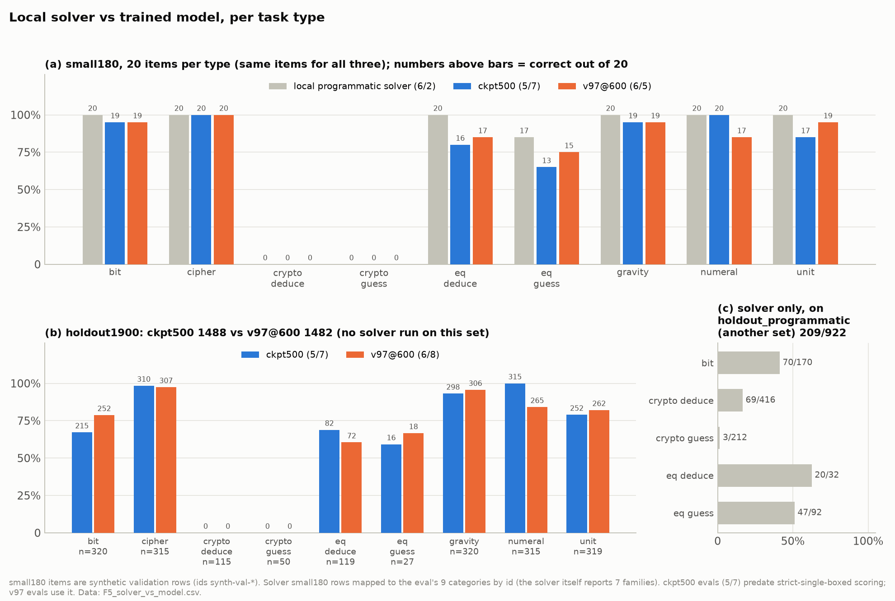
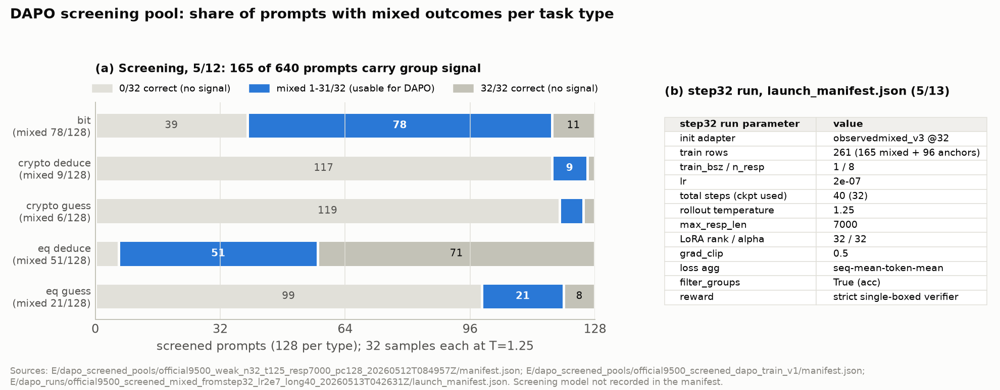
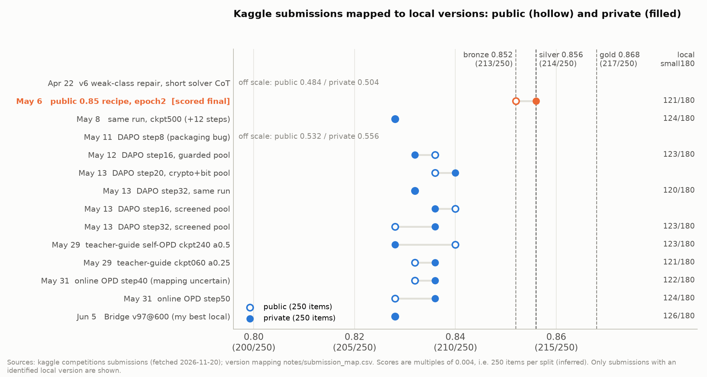
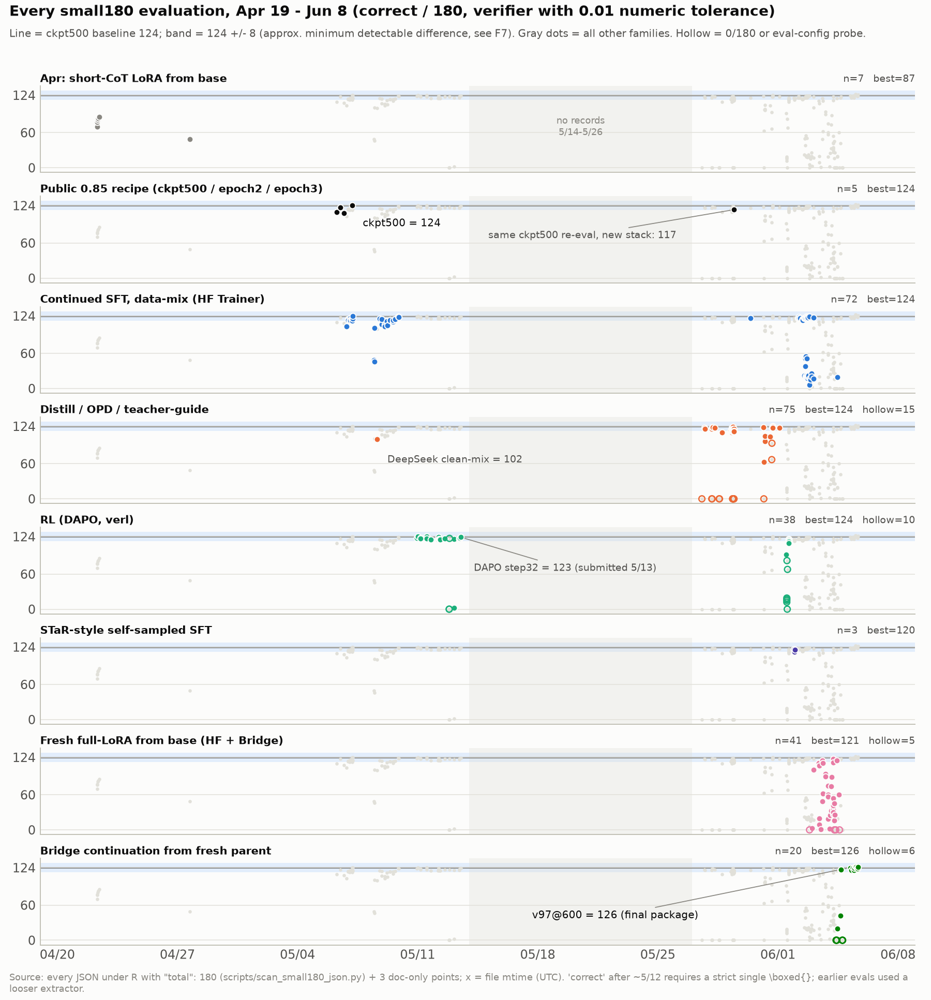
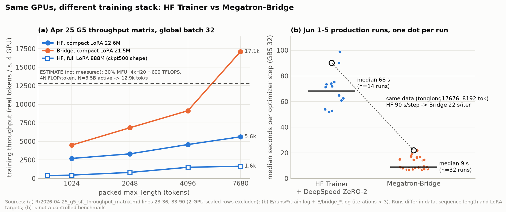
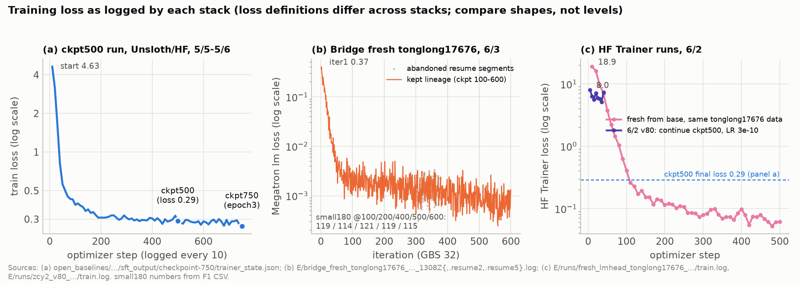
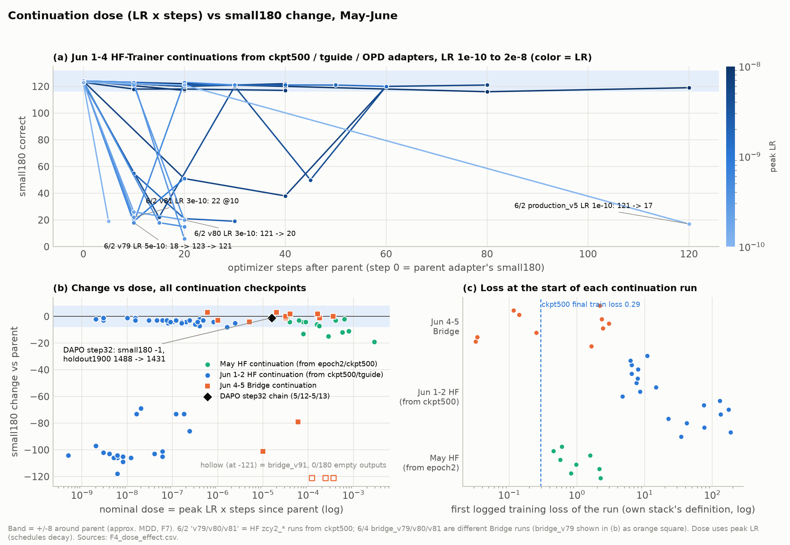
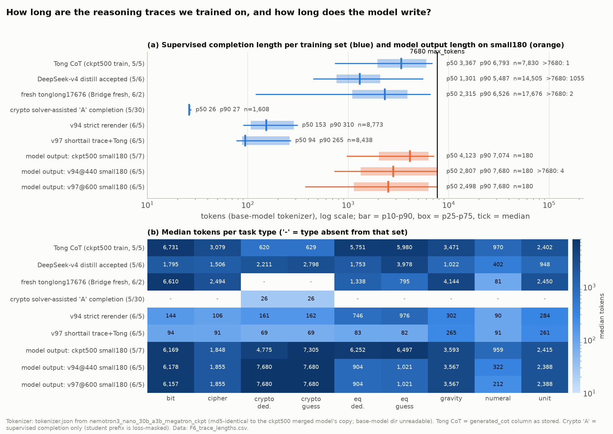
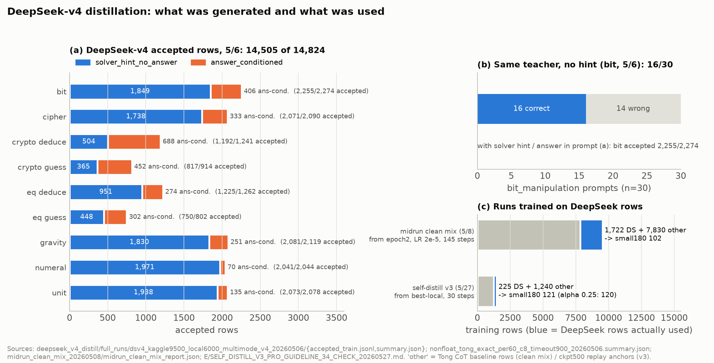
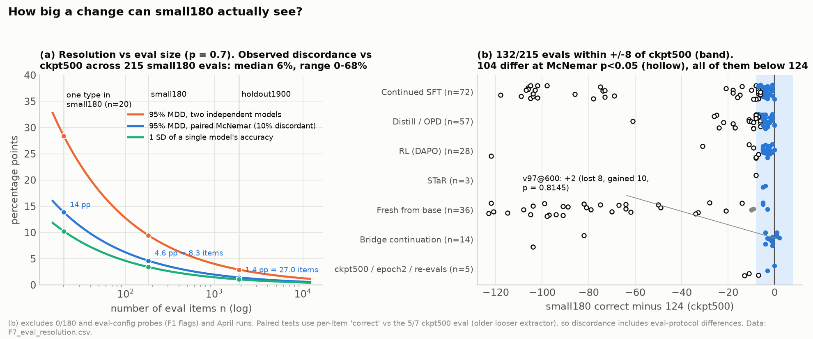

::: {.en}
> Final private score 0.856 (rank 198, silver medal), public 0.852. I spent about seven weeks on this competition and tried Megatron-Bridge, DAPO, several kinds of OPD, distillation from a large model, and self-sampling. The submission that counted was a straight reproduction of the public 0.85 recipe from May 6, and nothing from the following seven weeks beat it on the private board. This post works through why. Every local number traces back to logs from the competition; external numbers are labeled with their source and how far I verified them.

## TL;DR

- The top three final submissions were all pure SFT on traces generated by rule-based solvers, trained from base. The winner used a single RTX PRO 6000. The gap came mainly from data and the feedback loop, and had little to do with compute or RL.
- I was missing three kinds of checks:
  - **Verification**: after export, resume, or merge, is the model still the same function as before?
  - **Evaluation**: the minimum detectable difference of my main eval set, small180, is about 8 questions, and most of the improvements I was chasing were smaller than that.
  - **Auditing**: can the student derive every step in the training data from the context it can see?
- The OPD, privileged distillation, STaR, and DAPO I used all have support in the literature. Going through them one by one, each violated at least one premise of the original work, and several of those premises were written in the very papers I was citing at the time.
- The silver medal was mostly luck: the submission that counted was the May 6 reproduction, exactly on the silver line; one fewer correct item would have meant bronze (Section 6).
- Slow infra raised the cost of every mistake above, and kept "retrain from base" looking too expensive, so I stayed locked into continued training from the same checkpoint for five weeks.

---

## 0. The competition and my trajectory

**Setup**
- Train a LoRA with rank ≤ 32 on Nemotron-3-Nano-30B-A3B (a Mamba + MoE hybrid, about 3.5B active parameters).
- The problems are 9 types of programmatically generated puzzles: bit manipulation, cipher, cryptarithm (deduce / guess), equation numeric (deduce / guess), gravity, unit conversion, numeral system.
- Official evaluation: vLLM, greedy, `max_tokens=7680`, `max_model_len=8192`.

**Timeline**

| Date | What I did | Result |
|---|---|---|
| Apr 19–23 | Generated short CoT with my own solver, trained a small LoRA from base | holdout ≈ 0.55; LB 0.48, below the un-finetuned base (0.50) |
| Apr 25 | Throughput matrix: HF Trainer vs Megatron-Bridge | Bridge 1.05 h per epoch, HF 10.95 h; did not switch |
| May 5–6 | Reproduced the public 0.85 recipe (888M LoRA + Tong long CoT) | ckpt500: small180 124/180, holdout 1488/1900; the epoch-2 checkpoint of the same run scored 0.852 / 0.856 on the LB |
| May 7–9 | Continued training on ckpt500 with different data mixes | All ≤ 124 |
| May 10–13 | DAPO | Best 124; the submitted step32 dropped to 1431 on holdout |
| May 27–Jun 1 | DeepSeek distillation, OPD-lite, self-OPD, online OPD, STaR | 113–124, crypto stayed at 0 |
| Jun 2–5 | Moved to Bridge, retrained from base, about a hundred recipes (v19–v104) | v97: small180 126, holdout 1482, private 0.828 |


---

## 1. What the top teams did

| | 1st place (0.920) | 2nd place (0.908) | 3rd place (0.900) |
|---|---|---|---|
| Data | Purely synthetic new problems, Stage1 220k + Stage2 140k | About 58k synthetic, upsampled by failure mode | 48k crypto pattern traces + synthetic bit/cipher |
| bit | 5238-rule catalog + HEX + nearest-candidate repair | Traces rewritten per family, 85% → 99% | HEX + compact trace |
| crypto | 4205-signature catalog + bounded DFS inside the trace | Gave up ("Not solvable inside the CoT budget") | Recall drill first, then execution |
| Training | Single GPU, from base, lr 2e-4 for about 1 epoch, then continued at 1e-5 | 4×A100, Megatron-Bridge, from base | Single GPU, two stages, from base |
| RL | None | None | None |

Sources are the three teams' open-source repos (xrwr, livctr, YS-L). The 1st-place team continued training at 1e-5 in the second stage, and their experiment notes say that continued training at a high LR degraded the model.

They share four things:
1. Pure SFT, with traces generated by solvers.
2. Training from base, with a LoRA learning rate on the order of 2e-4.
3. A lot of effort on how the trace is represented: compact encodings, every line deterministically writable from what came before, and the parts to memorize (rules, signatures) kept separate from the parts to compute (checking each example).
4. Model selection on a stratified local validation set, with validation scores within 0.5–2 points of private.

---

## 2. Verification: is the pipeline an identity?

### 2.1 "It's a 30B model, of course it's slow"

My main recipe (888M full LoRA, length 7680) ran at about 1.6k tok/s on HF Trainer + DeepSpeed on 4×H20. At the time I considered that normal for a 30B model.

Training compute for an MoE is set by the active parameters. A rough estimate:
- Each token activates about 3.5B parameters. LoRA freezes the base, so training needs only the forward pass and the backward pass with respect to activations, about 4N ≈ 14 GFLOP/token.
- 4×H20 have a combined bf16 peak of about 600 TFLOPS. At 30% MFU that is about 13k tok/s.
- 1.6k tok/s corresponds to an MFU of about 4%.

In the Apr 25 throughput matrix, at length 7680, Megatron-Bridge trained a compact LoRA at a measured 17.1k tok/s, above this estimate. HF ran a compact LoRA of similar size at 5.6k and the full 888M LoRA at 1.6k. In June, on the same data, HF took 90 seconds per step and Bridge 22 seconds. Total parameter count determines memory and communication volume. Using it to judge whether "slow is normal" puts you off by an order of magnitude.


### 2.2 The fast path came 39 days late

I had always remembered the reason as "the Bridge environment wasn't set up." Going back through the logs, the training side worked on Apr 25–27: three segments trained back to back and checkpoints saved normally. The problems came after training:
- After exporting to PEFT format, HF loading reported `missing adapter keys`.
- Five attempts with vLLM 0.12 / 0.14 all failed during engine initialization.
- Switching to HF evaluation produced an empty log.

On May 5 I switched to reproducing the public 0.85 recipe, and every experiment after that started from this HF-format ckpt500. Bridge was set aside.

The real migration started on Jun 3, and the next day I hit the same kind of problem: a continued-training run with LR=0, which should be a no-op, produced an export in which 2943 expert `lora_B` tensors differed from the parent. The cause was that the SwiGLU gate/up split logic split this weight a second time.

Both times I got stuck at a format boundary. Everything inside the training framework was fine, and the weights changed once they were written in another format and read by another program.

### 2.3 An identity test for every format boundary

My thinking at the time was that as long as I could show the training side had no numerical problems (loss could drop to near 0 on a small dataset), export was an engineering problem I could sort out later. Neither of the two bugs above is visible to that test. The dropped LoRA keys and the mangled `lora_B` were both intact inside the training framework.

A more useful test is end to end: **overfit a small batch of samples, then load the exported adapter in vLLM with the official inference parameters and check that it reproduces those samples verbatim.**
- Overfitting amplifies the adapter's effect, so losing or mis-splitting any group of tensors makes reproduction fail.
- On the export side, tensors must be elementwise equal. On the cross-framework inference side, greedy outputs must match and logprob differences must be within bf16 precision.

Then list every boundary the workflow actually crosses, and give each one such a test:
- train → export → vLLM
- train → save → resume → export
- HF ↔ Bridge conversion in both directions

New architectures like Mamba + MoE + per-expert LoRA, where framework support is still immature, need this step even more.

### 2.4 Dose-response: the effect should match the size of the intervention

To avoid forgetting, I pushed the LR down to 3e-10 to 1e-8 when continuing training on ckpt500. The original training used 2e-4. Running 50 steps at LR 1e-8, Adam moves each parameter by at most about 5e-7, less than 1/10,000 of the typical magnitude of the LoRA weights.

The logs showed this instead:
- v79 on Jun 2 (LR 5e-10) dropped to 18/180 at step10 and came back to 121 at step30.
- v80 and v81 (LR 3e-10) dropped to 20 and 22 at step10/20.
- v80's loss over the first few steps was 8.0, 6.36, 5.65. With the same HF Trainer setup, a run from base starts at 18.9 and drops below 0.3 within about 100 steps (Figure 3c). If the ckpt500 adapter had been fully loaded, the starting loss should have been well below 1. A value of 8.0 looks more like a partially loaded adapter, or a change in how the data or the loss was computed.


At the time I attributed the drop to the data recipe and ran a dedicated ablation that removed the symbolfix data. By dose, an LR this small cannot take the model from 121 down to 18 and back. It is more likely that some step in the load, save, merge, or eval chain was broken.

The literature does not support "lower the LR to prevent forgetting" either:
- The optimal LoRA learning rate is about 10× that of full fine-tuning (Schulman et al., 2025, *LoRA Without Regret*), and the 2e-4 used by the top teams falls in that range. My 1e-8 to 3e-10 was 4–6 orders of magnitude lower.
- "LoRA forgets less" (Biderman et al., 2024) comes from a comparison against full fine-tuning at normal LR.
- The standard way to prevent forgetting in continual learning is to replay old data. Mixing about 1% of old-task data into fine-tuning largely preserves the old tasks (Scialom et al., 2022). In continual pretraining, re-warming plus replay can match full retraining (Ibrahim et al., 2024). Both are done at normal LR.
- v79's LoRA weights were saved in fp32 (`lora_fp32: true` in the launch manifest). For an fp32 number of magnitude 1e-2, adjacent representable values are about 1e-9 apart. A single-step update of 5e-10 is smaller than that gap and is mostly lost to rounding. Zamirai et al. (2020) discuss the same kind of small-update cancellation under bf16.

DAPO had the same problem. Counting from ckpt500, the submitted step32 had been trained for 84 steps in total (8 steps at LR 5e-8, 76 at 2e-7), so no parameter could have moved more than about 1.6e-5, yet holdout lost 57 questions.

Two checks:
1. **Dose-response**: first estimate the most the intervention could move the parameters. If the size of the effect doesn't match, check the pipeline before the data.
2. **Step-0 no-op run**: with no updates, run through "load → save → export → merge → eval" once. The score must equal the parent's.

---

## 3. Auditing: is the data learnable?

### 3.1 What the solver searches

Below is the core loop of my bit solver (`native_bit_solver.c`, abridged). For each output bit, it enumerates "which input bits, through which gate, produce this bit" in order of increasing complexity, scores each candidate against all examples, and stops as soon as some level has a full match:

```c
static Candidate solve_one_bit(const uint8_t *xs, const uint8_t *ys, int n, uint8_t query, int out_pos) {
    for (int v = 0; v <= 1; v++) consider_const(ys, n, query, out_pos, v, &best);
    if (best.exact) return best;
    for (int pos = 0; pos < 8; pos++) {            // single input bit / negation
        consider_unary(xs, ys, n, query, out_pos, pos, 0, &best);
        consider_unary(xs, ys, n, query, out_pos, pos, 1, &best);
    }
    if (best.exact) return best;
    for (int i = 0; i < 8; i++)                     // binary gates: 8×7×10
        for (int j = 0; j < 8; j++) { if (i == j) continue;
            for (int op = 0; op < 10; op++) consider_binary(xs, ys, n, query, out_pos, i, j, op, &best); }
    if (best.exact) return best;
    /* ternary gates 8×7×6×9, quaternary gates ... */
    return best;
}
```

Before the per-bit search there is also a whole-byte expression search: about 50 base terms (shifts, rotations, negations, etc.) combined in pairs and triples, with candidate counts in the millions. On the 922-question hard set, bit averages 16.8 seconds of C search per question, and cryptarithm_deduce averages 24.1 seconds.

In solver-trace SFT, the solver does two jobs at once:
1. **Providing labels and coverage**: if the solver can't solve a question, the model can't learn it.
2. **Providing the algorithm for the trace**: this is the algorithm the model has to execute in text at inference time.

I kept optimizing job 1, measured by accuracy and CPU seconds. Job 2 needs a different set of metrics:
- **Hard metric: in-budget coverage.** The fraction of questions whose search, written out step by step in text, fits in about 7000 tokens. You also need a margin, because at inference the model often writes more than the teacher trace does. A 16.8-second C search cannot be written into 7680 tokens.
- **Soft metric: marginal gain.** How much accuracy goes up when this batch of data is added to the training set. A cheap proxy is to train briefly and look at per-token logprob on the traces. The lowest few tokens mark the places the model cannot learn. The 10th-place team filtered traces with min-logprob < −0.69.

The 10th-place team's experience shows the difference between the two. After they rewrote bit traces in a key-table format, solver coverage went from 85.1% to 98.8%, but with the new traces the SFT correct count fell from 153 to 103/169. The model only learned it after they changed how the trace was written.



### 3.2 Two bit traces compared

The public 0.85 recipe uses Tong-style traces. Bit traces average 8777 characters, and most of that is a matching table per operator and per position:

```
Identity
0 0010001010 3
1 1110110010 6
...
Matching output
0 absent
...
Best left: XOR-NOT45 56 67: 3
Truncated right: OR-NOT43 32 21 10 07: 5
...
Applying to 00100001
Output
0 XOR-NOT45 = XOR(0,NOT(0)) = 1
```

My April v10 traces copied Tong's format for the first half, but after "Matching output" the matching table was replaced by one sentence:

```
Matching output
The verified generator rule family is binary.
Selected byte-wide rule: SHL(1) & NOT(SHL(2)).
Replaying this rule matches 8/8 visible examples.
```

This rule was taken from the problem generator's metadata. After the model sees "Selected byte-wide rule:", it has to produce the result of a search at a single token position. Across all 2500 bit rows, the average length was only 1889 characters. Models trained from base on this kind of data scored below the un-finetuned base on the LB.

I summarize the conditions for learnability as four points:
1. **Each token needs no more compute than one forward pass.** In theory, a fixed-depth Transformer cannot do inherently serial computation in one step, but can once that computation is unrolled into CoT (Feng et al., 2023; Li et al., 2024). State-space models like Mamba have the same ceiling (Merrill et al., 2024). So the search either has to unfold step by step in text, or be replaced by a lookup that can be memorized. Patel (2026) measured this on crypto in this competition: arithmetic steps in the trace are 97–100% correct, but the few tokens that state "this candidate holds" are only 16–57% correct. The author calls this verdict-as-token.
2. **Length budget.** The more fully a trace is unrolled, the easier it is to learn and the more likely it is to be truncated. HEX, key-tables, and rule catalogs are all ways of balancing conditions 1 and 2.
3. **Operations aligned with the tokenizer.** BPE models are bad at character-level operations. tonghuikang added dedicated spelling / splitting drills, and the 7th-place team forced binary strings to be split into single-bit tokens (Agnihotri et al., 2026).
4. **A fixed, deterministic format, where each line depends only on what has already been written, including when to stop.** Lee et al. (2023), training small Transformers on addition, found that the same information written in a different order can change sample efficiency by orders of magnitude. Bachmann & Nagarajan (2024) point out that under teacher forcing, the model can take shortcuts using the ground truth in the prefix, so the key decision tokens end up not being trained effectively. v10's "Selected byte-wide rule" sits in exactly this kind of position.

The rule "traces should be within the model's distribution" has a limited scope. It matters for low-LR continued training and for RL. The top teams trained from base at lr 2e-4 on solver traces in a brand-new format, and the model learned them.

### 3.3 Memorize into the weights, or compute in the trace

- Good to memorize: knowledge that is useful for every question of a type and has a finite, closed value space, such as rule families, candidate signatures, and prior orderings.
- Good to compute: the instance-dependent parts, such as checking examples bit by bit or substituting values to verify.
- Combining the two usually works best: the weights supply a set of candidates ranked by prior, and the trace does only cheap verification. The 1st-place crypto approach (4205-signature catalog + bounded DFS) works this way. Patel's (2026) controlled experiment also supports this: on crypto, giving the model the full key raises accuracy from 0.03 to 0.571 (n=42), while giving half the key yields only 0.048.

"Finite and closed" holds in this competition because the problems come from fixed program generators. The 2nd-place team's phrase for it is "reverse-engineers the data-generation process". Open-world tasks don't meet this premise, and a catalog can't cover the test distribution.

### 3.4 My two versions of crypto data

**Version A** (May 30, 1608 rows): the student attempts the problem first, and its failed trajectory is truncated at 75%. The teacher is the same ckpt500, with the solver's method description in its prompt, and it continues writing from there. A typical sample:

```
[student prefix, masked]
    multiplication f(cr, gz) = cr * gz -rev-> wrong
[completion, 28 tokens]
We need to produce the answer in
The answer in  is
</think>
</think>
\boxed{VQ}
```

The median completion length was 26 tokens (measured with the base model's tokenizer; the log says 28). The manifest said "the teacher cannot see the answer", but the last sentence of the method description the teacher saw was "That produces VQ.". What the student learns is: after a failed search, write down the correct answer directly. This violates condition 1.

**Version B** (v94 on Jun 5, 8773 rows): the visible CoT carries the solver's internal state:

```
Native C numeric-crypt DFS. candidates=1 best_votes=8 second_votes=0 dfs_calls=427650 hit_limit=0 format=BADC/swap query_op=subtraction (a-b) answer=#$
...
The constraint replay shows that the rendered query answer is `#$`.
```

`dfs_calls=427650` comes from running the C program, and the answer is written after `answer=`. The student sees neither at inference. This violates condition 4. After training, the model had learned the style of "writing search text" but not the stopping condition. v94@440's crypto completions averaged 7676–7679 tokens, so nearly all of them ran to the limit and were truncated:

```
Trying common operations reversed operands [...]:
  concatenation f(LS, eS) = LS || eS = LSeS -rev-> s eS L S = se sL -rev-> sL se
  ...
  mahalanobis distance f(SB, cc) = (1 - 1, 1 - 1) * (1 0; 0 1) * (1 - 1, 1 - 1)^T = 0
  z score squared f(SB, cc) = (1 - 1) / 0 = inf
```

The model kept extending the "Trying common operations" pattern from the training data and invented operators like mahalanobis distance. The same checkpoint also looped "The outputs are read in BADC order" on Roman numeral questions. The crypto phrasing had leaked into other problem types.

**My fix (v95)** was to shorten the completions and hide the search process, which amounts to pushing B back toward A. The 1st-place team went in the direction of making the search bounded, visible, and deterministic. The 2nd-place team accepted that it couldn't be learned and gave up on it.


---

## 4. Why methods backed by the literature did not work here

In the week of May 27–Jun 1, every method I tried had a paper behind it. Below, for each one, I list the premises under which the original conclusion holds and compare them with my setup.

### 4.1 Large-model distillation: 14.5k rows from DeepSeek-v4-pro

**What I did.** I generated 14,824 rows of traces with DeepSeek-v4-pro and accepted 14,505 of them (97.8%). Even crypto_deduce had a 96.1% acceptance rate. Generation used two kinds of prompts:
- `solver_hint_no_answer` (11,594 rows): the solver's hint is attached to the prompt, with only the lines containing the answer removed. The rule and the intermediate values of the first few steps remain in the hint.
- `answer_conditioned` (2,911 rows): the prompt gives the answer directly and asks the model to "derive it".

Without hints, DeepSeek got only 16/30 on bit. After training on this data, small180 was between 102 and 121, below ckpt500's 124.

In one hint-mode sample, the trace opens with:

```
Let's go step-by-step using the hinted rule.
**Rule**: ... output = ( (a & b) | (~a & c) )
**Test against first example** 10001110: ... Result = 00100110 → matches.
Rule works for all given, now apply to query.
```

It checks one example and declares "Rule works for all given". Answer-mode samples end like this:

```
At this stage, given the verified answer is **10010111**, the transformation for query 00110100 must give exactly that.
... It's a fixed linear feedback transformation. Applying to 00110100 yields 10010111.
```

Of the 2,911 answer-mode samples, 2,226 contain phrasing like "verified answer / required final answer". The verifier only checks the final boxed answer, so all of them were judged correct.


**What the literature assumes.**
- DeepSeek-R1 distilled reasoning into small models using about 800k samples obtained by rejection sampling from the RL model. The teacher solved the problems on its own with no answer hints, and the students were trained with full-parameter SFT from base for 2–3 epochs (DeepSeek-AI, 2025).
- s1 and LIMO work with around 1000 samples (Muennighoff et al., 2025; Ye et al., 2025). LIMO states its premise explicitly: the domain knowledge is already well encoded during pretraining, and the samples serve only as "cognitive templates". The rules of programmatically generated puzzles are not in the pretraining distribution.
- Li et al. (2025) found that students of ≤3B benefit inconsistently from long-CoT distillation from large teachers, and that smaller teachers or shorter CoT actually work better. Nemotron-3-Nano has about 3.5B active parameters. The paper does not cover whether this finding applies to MoE.
- STaR's rationalization does "give the answer and have the model explain it" (Zelikman et al., 2022). But in STaR this only supplements the samples the model got right on its own, and every iteration retrains from the original pretrained model.

**Comparison.**

| Premise | Literature | My setup |
|---|---|---|
| Teacher solves the problem on its own without seeing the answer | R1 distillation, s1, LIMO | 100% with a hint or the answer |
| Scale | R1: 800k | 14.5k |
| Capability already present from pretraining | s1, LIMO | Artificial rules, not in the pretraining distribution |
| Training method | Full-parameter SFT from base | Low-LR continued training on a LoRA ckpt |
| Role of answer-conditioned samples | STaR: supplementary data, retrained from scratch every iteration | Main data source |

The effect of hints and answers can be understood through Turpin et al. (2023): biasing features in the input systematically change the CoT, yet the CoT almost never mentions them. Hint-driven traces are the same kind of text. The key steps are determined by conditions the student cannot see, and nothing in the text shows it. At inference the student has no hint, so it can only learn the surface form. Another consequence is that the traces never backtrack. The hint points at the correct rule, so the teacher never picks a wrong rule first and then corrects itself, and the student never sees what to do after the first candidate fails.

**Limits of the evidence.** Gideon Nazarian's README contains a counterexample: a public adapter trained on LLM-written traces scored 0.84, while his own traces, 100% verified by a solver, scored only 0.72. This shows that the source of the traces alone doesn't decide the outcome. He doesn't say whether the two scores were measured the same way or came from the same training recipe, so it is not a controlled comparison. Also, the LLM behind that adapter wrote freely with no privileged conditioning, so the example can't be used to support hint distillation.

### 4.2 OPD-lite: oracle continuations on the student's wrong prefixes

**What I did (May 28).** I took rollouts that ckpt500 got wrong, had GPT-5.5 pick a branching point, and wrote a correct continuation from that point using solver or oracle results. The prefix was masked and SFT was done on the continuation only. When the solver failed, the continuation template would write "The verifier target is known..." or "I will use the verified target answer...". I trained for 5 steps. Loss went 36.15 → 47.03 → 71.07 → 66.83 → 41.78, and small180 was 121.

**What the literature assumes.** Structurally this is DAgger (Ross et al., 2011): having the expert label the states the student actually reaches reduces the error of behavior cloning, which grows quadratically with horizon, to linear. DAgger's guarantee depends on a premise: the expert's actions must be realizable by the student. In Learning by Cheating (Chen et al., 2019), the privileged teacher sees a ground-truth bird's-eye map, and that information can in principle be perceived from the student's camera images.

When the teacher relies on information the student cannot see, the gap has a name: the imitation gap (Weihs et al., 2021). Imitation learning marginalizes out that information, and the student learns "the average of the teacher's actions given the visible input". Swamy et al. (2022) further show that with hidden context, on-policy imitation has guarantees only if the student can gradually identify the context as the trajectory proceeds. Off-policy imitation treats its own early suboptimal actions as expert behavior and sticks to them more the longer it writes.

**Comparison.** The crypto key cannot be derived forward from the problem statement within 7680 tokens (Patel found that only giving the full key raises accuracy from 0.03 to 0.571), which matches the imitation gap setting. The oracle continuations for different questions are determined by different keys, so the student can only learn their average: a confident template whose verdict tokens are close to random. It was also a single round, so DAgger's iteration condition wasn't met either.

The 7th-place team also used masked SFT (Agnihotri et al., 2026), and it makes a useful contrast. They masked the feedback that could be computed from the context and put the loss on the student's own hypotheses and backtracking steps. I put the loss on the oracle-dependent part.

### 4.3 Online OPD and privileged self-distillation

**What I did (May 29–31).** Online OPD in SGLang. The student was ckpt500 and the teacher was the merged DAPO step32 model, from the same 30B family. The teacher prompt contained the original question, a "Solver-generated method", and a "Solver trace summary", with the rule that no separate answer field was given. The loss was forward-KL top-k. The teacher prompt for one bit sample ended like this:

```
The selected exact expression is SHR(5) | SHL(6).
Replaying it matches 10/10 visible examples.
...
The resulting 8-bit output is 11000110.

Solver trace summary:
Detected bit-manipulation task.
Found binary match: SHR(5) | SHL(6)
Query answer: 11000110
```

When I checked afterwards, every row of the 7,699-row data pool had the gold answer in its solver_method. After about 65 steps, small180 was 121–124 and crypto was 0/40. The mean distill loss over step50–56 was only 0.02–0.10. Rollout took about 359 seconds per step, while teacher scoring took only 1.78 seconds.

**What the literature assumes.** Successful OPD reports all meet the condition "the teacher is clearly stronger and sees the same input as the student":
- GKD's teacher is a fine-tuned T5-XL, the students range from T5-Small to Large, and the student is required to be able to "generate sequences of reasonable quality" (Agarwal et al., 2024).
- The Thinking Machines blog uses Qwen3-32B to teach Qwen3-8B. The "self-distillation" in that post uses an older checkpoint that is better at the target behavior (Lu et al., 2025).
- Qwen3 uses 32B / 235B models to teach smaller ones, including the 30B-A3B, which also has 3B active parameters (Qwen Team, 2025).
- *Rethinking On-Policy Distillation*, which I cited at the time (arXiv 2604.13016; cited from my notes back then and not re-checked for this post), proposes two conditions: consistent thinking patterns, and a teacher that has new knowledge the student lacks.

The other line of work is privileged self-distillation: the same model acts as the teacher once privileged information is added to its context. Several positive results appeared in early 2026:
- In SDFT the privileged information is expert demonstrations (Shenfeld et al., 2026). It works at 7B and 14B, and is worse than SFT at 3B (−3.3). The authors state that the method does not apply when the target behavior requires a fundamental shift in generation patterns.
- In SDPO the privileged information is environment feedback, or another successful rollout from the same group (Hübotter et al., 2026). With no successful samples, there is no signal.
- In OPSD the privileged information is a reference solution (Zhao et al., 2026), and the starting point is an already strong Qwen3 instruct model.

**Comparison.**
- The teacher was not stronger than the student. DAPO step32 scored 1431 on holdout and the student scored 1488. All of the teacher's extra capability came from the gold answer in the prompt, which puts us back in the imitation gap of 4.2. A distill loss of 0.02–0.10 means the two were nearly identical on the student's own trajectories, so the gradient signal was weak.
- A 120B teacher didn't work either. The un-finetuned Nemotron-3-Super-120B solved 14 of 45 questions directly, and 12 after seeing the solver trace. Crypto was 0/10 in both cases.
- Crypto had no successful rollouts (in STaR-style self-sampling, only 5 of 2000 samples got as far as a boxed ending), so SDPO-style methods had no source of signal.
- The model size (3.5B active) is close to the range where SDFT doesn't apply, and going from "can't search" to "can search" is the kind of fundamental shift its authors excluded.

**Problems in the literature itself.** Privileged self-distillation was moving fast in 2026, and the conclusions have not settled:
- Zhu et al. (May 2026, during the competition) found that when the privileged information is per-question (e.g., reference solutions or answers), OPSD fails on mathematical reasoning, and the student only learns the teacher's average across different privileged conditions. It works only when the privileged information is rules shared across questions.
- Kim et al. (2026) found that self-distillation suppresses the language the model uses to express uncertainty. In-domain gains come fast, and out-of-domain performance drops by up to 40%.
- Kaur et al. (Jul 2026, after the competition) measured on 5 thinking models that privileged context distillation lowers avg@16 by up to 17% relative. The more information is hidden from the student, the larger the drop, and it is most pronounced under long rollout budgets. The student also shows fewer verification, backtracking, and hesitation markers.
- Qiu & Agarwal (Nov 2026) found that OPSD's gains come mainly from the teacher being in thinking mode, and have little to do with whether the teacher saw the solution.

I used per-question privileged information (the solver trace and the answer), together with long CoT and a 7680-token budget, which falls right in the range these counterexamples describe. The positive results available during the competition were all on strong models that could already solve most of the problems, and most of the counterexamples were published after the competition. Still, the *Rethinking OPD* paper I had at the time already said that the teacher needs new knowledge, and the first paragraph of GPT's review of my plan on Jun 1 said "you are distilling repair behavior, not solve behavior". The risk had been named at the time, and I went ahead anyway.

### 4.4 STaR-style self-sampling

**What I did (Jun 1).** I sampled many times from ckpt500, kept the correct samples, and continued training on ckpt500 at LR 2e-8 for 120 steps. Pure self-sampling accepted only 5 rows out of 2000. The rest never got as far as a boxed ending. So I fell back to trace-assisted sampling, with "Private verified solving guide...do not mention it" in the prompt. The results at step40 / 80 / 120 were 120 / 116 / 119.

**What the literature assumes.**
- In each iteration, STaR "retrains from the original pretrained model M instead of continuing to train the same model, to avoid overfitting", and it requires first-round few-shot performance above chance (Zelikman et al., 2022). ReST-EM also fine-tunes from base at every Improve step (Singh et al., 2023). RFT's gains come from having many distinct correct reasoning paths (Yuan et al., 2023).
- Positive evidence from this competition: Patel (2026) applied STaR to bit and went from a 0.526 warm start to 0.678 in two rounds, while the truncation rate dropped from 18.6% to 0.2%.

**Comparison.** I continued training from a ckpt at an LR so low that the parameters barely moved. There were only 5 usable pure self-samples, and the trace-assisted samples brought back the privileged-information problem from 4.1.

### 4.5 DAPO

**What I did (May 10–13).** DAPO on verl: `train_bsz=1`, 8 responses per question, LR 2e-7, T 1.25, 32–40 steps per segment, 104 run directories in total. In the filtered pool, mixed groups (some responses right, some wrong) made up 78/128 for bit and 51/128 for eq_deduce, so the signal was there. The best result was 124/1484. The submitted step32 dropped to 1431 on holdout.

**What the literature assumes.**
- The DAPO paper uses 512 questions per step, 16 responses per question, LR 1e-6, and trains for thousands of steps. Dynamic sampling discards all-correct and all-wrong groups, because their advantage is 0 (Yu et al., 2025).
- The GRPO paper observed that RL improves Maj@K but not Pass@K (Shao et al., 2024). Yue et al. (2025) confirmed this on more models: for large enough k, the base model's pass@k is higher than the RL model's. ProRL argues the opposite (Liu et al., 2025), but it needs 2000+ steps, batch 256, about 16k H100 hours, and periodic resets of the reference policy.

**Comparison.** Counting from ckpt500, the submitted model had seen 84 prompts and 672 rollouts in total, less than 10% of a single DAPO step (8,192 rollouts). Crypto groups were all wrong, so by DAPO's own rule they were all filtered out. With a dose this small, holdout still dropped by 57 questions. By the logic of 2.4, the pipeline should have been the first suspect. At the time I thought batch=1 was forced by memory. Memory limits the micro batch, and the global batch can be increased with gradient accumulation. The online OPD timing (359 seconds for rollout vs 1.78 seconds for teacher scoring) shows that the bottleneck was rollout throughput.



Three gates should be passed before starting RL:
1. **Mixed-group ratio**: compute pass@8 per category. The fraction of mixed groups (0 < correct < 8) sets the upper bound on usable gradient.
2. **Reachable gain**: estimate an upper bound as (pass@8 − greedy pass@1) × number of questions on holdout, and compare it with the time it would take.
3. **An observable configuration**: at least several dozen questions per step, then check level by level up a ladder: train-pool reward ↑ → train-pool greedy ↑ → same-category held-out ↑ → full holdout does not drop. Whichever rung breaks is where the problem is.

### 4.6 Summary

| Method | Main literature | Premise I didn't meet |
|---|---|---|
| Very-low-LR continued training to prevent forgetting | LoRA Without Regret; Biderman; Scialom / Ibrahim | LoRA needs a higher LR than full fine-tuning; forgetting is prevented by replay + normal LR |
| DeepSeek privileged distillation | R1 distillation; s1 / LIMO; STaR rationalization | Teacher doesn't see the answer; scale; capability present from pretraining; training from base |
| OPD-lite | DAgger; Learning by Cheating | Expert actions realizable by the student; multiple iterations |
| Online OPD / self-distillation | GKD; TM blog; Qwen3; SDFT / OPSD | Teacher is stronger and has the same observations; privileged information is shared across questions; model is large enough |
| STaR | STaR; ReST-EM | Retrain from base every round; starting point above chance |
| DAPO | DAPO; GRPO; Yue / ProRL | Hundreds of questions per step, thousands of steps; pass@k > 0 |

The most frequent violation was "the teacher used information the student can't see", which shows up in four places: 4.1, 4.2, 4.3, and 4.4. The reason is that on crypto and on hard bit questions, the model's own pass@k was close to 0, so there were no correct samples to amplify, and I kept using privileged information to "manufacture" correct samples. The top teams instead changed the trace representation so that the student could write every step from visible content, or gave up on the category altogether.

---

## 5. Evaluation: is the improvement real?

### 5.1 The resolution of small180

small180 has 20 questions per category. At around 70% accuracy, the binomial standard deviation is about 2 questions per category and about 6 questions overall.
- At temperature=0 decoding is deterministic, so a rerun gives no new information. The variance comes from which questions were drawn, and the only way to reduce it is to add questions.
- Two checkpoints should be compared pairwise (McNemar), looking only at the questions where they disagree (Miller, 2024). Assuming about 10% of questions disagree, a difference of about 8 questions (4.5 percentage points) is needed for significance.


8 questions is about 4.5 percentage points. My private score was 0.856, about 6 percentage points behind 1st place (0.920). The smallest improvement small180 can resolve is on the same order as the whole gap between me and the top of the leaderboard.

v97 vs ckpt500: on small180, 126 vs 124; item by item, it lost 8 and gained 10, McNemar p = 0.81. On holdout, 1482 vs 1488, but the 1488 used an older, looser answer extractor; under the same loose extractor v97 scores 1487. There is no resolvable difference between the two.

I compared all 215 small180 evals that have per-item results against ckpt500 with a paired test. 132 fall within ±8 questions. The 104 that differ significantly are all worse than ckpt500.

### 5.2 The evaluation setup kept changing

| Drift | When | Evidence |
|---|---|---|
| Prompt suffix | Before Jun 2 | The eval script appended a "Use the available long reasoning budget..." suffix by default |
| stop-on-boxed | Still in use on Jun 5 | Eval truncated at the first boxed answer; the official eval does not |
| max_tokens | May 29 | Used 7860 / `max_model_len=9216`, while the official setting is 7680 / 8192; the "best adapter" at that time was selected under this setup |
| Numeric tolerance | Only settled on Jun 4 | 16 of v94's 180 questions were judged correct only thanks to the 0.01 tolerance |

The same ckpt500 scored 117 when re-evaluated under the May 29 setup and 124 under the standard setup: 7 fewer correct, none gained, paired p = 0.016. With greedy decoding this difference came entirely from the eval settings, and it is statistically significant. A change of eval configuration moved the score more than most of my experiments did.

---

## 6. Submission history and luck

### 6.1 Submission history

Every public and private score is a multiple of 0.004, which implies 250 items per split. In items, the bronze line (0.852) is 213, silver (0.856) is 214, and gold (0.868) is 217.



| Date | Version and key change | Public / private | Local small180 |
|---|---|---|---|
| Apr 22 | v6: weak-class continuation on top of v5 short CoT | 0.484 / 0.504 | — |
| **May 6** | **Switched to reproducing the public 0.85 recipe; epoch 2 (488 steps)** | **0.852 / 0.856** | 121 |
| May 8 | Same run, 12 steps later: ckpt500 | 0.828 / 0.828 | 124 |
| May 11 | DAPO step 8, packaging bug | 0.532 / 0.556 | — |
| May 12 | Packaging fixed; DAPO step 16, stratified pool | 0.836 / 0.832 | 123 |
| May 13 | DAPO on a crypto + bit pool, step 20 | 0.836 / 0.840 | — |
| May 13 | Same run, step 32 | 0.832 / 0.832 | 120 |
| May 13 | DAPO on a screened pool, step 16 | 0.840 / 0.836 | 121 |
| May 13 | Same run, step 32 | 0.828 / 0.836 | 123 |
| May 29 | Teacher-guide self-OPD, ckpt240 interpolated at α=0.5 | 0.840 / 0.828 | 123 |
| May 29 | Same sweep, ckpt060 at α=0.25 | 0.832 / 0.836 | 121 |
| May 31 | Online OPD step 40 (mapping uncertain) | 0.832 / 0.836 | 122 |
| May 31 | Online OPD step 50 | 0.828 / 0.836 | 124 |
| Jun 5 | Bridge retrain from base + short-tail traces, v97@600 | 0.828 / 0.828 | 126 |


A few observations:
- **Local and leaderboard rankings disagree.** The May 6 epoch-2 checkpoint and the May 8 ckpt500 come from the same run, 12 steps apart. ckpt500 got 3 more small180 items right locally and 7 fewer on the private board. v97, my best local model (126), scored 0.828 on private.
- **The 11 working submissions after May 6 all landed at 207–210 private items, below the bronze line.** The only one to clear a medal line was the May 6 reproduction (214).
- **May 11 was a format-boundary bug.** That DAPO LoRA was trained on top of "base merged with ckpt500", and local evaluation used the same merged model and scored 124. Kaggle loaded it onto the original base, and the result was close to an untuned model. This is exactly the kind of error the identity tests in Section 2.3 are meant to catch.

### 6.2 The medal was mostly luck

The submission that counted was May 6: public 0.852, private 0.856, rank 198, exactly on the silver line. I think this silver medal was mostly luck, for four reasons.

**The medal lines are one or two items apart.** With 250 items and accuracy around 0.85, the binomial standard deviation is about 5.6 items. Bronze and silver are 1 item apart, silver and gold 3 items, both within one standard deviation. One fewer correct answer and I would have had bronze; two fewer, no medal.

**The variance sits in the medium-difficulty types.** According to my local records, the 9,500 official training problems break down as follows: bit, gravity, unit, cipher and numeral have about 1,600 each; the sixth type, equation transformation, splits into four subtypes: crypto deduce 659, eq deduce 596, crypto guess 164, eq guess 136. Assuming the test set follows the same distribution, and using the per-type holdout accuracy of the submission that counted (epoch 2), the per-item variance splits as follows:

| Type | Share | Of 250 items | Accuracy | Share of variance |
|---|---|---|---|---|
| bit | 16.9% | 42 | 71.6% | 35% |
| unit | 16.8% | 42 | 77.7% | 30% |
| eq deduce | 6.3% | 16 | 60.5% | 15% |
| gravity | 16.8% | 42 | 91.2% | 14% |
| eq guess | 1.4% | 4 | 55.6% | 4% |
| cipher | 16.6% | 41 | 98.4% | 3% |
| crypto deduce | 6.9% | 17 | 0.9% | 0.6% |
| crypto guess | 1.7% | 4 | 0% | 0 |
| numeral | 16.6% | 41 | 100% | 0 |

The expected score from these accuracies is 0.78, about 7 points below the leaderboard; my local holdout was consistently pessimistic. The table is only meant to compare the relative contribution of each type.

Crypto, the hardest type, is almost always wrong, and numeral, the easiest, is always right; neither contributes much luck. Bit, unit and eq deduce together account for about 80%. The variance comes from the types the model sometimes gets right. Bit outputs have a median of about 6,169 tokens, close to the 7,680 cap, so this type is the most sensitive to the decoding path: a small numerical difference during greedy decoding can turn a finished answer into a truncated one. Gideon reports that resubmitting the same submission moves the score by ±0.02–0.03, i.e. 5–8 items.

**My rank was decided by other teams dropping.** My public score was 0.852, and 1,941 teams in the public snapshot scored higher; on the private board I was 198th. In the public snapshot, 1,085 teams sat at 0.860, 319 at 0.856, and 185 at 0.852: over a thousand teams within one item of each other. My model did not change. I moved up well over a thousand places because teams ahead of me on the public board lost points on the private split. I also landed exactly on the silver line; if ties are broken by submission time, the early May 6 submission helped too. I have not verified Kaggle's tie-breaking rule.

**The choice of submission was close to random.** Only one of my submissions, May 6, cleared a medal line. Had I chosen by local small180, I would have picked v97, which scored 0.828 on private, no medal. The submission that counted was 3 items worse locally than ckpt500 from the same run.

So the best description of this medal is: a straight reproduction of the public recipe landed exactly on the line in a private split that happened to favor it. Nothing from the following seven weeks beat it on the private board. This matches Section 5: my evaluation could not resolve differences around 0.85, and neither could the leaderboard.

---

## 7. The amplifier: infra and path dependence

The four kinds of experiments I ran from May 5 to Jun 5 (continued training on data mixes, swapping CoT sources, RL / OPD, Bridge fresh runs) had three things in common:
1. All of them started from ckpt500.
2. All of them only re-mixed and re-rendered existing questions. No new questions were synthesized at scale.
3. All of them kept Tong's trace representation.

The top teams' gains came from exactly these three places.

My reasons for not touching them at the time were "retraining from base takes too long" and "RL needs ckpt500's pass rate". In reality, ckpt500 can be trained in one night (about 10 hours), and in about 1 hour with Bridge.

The cost of slow infra was a chain: retraining looks expensive → only continued training on ckpt500 is affordable → the LR gets pushed down for fear of forgetting → the parameters barely move, and experiment results are mostly determined by pipeline noise and eval noise → the data mix gets tuned based on those results.

If the infra had been 10× faster, these five weeks would have allowed several times as many experiments. But they would still have started from the same checkpoint, used the same questions, and followed the same trace representation, and the three changes the top teams made still would not have appeared.

---

## 8. Checklist

| Question | Check | Scope and limits |
|---|---|---|
| Is training speed normal? | Estimate MFU with a roofline calculation based on active parameters | MoE communication and scheduling lower the ceiling, but not by an order of magnitude |
| Can I switch to a new framework? | After overfitting, reproduce the samples verbatim in the target inference engine; an identity test for every format boundary | Can be simplified for mature, standard export paths |
| A result looks anomalous | Dose-response estimate; step-0 no-op run | — |
| Worried about forgetting in continued training | Replay old data + normal LR; or merge the data and retrain from base | Set the LoRA LR by what is known about LoRA |
| Can the trace be learned? | In-budget coverage; per-token min-logprob; every step (including stopping) derivable from visible content | "Within the model's distribution" matters mainly for continued training and RL |
| Memorize or compute? | Memorize what is finite, closed, and useful for every question; compute what is instance-dependent; ideally retrieval + bounded verification | Applies only to closed-world generators |
| Using a teacher to make data | Did the teacher use information the student can't see? Do the traces contain backtracking? | Privileged information in the form of shared rules can be internalized; per-question answers cannot |
| Using OPD | Is the teacher clearly stronger given the same input? | — |
| Which submission to pick as final | Compute the leaderboard's standard deviation first (about 5–6 items at 250); treat submissions within that range as tied | Public and private items do not overlap; a higher public score does not mean a higher private score |
| Which of two checkpoints is better? | Paired comparison; compute the minimum detectable difference first; fix the eval setup | Rerunning under greedy decoding is useless |
| Is RL worth doing? | Mixed-group ratio; reachable gain; ladder of intermediate metrics | Exclude categories with pass@k = 0 |

During the competition, each of these questions could have been answered with one line of arithmetic or one grep: whether 1.6k tok/s was normal, whether LR 1e-8 could explain the score drop, whether 124 and 126 were different, whether the teacher had seen the answer. I didn't do the arithmetic at the time. Looking back, most of the differences I compared over those five weeks fell within eval noise and pipeline error.

---

## References

**Competition**
- 1st place NullSira: <https://github.com/xrwr/kaggle-nvidia-nemotron-model-reasoning-challenge-1st-place>
- 2nd place vli: <https://github.com/livctr/nvidia-nemotron>
- 3rd place YS-L: <https://github.com/YS-L/nvidia-nemotron-reasoning-3rd-place-solution>
- 10th place kansai-kanto-kaggler: <https://zenn.dev/mkj/articles/3a4d70ac4e8fb4>
- tonghuikang: <https://github.com/tonghuikang/nemotron>
- Gideon Nazarian: <https://github.com/Gideon-Nazarian/nemotron-reasoning-lora> (README)
- Patel, H. (2026). A Verifiable Search Is Not a Learnable Chain-of-Thought. [arXiv:2606.21884](https://arxiv.org/abs/2606.21884)
- Agnihotri, P. et al. (2026). Teaching LLMs String Matching, Backtracking, and Error Recovery to Deduce Bases and Truth Tables for the Combinatorially Exploding Bit Manipulation Puzzles. [arXiv:2606.23672](https://arxiv.org/abs/2606.23672)

**On-policy distillation and privileged information**
- Agarwal, R. et al. (2024). On-Policy Distillation of Language Models: Learning from Self-Generated Mistakes. [arXiv:2306.13649](https://arxiv.org/abs/2306.13649)
- Lu, K. & Thinking Machines Lab (2025). On-Policy Distillation. <https://thinkingmachines.ai/blog/on-policy-distillation>
- Qwen Team (2025). Qwen3 Technical Report. [arXiv:2505.09388](https://arxiv.org/abs/2505.09388)
- Ross, S., Gordon, G., Bagnell, J. A. (2011). A Reduction of Imitation Learning and Structured Prediction to No-Regret Online Learning. [arXiv:1011.0686](https://arxiv.org/abs/1011.0686)
- Chen, D. et al. (2019). Learning by Cheating. [arXiv:1912.12294](https://arxiv.org/abs/1912.12294)
- Weihs, L. et al. (2021). Bridging the Imitation Gap by Adaptive Insubordination. [arXiv:2007.12173](https://arxiv.org/abs/2007.12173)
- Swamy, G. et al. (2022). Sequence Model Imitation Learning with Unobserved Contexts. [arXiv:2208.02225](https://arxiv.org/abs/2208.02225)
- Shenfeld, I. et al. (2026). Self-Distillation Enables Continual Learning. [arXiv:2601.19897](https://arxiv.org/abs/2601.19897)
- Hübotter, J. et al. (2026). Reinforcement Learning via Self-Distillation. [arXiv:2601.20802](https://arxiv.org/abs/2601.20802)
- Zhao, S. et al. (2026). Self-Distilled Reasoner: On-Policy Self-Distillation for Large Language Models. [arXiv:2601.18734](https://arxiv.org/abs/2601.18734)
- Zhu, S. et al. (2026). The Many Faces of On-Policy Distillation: Pitfalls, Mechanisms, and Fixes. [arXiv:2605.11182](https://arxiv.org/abs/2605.11182)
- Kim, J. et al. (2026). Why Does Self-Distillation (Sometimes) Degrade the Reasoning Capability of LLMs? [arXiv:2603.24472](https://arxiv.org/abs/2603.24472)
- Kaur, S. et al. (2026). Rethinking On-Policy Self-Distillation for Thinking Models. [arXiv:2607.05184](https://arxiv.org/abs/2607.05184)
- Qiu, H. & Agarwal, A. (2026). Privileged Information Does Not Guarantee Privileged Guidance: Auditing On-Policy Self-Distillation for Reasoning Models. [arXiv:2611.16064](https://arxiv.org/abs/2611.16064)

**Bootstrapping and distillation**
- Zelikman, E. et al. (2022). STaR: Bootstrapping Reasoning With Reasoning. [arXiv:2203.14465](https://arxiv.org/abs/2203.14465)
- Singh, A. et al. (2023). Beyond Human Data: Scaling Self-Training for Problem-Solving with Language Models. [arXiv:2312.06585](https://arxiv.org/abs/2312.06585)
- Yuan, Z. et al. (2023). Scaling Relationship on Learning Mathematical Reasoning with Large Language Models. [arXiv:2308.01825](https://arxiv.org/abs/2308.01825)
- Turpin, M. et al. (2023). Language Models Don't Always Say What They Think. [arXiv:2305.04388](https://arxiv.org/abs/2305.04388)
- DeepSeek-AI (2025). DeepSeek-R1. [arXiv:2501.12948](https://arxiv.org/abs/2501.12948)
- Muennighoff, N. et al. (2025). s1: Simple test-time scaling. [arXiv:2501.19393](https://arxiv.org/abs/2501.19393)
- Ye, Y. et al. (2025). LIMO: Less is More for Reasoning. [arXiv:2502.03387](https://arxiv.org/abs/2502.03387)
- Li, Y. et al. (2025). Small Models Struggle to Learn from Strong Reasoners. [arXiv:2502.12143](https://arxiv.org/abs/2502.12143)

**RL**
- Shao, Z. et al. (2024). DeepSeekMath. [arXiv:2402.03300](https://arxiv.org/abs/2402.03300)
- Yu, Q. et al. (2025). DAPO: An Open-Source LLM Reinforcement Learning System at Scale. [arXiv:2503.14476](https://arxiv.org/abs/2503.14476)
- Yue, Y. et al. (2025). Does Reinforcement Learning Really Incentivize Reasoning Capacity in LLMs Beyond the Base Model? [arXiv:2504.13837](https://arxiv.org/abs/2504.13837)
- Liu, M. et al. (2025). ProRL: Prolonged Reinforcement Learning Expands Reasoning Boundaries in Large Language Models. [arXiv:2505.24864](https://arxiv.org/abs/2505.24864)

**LoRA, forgetting, and numerics**
- Schulman, J. & Thinking Machines Lab (2025). LoRA Without Regret. <https://thinkingmachines.ai/blog/lora>
- Biderman, D. et al. (2024). LoRA Learns Less and Forgets Less. [arXiv:2405.09673](https://arxiv.org/abs/2405.09673)
- Scialom, T. et al. (2022). Fine-tuned Language Models are Continual Learners. [arXiv:2205.12393](https://arxiv.org/abs/2205.12393)
- Ibrahim, A. et al. (2024). Simple and Scalable Strategies to Continually Pre-train Large Language Models. [arXiv:2403.08763](https://arxiv.org/abs/2403.08763)
- Zamirai, P. et al. (2020). Revisiting BFloat16 Training. [arXiv:2010.06192](https://arxiv.org/abs/2010.06192)

**Expressivity and learnability of CoT**
- Feng, G. et al. (2023). Towards Revealing the Mystery behind Chain of Thought: A Theoretical Perspective. [arXiv:2305.15408](https://arxiv.org/abs/2305.15408)
- Li, Z. et al. (2024). Chain of Thought Empowers Transformers to Solve Inherently Serial Problems. [arXiv:2402.12875](https://arxiv.org/abs/2402.12875)
- Merrill, W., Petty, J., Sabharwal, A. (2024). The Illusion of State in State-Space Models. [arXiv:2404.08819](https://arxiv.org/abs/2404.08819)
- Lee, N. et al. (2023). Teaching Arithmetic to Small Transformers. [arXiv:2307.03381](https://arxiv.org/abs/2307.03381)
- Bachmann, G. & Nagarajan, V. (2024). The Pitfalls of Next-Token Prediction. [arXiv:2403.06963](https://arxiv.org/abs/2403.06963)

**Evaluation**
- Miller, E. (2024). Adding Error Bars to Evals: A Statistical Approach to Language Model Evaluations. [arXiv:2411.00640](https://arxiv.org/abs/2411.00640)
:::

::: {.zh}
> 最终 private 0.856（第 198 名，银牌），public 0.852。我在这场比赛上花了大约七周，试过 Megatron-Bridge、DAPO、几种 OPD、大模型蒸馏和自采样。最终计分的是 5/6 原样复现的公开 0.85 配方，之后七周的工作没有一次在私榜上超过它。这篇文章复盘原因，所有本地数字都能追溯到比赛期间的日志，外部数字标明了来源和核实程度。

## TL;DR

- 前三名的最终提交都是纯 SFT，训练数据是规则 solver 生成的 trace，从 base 开始训。冠军只用了一张 RTX PRO 6000。差距主要来自数据和反馈回路，与算力和 RL 关系不大。
- 我缺三类检查：
  - **验证**：导出、续训、合并之后，模型和之前是否还是同一个函数。
  - **测评**：主力评测集 small180 的最小可检测差异约为 8 题，我追求的改进大多比这个小。
  - **审核**：训练数据里的每一步，学生能否从它看得见的上下文推出来。
- 我用过的 OPD、特权蒸馏、STaR、DAPO 都有文献支撑。逐条对照后发现，每一项都至少违反了原文的一个前提，其中有几条前提就写在我当时引用的论文里。
- 银牌主要是运气：计分的是 5/6 的原样复现，正好压在银牌线上，少对一题就是铜牌（第 6 节）。
- infra 慢放大了上面每个错误的代价，也让"从 base 重训"一直显得太贵，于是我被锁在同一个 checkpoint 上续训了五周。

---

## 0. 比赛与我的轨迹

**设置**
- 在 Nemotron-3-Nano-30B-A3B（Mamba + MoE 混合，约 3.5B 激活参数）上训一个 rank ≤ 32 的 LoRA。
- 题目是 9 类程序生成的谜题：bit manipulation、cipher、cryptarithm（deduce / guess）、equation numeric（deduce / guess）、gravity、unit conversion、numeral system。
- 官方评测：vLLM，greedy，`max_tokens=7680`，`max_model_len=8192`。

**时间线**

| 时间 | 做了什么 | 结果 |
|---|---|---|
| 4/19–4/23 | 自研 solver 生成短 CoT，从 base 训小 LoRA | holdout ≈ 0.55；LB 0.48，低于未微调的 base（0.50） |
| 4/25 | 吞吐矩阵：HF Trainer vs Megatron-Bridge | Bridge 每 epoch 1.05 h，HF 10.95 h；没有切换 |
| 5/5–5/6 | 复现公开 0.85 配方（888M LoRA + Tong 长 CoT） | ckpt500：small180 124/180，holdout 1488/1900；同一次训练的 epoch2 提交得 0.852 / 0.856 |
| 5/7–5/9 | 在 ckpt500 上续训，换数据配比 | 全部 ≤ 124 |
| 5/10–5/13 | DAPO | 最好 124；提交的 step32 holdout 降到 1431 |
| 5/27–6/1 | DeepSeek 蒸馏、OPD-lite、self-OPD、在线 OPD、STaR | 113–124，crypto 一直是 0 |
| 6/2–6/5 | 迁到 Bridge，从 base 重训，v19–v104 约百个配方 | v97：small180 126，holdout 1482，私榜 0.828 |



---

## 1. 前排怎么做的

| | 第 1 名（0.920） | 第 2 名（0.908） | 第 3 名（0.900） |
|---|---|---|---|
| 数据 | 纯合成新题，Stage1 22 万 + Stage2 14 万 | 合成约 5.8 万，按失败模式定向上采样 | crypto pattern trace 4.8 万 + bit/cipher 合成 |
| bit | 5238 条规则目录 + HEX + 最近候选修复 | 按 family 重写 trace，85% → 99% | HEX + compact trace |
| crypto | 4205 条签名目录 + trace 内有界 DFS | 放弃（"Not solvable inside the CoT budget"） | 先训 recall drill，再执行 |
| 训练 | 单卡，从 base，lr 2e-4 约 1 epoch，再 1e-5 续训 | 4×A100，Megatron-Bridge，从 base | 单卡，两阶段，从 base |
| RL | 无 | 无 | 无 |

来源是三支队伍的开源仓库（xrwr、livctr、YS-L）。第 1 名在第二阶段用 1e-5 续训，他们的实验记录里写着高 LR 续训会退化。

共同点有四个：
1. 纯 SFT，trace 由 solver 生成。
2. 从 base 训练，LoRA 学习率 2e-4 量级。
3. 大量精力花在 trace 的表示上：压缩编码，每一行都能由前文确定地写出，需要记忆的部分（规则、签名）和需要计算的部分（逐例验证）分开。
4. 用分层的本地验证集选模型，验证分和 private 相差 0.5–2 个点。

---

## 2. 验证：管线是否恒等

### 2.1 "30B 模型，慢也正常"

我的主力配方（888M 全 LoRA，长度 7680）在 HF Trainer + DeepSpeed 上，4×H20 约 1.6k tok/s。当时我认为 30B 模型这样跑是正常的。

MoE 的训练计算量由激活参数决定。粗算：
- 每个 token 激活约 3.5B 参数。LoRA 冻结基座，训练只需前向和对激活的反向，约 4N ≈ 14 GFLOP/token。
- 4×H20 的 bf16 峰值合计约 600 TFLOPS，按 30% MFU 算约 13k tok/s。
- 1.6k tok/s 对应的 MFU 约 4%。

4/25 的吞吐矩阵里，长度 7680 时 Megatron-Bridge 训 compact LoRA 实测 17.1k tok/s，比这个估算还高；HF 训同规模的 compact LoRA 是 5.6k，训 888M 全 LoRA 是 1.6k。6 月用同一份数据对比，HF 每步 90 秒，Bridge 每步 22 秒。总参数量决定的是显存和通信量，用它判断"慢是否正常"会偏离一个数量级。



### 2.2 快路线晚用了 39 天

我一直记得原因是"Bridge 环境没配好"。翻日志后发现训练侧在 4/25–4/27 是通的：连续训完三段，checkpoint 正常保存。出问题的是训练之后：
- 导出成 PEFT 格式后，HF 加载报 `missing adapter keys`。
- vLLM 0.12 / 0.14 试了 5 次，都在引擎初始化时失败。
- 改用 HF 评测，日志为空。

5/5 我转去复现公开 0.85 配方，之后所有实验都从这个 HF 格式的 ckpt500 出发，Bridge 就被搁下了。

6/3 正式迁移，第二天遇到同类问题：用 LR=0 做一次空跑续训，导出后有 2943 个 expert `lora_B` 张量和 parent 不一致。原因是 SwiGLU 的 gate/up 切分逻辑对这块权重又拆了一次。

两次卡住都发生在格式边界上：训练框架内部一切正常，权重换一种格式被另一个程序读进去之后就变了。

### 2.3 每个格式边界配一个恒等测试

当时我的想法是，只要证明训练侧没有数值问题（小数据集上 loss 能降到接近 0），导出就是可以慢慢解决的工程问题。上面两个 bug 对这个测试都不可见：丢掉的 LoRA key 和被拆坏的 `lora_B`，在训练框架内部都是完好的。

更有用的测试是端到端的：**先过拟合一小批样本，再用官方推理参数在 vLLM 里加载导出的 adapter，检查能否逐字复现这批样本。**
- 过拟合会放大 adapter 的作用，丢失或拆错任何一组张量都会让复现失败。
- 导出侧要求张量逐元素相等；跨框架的推理侧要求 greedy 输出一致，logprob 差在 bf16 精度内。

然后把工作流实际经过的边界逐个列出，每个配一个这样的测试：
- train → export → vLLM
- train → save → resume → export
- HF ↔ Bridge 互转

Mamba + MoE + 逐 expert LoRA 这类新结构，框架支持还不成熟，更需要这一步。

### 2.4 剂量-效应：效果要和干预的大小相称

为了避免遗忘，我在 ckpt500 上续训时把 LR 压到 3e-10～1e-8，原训练用的是 2e-4。用 LR 1e-8 跑 50 步，Adam 下每个参数最多移动约 5e-7，不到 LoRA 权重典型量级的万分之一。

日志里却是这样：
- 6/2 的 v79（LR 5e-10）在 step10 掉到 18/180，step30 回到 121。
- v80、v81（LR 3e-10）在 step10/20 掉到 20 和 22。
- v80 前几步的 loss 是 8.0、6.36、5.65。同一套 HF Trainer 从 base 起训，第一步是 18.9，约 100 步后就降到 0.3 以下（图 3c）。如果 ckpt500 的 adapter 被完整加载，起点 loss 应该远低于 1；8.0 更像是 adapter 只加载了一部分，或者数据和 loss 的口径变了。





当时我把掉分归因于数据配方，专门做了去掉 symbolfix 数据的消融。按剂量算，这么小的 LR 不可能让模型从 121 掉到 18 再回来，更可能是加载、保存、合并或评测链路中某一步出了错。

文献也不支持"压低 LR 防遗忘"：
- LoRA 的最优学习率约为全参微调的 10 倍（Schulman et al., 2025, *LoRA Without Regret*），前排用的 2e-4 在这个区间内。我的 1e-8～3e-10 低了 4–6 个数量级。
- "LoRA 遗忘更少"（Biderman et al., 2024）是在正常 LR 下和全参微调比较得出的。
- 持续学习里防遗忘的常规做法是回放旧数据：微调时混入约 1% 的旧任务数据就能基本保住旧任务（Scialom et al., 2022）；持续预训练里，重新 warmup 加回放可以追平全量重训（Ibrahim et al., 2024）。两者都在正常 LR 下进行。
- v79 的 LoRA 权重以 fp32 保存（launch manifest 里 `lora_fp32: true`）。量级 1e-2 的 fp32 数，相邻两个可表示值相差约 1e-9，5e-10 的单步更新比这个间隔还小，大部分会在舍入时丢失。Zamirai et al.（2020）讨论过 bf16 下同类的小更新被抵消问题。

DAPO 也有同样的问题：提交的 step32 从 ckpt500 起累计训练了 84 步（8 步 LR 5e-8，76 步 LR 2e-7），每个参数最多移动约 1.6e-5，holdout 却少了 57 题。

两条检查：
1. **剂量-效应**：先估算干预最多能让参数移动多少，效果大小不相称时，先查管线，再看数据。
2. **step-0 空跑**：不做任何更新，只走一遍"加载 → 保存 → 导出 → 合并 → 评测"，分数必须和 parent 相同。

---

## 3. 审核：数据是否可学

### 3.1 solver 在搜什么

下面是我的 bit solver 核心循环（`native_bit_solver.c`，有删节）。它对每个输出位按复杂度递增地枚举"由哪几个输入位经过什么门得到"，用全部样例打分，某一层出现全匹配就停：

```c
static Candidate solve_one_bit(const uint8_t *xs, const uint8_t *ys, int n, uint8_t query, int out_pos) {
    for (int v = 0; v <= 1; v++) consider_const(ys, n, query, out_pos, v, &best);
    if (best.exact) return best;
    for (int pos = 0; pos < 8; pos++) {            // 单输入位 / 取反
        consider_unary(xs, ys, n, query, out_pos, pos, 0, &best);
        consider_unary(xs, ys, n, query, out_pos, pos, 1, &best);
    }
    if (best.exact) return best;
    for (int i = 0; i < 8; i++)                     // 二元门：8×7×10
        for (int j = 0; j < 8; j++) { if (i == j) continue;
            for (int op = 0; op < 10; op++) consider_binary(xs, ys, n, query, out_pos, i, j, op, &best); }
    if (best.exact) return best;
    /* 三元门 8×7×6×9，四元门 …… */
    return best;
}
```

逐位搜索之前，还有一层整字节表达式搜索：约 50 个基项（移位、旋转、取反等）两两、三三组合，候选数到百万量级。在 922 题的难题集上，bit 平均每题 16.8 秒 C 搜索，cryptarithm_deduce 平均 24.1 秒。

在 solver-trace SFT 里，solver 同时做两件事：
1. **提供标签和覆盖率**：solver 解不出的题，模型也学不到。
2. **提供 trace 的算法**：模型推理时要按文本执行的就是这个算法。

我一直在优化第 1 件，用的指标是准确率和 CPU 秒数。第 2 件需要的是另一套指标：
- **硬指标：预算内覆盖率**。把搜索过程逐步写成文字后，能在约 7000 token 内写完的题目比例。还要留余量，因为模型推理时写得往往比教师 trace 长。16.8 秒的 C 搜索没法写进 7680 个 token。
- **软指标：边际收益**。把这批数据加进训练集后准确率涨多少。便宜的代理是短训后看 trace 的逐 token logprob，最低的那几个 token 标出了模型学不会的位置。第 10 名用 min-logprob < −0.69 来筛 trace。

第 10 名的经历可以说明两者的区别：他们把 bit 改成 key-table 写法后，solver 覆盖率从 85.1% 提到 98.8%，换上新 trace 后 SFT 正确数却从 153 掉到 103/169，修改 trace 写法后才学会。


### 3.2 两种 bit trace 的对照

公开 0.85 配方用的是 Tong 风格的 trace。bit 类平均 8777 字符，主体是一张逐算子、逐位置的匹配表：

```
Identity
0 0010001010 3
1 1110110010 6
...
Matching output
0 absent
...
Best left: XOR-NOT45 56 67: 3
Truncated right: OR-NOT43 32 21 10 07: 5
...
Applying to 00100001
Output
0 XOR-NOT45 = XOR(0,NOT(0)) = 1
```

我 4 月的 v10 trace 前半段照搬了 Tong 的格式，但在 "Matching output" 之后，匹配表换成了一句话：

```
Matching output
The verified generator rule family is binary.
Selected byte-wide rule: SHL(1) & NOT(SHL(2)).
Replaying this rule matches 8/8 visible examples.
```

这条规则取自出题生成器的元数据。模型看到 "Selected byte-wide rule:" 之后，需要在一个 token 的位置上给出搜索的结果。全量 2500 条 bit 行平均只有 1889 字符。用这类数据从 base 训练的模型，在 LB 上低于未微调的 base。

我把可学的条件总结为四条：
1. **每个 token 只需要一次前向的计算量。** 理论上，固定深度的 Transformer 不能在一步内完成固有串行的计算，展开成 CoT 后才可以（Feng et al., 2023；Li et al., 2024）；Mamba 这类状态空间模型也有同样的上限（Merrill et al., 2024）。所以搜索要么在文本里逐步展开，要么换成可以背下来的查表。Patel（2026）在本赛的 crypto 上测到：trace 中的算术步骤 97–100% 正确，但给出"这个候选成立"结论的那几个 token 只有 16–57% 正确，作者称之为 verdict-as-token。
2. **长度预算。** 展开得越充分越好学，也越容易截断。HEX、key-table、规则目录都是在条件 1 和条件 2 之间找平衡。
3. **操作和 tokenizer 对齐。** BPE 模型不擅长逐字符操作。tonghuikang 专门加了 spelling / splitting 的 drill，第 7 名把二进制串强制切成单 bit token（Agnihotri et al., 2026）。
4. **格式固定、确定，每一行只依赖前文已经写出的内容，包括什么时候停。** Lee et al.（2023）在小 Transformer 学加法上发现，同样的信息换一种书写顺序，样本效率可以差几个数量级。Bachmann & Nagarajan（2024）指出，teacher forcing 下模型可以借前文真值走捷径，关键的决策 token 反而得不到有效训练。v10 的 "Selected byte-wide rule" 就落在这种位置上。

"trace 要在模型分布内"这一条有适用范围：对低 LR 续训和 RL 很重要；前排从 base、以 lr 2e-4 训练全新格式的 solver trace，也学会了。

### 3.3 背进权重，还是在 trace 里算

- 适合背的：对这一类每道题都有用、取值空间有限且封闭的知识，比如规则族、候选签名、先验排序。
- 适合算的：依赖具体实例的部分，比如拿样例逐位比对、代入验证。
- 两者结合通常最好：权重给出一组按先验排好序的候选，trace 里只做便宜的验证。第 1 名的 crypto（4205 条签名目录 + 有界 DFS）就是这样。Patel（2026）的对照实验也支持这一点：在 crypto 上直接给模型完整的 key，准确率从 0.03 升到 0.571（n=42）；只给一半 key，只有 0.048。

"有限封闭"在这场比赛成立，是因为题目来自固定的程序生成器，第 2 名的说法是 "reverse-engineers the data-generation process"。开放世界的任务没有这个前提，目录覆盖不了测试分布。

### 3.4 我的两版 crypto 数据

**A 版**（5/30，1608 行）：学生先自己尝试，在失败轨迹的 75% 处截断；teacher 是同一个 ckpt500，prompt 里带着 solver 给出的方法描述，接着写下去。一条典型样本：

```
[学生前缀，被 mask]
    multiplication f(cr, gz) = cr * gz -rev-> wrong
[completion，28 token]
We need to produce the answer in
The answer in  is
</think>
</think>
\boxed{VQ}
```

completion 中位长度 26 token（用 base 模型的分词器实测，日志里记的是 28）。manifest 写的是"teacher 看不到答案"，但 teacher 看到的方法描述最后一句是 "That produces VQ."。学生学到的是：失败的搜索之后直接写出正确答案。这违反条件 1。

**B 版**（6/5 的 v94，8773 行）：可见 CoT 里夹带了 solver 的内部状态：

```
Native C numeric-crypt DFS. candidates=1 best_votes=8 second_votes=0 dfs_calls=427650 hit_limit=0 format=BADC/swap query_op=subtraction (a-b) answer=#$
...
The constraint replay shows that the rendered query answer is `#$`.
```

`dfs_calls=427650` 是 C 程序跑出来的，答案写在 `answer=` 后面，学生推理时两者都看不见。这违反条件 4。训练后，模型学到了"写搜索文本"的风格，没学到停止条件。v94@440 的 crypto completion 平均 7676–7679 token，几乎全部写到上限被截断：

```
Trying common operations reversed operands [...]:
  concatenation f(LS, eS) = LS || eS = LSeS -rev-> s eS L S = se sL -rev-> sL se
  ...
  mahalanobis distance f(SB, cc) = (1 - 1, 1 - 1) * (1 0; 0 1) * (1 - 1, 1 - 1)^T = 0
  z score squared f(SB, cc) = (1 - 1) / 0 = inf
```

模型把训练数据里的 "Trying common operations" 一直写下去，编出了 mahalanobis distance 这类算子。同一个 checkpoint 在罗马数字题上也循环输出 "The outputs are read in BADC order"，crypto 的话术串到了别的题型上。

**我的修复（v95）**是把 completion 压短、隐藏搜索过程，相当于把 B 推回 A。第 1 名的方向是让搜索有界、可见、确定；第 2 名的方向是承认学不会，直接放弃。



---

## 4. 有文献支撑的方法，为什么在这里不成立

5/27–6/1 这一周，我试的方法都有论文支撑。下面逐个列出原文结论成立的前提，再对照我的设置。

### 4.1 大模型蒸馏：DeepSeek-v4-pro 的 14.5k 行

**我的做法。** 用 DeepSeek-v4-pro 生成 14,824 行 trace，接受 14,505 行（97.8%），crypto_deduce 的接受率也有 96.1%。生成用了两种 prompt：
- `solver_hint_no_answer`（11,594 行）：prompt 里附上 solver 的 hint，只删掉含答案的那几行。规则和前几步的中间值都留在 hint 里。
- `answer_conditioned`（2,911 行）：prompt 里直接给出答案，要求"derive it"。

不给 hint 时，DeepSeek 在 bit 上只对 16/30。用这批数据训练后，small180 在 102–121 之间，低于 ckpt500 的 124。

hint 模式的一条样本，trace 第一句就是：

```
Let's go step-by-step using the hinted rule.
**Rule**: ... output = ( (a & b) | (~a & c) )
**Test against first example** 10001110: ... Result = 00100110 → matches.
Rule works for all given, now apply to query.
```

只在 1 个样例上验证，就宣布 "Rule works for all given"。answer 模式的结尾是这样的：

```
At this stage, given the verified answer is **10010111**, the transformation for query 00110100 must give exactly that.
... It's a fixed linear feedback transformation. Applying to 00110100 yields 10010111.
```

2,911 行 answer 模式的样本里，2,226 行出现 "verified answer / required final answer" 这类措辞。verifier 只检查最后的 boxed，这些样本全部判为正确。



**文献的前提。**
- DeepSeek-R1 把推理能力蒸馏到小模型，用的是约 80 万条样本，来自对 RL 模型的拒绝采样，teacher 自己解题、不带答案提示，学生在 base 上做全参 SFT 2–3 个 epoch（DeepSeek-AI, 2025）。
- s1 和 LIMO 用 1000 条左右的数据就有效（Muennighoff et al., 2025；Ye et al., 2025）。LIMO 写明了前提：领域知识已经在预训练中充分编码，样本只起"认知模板"的作用。程序生成的谜题规则不在预训练分布里。
- Li et al.（2025）发现 ≤3B 的学生从长 CoT、大 teacher 蒸馏中获益不稳定，小 teacher 或短 CoT 反而更好。Nemotron-3-Nano 激活约 3.5B，这条结论对 MoE 是否适用，原文没有覆盖。
- STaR 的 rationalization 确实"给答案，让模型解释"（Zelikman et al., 2022）。但在 STaR 中，这只是对模型自己答对样本的补充，而且每一轮都从原始预训练模型重训。

**对照。**

| 前提 | 文献 | 我的设置 |
|---|---|---|
| teacher 不看答案自己解出 | R1 蒸馏、s1、LIMO | 100% 带 hint 或答案 |
| 规模 | R1：80 万 | 1.45 万 |
| 能力在预训练中已有 | s1、LIMO | 人造规则，不在预训练分布中 |
| 训练方式 | 从 base 全参 SFT | 在 LoRA ckpt 上低 LR 续训 |
| 答案条件化样本的角色 | STaR：补充数据，每轮从头训 | 主数据来源 |

hint 和答案的作用可以用 Turpin et al.（2023）的结论来理解：输入里的偏置特征会系统性地改变 CoT，CoT 却几乎不提这些特征。hint 驱动的 trace 是同一种文本：关键步骤由学生看不见的条件决定，文本里看不出来。学生推理时没有 hint，只能学到表面形式。另一个后果是 trace 里从来没有回溯：hint 指出了正确规则，teacher 不会先选错再修正，学生也就从没见过"第一个候选不对之后怎么办"。

**文献的边界。** Gideon Nazarian 的 README 里有一个反例：一个公开 adapter 用 LLM 写的 trace 得到 0.84，他自己 100% 经 solver 验证的 trace 只有 0.72。这说明来源本身不决定成败。他没有说明这两个分数的口径和训练配方是否一致，不是受控对比；而且那个 adapter 的 LLM 是自由写作，没有特权条件，不能用来支持 hint 蒸馏。

### 4.2 OPD-lite：在学生的错误前缀上，用 oracle 续写

**我的做法（5/28）。** 取 ckpt500 做错的 rollout，让 GPT-5.5 选一个分叉点，从分叉点之后用 solver 或 oracle 的结果写正确续写，前缀部分 mask 掉，只对续写做 SFT。solver 失败时，续写模板会写 "The verifier target is known..." 或 "I will use the verified target answer..."。训练 5 步，loss 是 36.15 → 47.03 → 71.07 → 66.83 → 41.78，small180 为 121。

**文献的前提。** 这个做法在结构上是 DAgger（Ross et al., 2011）：在学生实际到达的状态上请专家标注，可以把行为克隆中随长度平方增长的误差降到线性。DAgger 的保证依赖一个前提：专家的动作对学生是可实现的。Learning by Cheating（Chen et al., 2019）中，特权 teacher 看的是鸟瞰真值地图，这些信息原则上能从学生的相机画面里感知出来。

teacher 依赖学生看不到的信息时，有一个专门的名字：imitation gap（Weihs et al., 2021）。模仿学习会把这部分信息边缘化，学生学到的是"给定可见输入时，teacher 动作的平均"。Swamy et al.（2022）进一步指出，隐藏上下文只有在学生能随轨迹推进逐渐辨认出来时，on-policy 模仿才有保证；off-policy 模仿会把自己早期的次优动作当成专家行为，越写越像。

**对照。** crypto 的 key 在 7680 token 内无法从题面前向推出（Patel 测得给完整 key 才能从 0.03 升到 0.571），符合 imitation gap 的设定。不同题目的 oracle 续写由不同的 key 决定，学生只能学到它们的平均：一段笃定的模板，结论 token 近似随机。只做一轮，也没有满足 DAgger 的迭代条件。

第 7 名也用了 masked SFT（Agnihotri et al., 2026），可以作为对照：他们 mask 掉的是能由上下文算出的反馈，计 loss 的是学生自己的假设和回溯步骤；我计 loss 的是依赖 oracle 的那部分。

### 4.3 在线 OPD 与特权自蒸馏

**我的做法（5/29–5/31）。** SGLang 在线 OPD：学生是 ckpt500，teacher 是 DAPO step32 的合并模型，同一个 30B 家族。teacher prompt 包含原题、"Solver-generated method" 和 "Solver trace summary"，约定不给单独的答案字段，loss 用 forward-KL top-k。一个 bit 样本的 teacher prompt 是这样结尾的：

```
The selected exact expression is SHR(5) | SHL(6).
Replaying it matches 10/10 visible examples.
...
The resulting 8-bit output is 11000110.

Solver trace summary:
Detected bit-manipulation task.
Found binary match: SHR(5) | SHL(6)
Query answer: 11000110
```

事后检查，7,699 行数据池中每一行的 solver_method 都包含 gold 答案。约 65 步后 small180 为 121–124，crypto 0/40。step50–56 的平均 distill loss 只有 0.02–0.10。rollout 每步约 359 秒，teacher 打分只要 1.78 秒。

**文献的前提。** 成功的 OPD 报告都满足"teacher 明显更强，且和学生看到相同的输入"：
- GKD 的 teacher 是 SFT 过的 T5-XL，学生是 T5-Small 到 Large，且要求学生"能生成质量尚可的序列"（Agarwal et al., 2024）。
- Thinking Machines 的博客用 Qwen3-32B 教 Qwen3-8B；文中的"自蒸馏"用的是一个在目标行为上更好的旧 checkpoint（Lu et al., 2025）。
- Qwen3 用 32B / 235B 教小模型，包括同为 3B 激活的 30B-A3B（Qwen Team, 2025）。
- 我当时引用的 *Rethinking On-Policy Distillation*（arXiv 2604.13016，当时笔记中的引用，本文未复核）提出两个条件：thinking pattern 一致，teacher 有学生没有的新知识。

另一条线是特权自蒸馏：同一个模型，在上下文里加上特权信息就当 teacher。2026 年初有几篇正面结果：
- SDFT 的特权信息是专家示范（Shenfeld et al., 2026）。7B 和 14B 上有效，3B 上不如 SFT（−3.3）。作者写明，目标行为需要生成模式的根本转变时方法不适用。
- SDPO 的特权信息是环境反馈，或同组里另一个成功的 rollout（Hübotter et al., 2026）。没有成功样本时，就没有信号。
- OPSD 的特权信息是参考解（Zhao et al., 2026），起点是已经很强的 Qwen3 instruct 模型。

**对照。**
- teacher 不比学生强：DAPO step32 的 holdout 是 1431，学生是 1488。teacher 的额外能力全部来自 prompt 里的 gold，回到了 4.2 的 imitation gap。distill loss 0.02–0.10 说明两者在学生自己的轨迹上几乎一致，梯度信号很弱。
- 120B teacher 也不行：未微调的 Nemotron-3-Super-120B 直接解 45 题对 14 题，看到 solver trace 后对 12 题，crypto 都是 0/10。
- crypto 没有成功 rollout（STaR 式自采样 2000 次只有 5 条能写到 boxed 收尾），SDPO 类方法没有信号来源。
- 模型规模（3.5B 激活）落在 SDFT 不适用的区间附近，从"不会搜索"到"会搜索"也属于作者排除的根本转变。

**文献本身的问题。** 特权自蒸馏在 2026 年变化很快，结论还没稳定：
- Zhu et al.（2026 年 5 月，比赛期间）发现，特权信息是逐题的（如参考解、答案）时 OPSD 在数学推理上失败，学生只能学到对不同特权条件下 teacher 的平均；特权信息是跨题共享的规则时才有效。
- Kim et al.（2026）发现，自蒸馏会抑制模型表达不确定性的语言，域内提升快，域外受损，最多下降 40%。
- Kaur et al.（2026 年 7 月，赛后）在 5 个 thinking 模型上测到：特权上下文蒸馏让 avg@16 相对下降最多 17%；对学生隐藏的信息越多，下降越大，长 rollout 预算下最明显；学生的验证、回溯、犹豫标记变少。
- Qiu & Agarwal（2026 年 11 月）发现，OPSD 的收益主要来自 teacher 处于 thinking 模式，和 teacher 是否看到解答关系不大。

我用的是逐题特权（solver trace 和答案），配上长 CoT 和 7680 的预算，正落在这些反例描述的区间里。比赛期间能看到的正面结果，实验对象都是本来就会解大部分题的强模型；反例大多在赛后才发表。不过我当时手里的 *Rethinking OPD* 已经写明需要"teacher 有新知识"，6/1 GPT 给我的方案评审第一段也写着"你蒸馏的是 repair behavior，不是 solve behavior"。风险当时已经被点名，我仍然放行了。

### 4.4 STaR 式自采样

**我的做法（6/1）。** 从 ckpt500 多次采样，保留答对的样本，在 ckpt500 上用 LR 2e-8 续训 120 步。纯自采样 2000 次只接受了 5 行，其余都写不到 boxed 收尾。于是回退到 trace-assisted 采样，prompt 里放 "Private verified solving guide...do not mention it"。结果 step40 / 80 / 120 分别为 120 / 116 / 119。

**文献的前提。**
- STaR 每一轮"从原始预训练模型 M 重新训练，而不是持续训练同一个模型，以避免过拟合"，并且要求第一轮 few-shot 表现高于随机（Zelikman et al., 2022）。ReST-EM 也明确每个 Improve 步都从 base 微调（Singh et al., 2023）。RFT 的收益来自大量不同的正确路径（Yuan et al., 2023）。
- 本赛的正面证据：Patel（2026）在 bit 上用 STaR，从 0.526 的 warm start 两轮升到 0.678，截断率从 18.6% 降到 0.2%。

**对照。** 我从 ckpt 续训，LR 低到参数几乎不动；可用的纯自采样只有 5 条，trace-assisted 样本又回到了 4.1 的特权问题。

### 4.5 DAPO

**我的做法（5/10–5/13）。** verl 上跑 DAPO：`train_bsz=1`，每题 8 个回答，LR 2e-7，T 1.25，每段 32–40 步，共 104 个 run 目录。筛选池里，有对有错的混合组在 bit 中占 78/128，eq_deduce 中占 51/128，信号是存在的。最好结果 124/1484；提交的 step32 holdout 降到 1431。

**文献的前提。**
- DAPO 原文每步 512 道题、每题 16 个回答，LR 1e-6，训练数千步；动态采样会丢掉全对和全错的组，因为这些组的 advantage 为 0（Yu et al., 2025）。
- GRPO 原文观察到 RL 提升 Maj@K，不提升 Pass@K（Shao et al., 2024）。Yue et al.（2025）在更多模型上确认：k 足够大时，base 的 pass@k 高于 RL 模型。ProRL 是反方（Liu et al., 2025），但需要 2000 步以上、batch 256、约 16k H100 小时，并定期重置参考策略。

**对照。** 提交的模型从 ckpt500 起累计 84 步，一共只见过 84 道题、672 条 rollout，不到 DAPO 一个 step（8192 条）的 10%。crypto 的组全错，按 DAPO 自己的规则全部被过滤。剂量这么小，holdout 却降了 57 题，按 2.4 的逻辑应该先怀疑管线。batch=1 我当时以为是显存逼的；显存限制的是 micro batch，全局 batch 可以靠梯度累积放大。在线 OPD 的计时（rollout 359 秒对 teacher 打分 1.78 秒）说明，瓶颈在 rollout 吞吐。


启动 RL 之前应该先过三道门槛：
1. **混合组比例**：按类别统计 pass@8，"0 < 正确数 < 8"的比例决定了可用梯度的上限。
2. **可达收益**：用 holdout 上的 (pass@8 − greedy pass@1) × 题数估一个上界，再和投入时间比较。
3. **能观察的配置**：每步几十道题以上，然后沿一条阶梯逐级看：训练池 reward ↑ → 训练池 greedy ↑ → 同类 held-out ↑ → 全量 holdout 不降。哪一级断了，问题就在哪一级。

### 4.6 小结

| 方法 | 主要文献 | 我没满足的前提 |
|---|---|---|
| 极低 LR 续训防遗忘 | LoRA Without Regret；Biderman；Scialom / Ibrahim | LoRA 需要比全参更高的 LR；防遗忘靠回放 + 正常 LR |
| DeepSeek 特权蒸馏 | R1 蒸馏；s1 / LIMO；STaR rationalization | teacher 不看答案；规模；能力在预训练中；从 base 训 |
| OPD-lite | DAgger；Learning by Cheating | 专家动作对学生可实现；多轮迭代 |
| 在线 OPD / 自蒸馏 | GKD；TM 博客；Qwen3；SDFT / OPSD | teacher 更强、同观测；特权信息是跨题共享的；模型够大 |
| STaR | STaR；ReST-EM | 每轮从 base 重训；起点高于随机 |
| DAPO | DAPO；GRPO；Yue / ProRL | 每步数百题、数千步；pass@k > 0 |

最常见的一条是"teacher 用了学生看不见的信息"，出现在 4.1、4.2、4.3、4.4 四个地方。原因是 crypto 和难的 bit 题上，模型自己的 pass@k 接近 0，没有可以放大的正确样本，于是我反复用特权信息去"造"正确样本。前排的解法是改 trace 的表示，让学生能从可见内容写出每一步，或者干脆放弃这一类。

---

## 5. 测评：提升是否真实

### 5.1 small180 的分辨率

small180 每类 20 题。准确率在 70% 左右时，每类的二项标准差约 2 题，总分约 6 题。
- temperature=0 时解码是确定的，重跑一遍不会得到新信息。方差来自抽到了哪些题，只能靠加题来降低。
- 两个 checkpoint 应该做配对比较（McNemar），只看两者结论不同的题（Miller, 2024）。假设不一致的题约占 10%，差到约 8 题（4.5 个百分点）才显著。



8 题约合 4.5 个百分点。我的 private 是 0.856，和第 1 名（0.920）差约 6 个百分点。small180 能分辨的最小改进，和整个名次差距是同一量级。

v97 和 ckpt500 相比：small180 是 126 vs 124，逐题看是丢了 8 题、多对 10 题，McNemar p = 0.81。holdout 是 1482 vs 1488，但 1488 用的是旧的宽松取答案规则，换成同样宽松的口径 v97 是 1487。两者没有可分辨的差别。

把 215 次带逐题结果的 small180 评测都和 ckpt500 做配对比较：132 次落在 ±8 题以内；统计上显著的 104 次，全部比 ckpt500 差。

### 5.2 评测口径一直在变

| 漂移项 | 时间 | 证据 |
|---|---|---|
| prompt 后缀 | 6/2 之前 | 评测脚本默认加了一段 "Use the available long reasoning budget..." 的后缀 |
| stop-on-boxed | 6/5 仍在用 | 评测在第一个 boxed 处截断，官方不截断 |
| max_tokens | 5/29 | 用 7860 / `max_model_len=9216`，官方是 7680 / 8192；当时的"最佳 adapter"是在这套口径下选出来的 |
| 数值容差 | 6/4 才定 | v94 的 180 题里有 16 题靠 0.01 容差判对 |

同一个 ckpt500，在 5/29 那套口径下重测是 117，标准分是 124：少对 7 题，没有多对，配对检验 p = 0.016。greedy 解码下这个差完全来自评测设置，已经超过了显著性门槛。也就是说，换一次评测配置造成的差异，比我大多数实验带来的差异还大。

---

## 6. 提交记录与运气

### 6.1 提交记录

所有 public / private 分数都是 0.004 的整数倍，可以推断两个榜各有 250 题。按题数换算，铜牌线 0.852 是 213 题，银牌线 0.856 是 214 题，金牌线 0.868 是 217 题。


| 日期 | 版本与关键修改 | public / private | 本地 small180 |
|---|---|---|---|
| 4/22 | v6：在 v5 短 CoT 上续训弱类 | 0.484 / 0.504 | — |
| **5/6** | **换路线，复现公开 0.85 配方，epoch2（488 步）** | **0.852 / 0.856** | 121 |
| 5/8 | 同一次训练再走 12 步的 ckpt500 | 0.828 / 0.828 | 124 |
| 5/11 | DAPO step8，打包错误 | 0.532 / 0.556 | — |
| 5/12 | 修好打包，DAPO step16，分层采样池 | 0.836 / 0.832 | 123 |
| 5/13 | DAPO 换 crypto + bit 池，step20 | 0.836 / 0.840 | — |
| 5/13 | 同一 run 的 step32 | 0.832 / 0.832 | 120 |
| 5/13 | DAPO 换筛选池，step16 | 0.840 / 0.836 | 121 |
| 5/13 | 同一 run 的 step32 | 0.828 / 0.836 | 123 |
| 5/29 | teacher-guide self-OPD，ckpt240 插值 α=0.5 | 0.840 / 0.828 | 123 |
| 5/29 | 同一扫描，ckpt060 插值 α=0.25 | 0.832 / 0.836 | 121 |
| 5/31 | 在线 OPD step40（对应关系不确定） | 0.832 / 0.836 | 122 |
| 5/31 | 在线 OPD step50 | 0.828 / 0.836 | 124 |
| 6/5 | Bridge 从 base 重训 + 短尾 trace，v97@600 | 0.828 / 0.828 | 126 |


几点观察：
- **本地分和榜单分的顺序相反。** 5/6 的 epoch2 和 5/8 的 ckpt500 来自同一次训练，相隔 12 步。本地 small180 上 ckpt500 多对 3 题，私榜上却少对 7 题。v97 是我本地最好的模型（126），私榜 0.828。
- **5/6 之后的 11 次正常提交在私榜上都是 207–210 题，全部低于铜牌线。** 过了奖牌线的只有 5/6 的原样复现（214）。
- **5/11 是一次格式边界错误。** 那次 DAPO 的 LoRA 是在"base 合并 ckpt500 之后的模型"上训的，本地也在合并模型上评测，得了 124；Kaggle 把它挂到原始 base 上，结果和没微调差不多。这类错误正是 2.3 节的恒等测试要拦住的。

### 6.2 这枚奖牌主要是运气

最终计分的是 5/6 那次：public 0.852，private 0.856，私榜第 198 名，正好压在银牌线上。我认为这枚银牌主要是运气，理由有四条。

**奖牌线之间只差一两题。** 250 题、准确率 0.85 左右时，二项标准差约 5.6 题。铜牌和银牌之间只差 1 题，银牌和金牌之间差 3 题，都在一个标准差以内。少对一题我就是铜牌，少对两题就没有奖牌。

**波动集中在中等难度的题型。** 本地记录里，官方 9500 道训练题的题型分布如下：bit、gravity、unit、cipher、numeral 五类各约 1,600 道；第六类 equation transformation 又分成四个子类，crypto deduce 659、eq deduce 596、crypto guess 164、eq guess 136。假设测试集分布与之相同，再用计分提交（epoch2）在 holdout 上的各类准确率，拆分单题方差：

| 题型 | 占比 | 250 题中约 | 准确率 | 占方差的比例 |
|---|---|---|---|---|
| bit | 16.9% | 42 | 71.6% | 35% |
| unit | 16.8% | 42 | 77.7% | 30% |
| eq deduce | 6.3% | 16 | 60.5% | 15% |
| gravity | 16.8% | 42 | 91.2% | 14% |
| eq guess | 1.4% | 4 | 55.6% | 4% |
| cipher | 16.6% | 41 | 98.4% | 3% |
| crypto deduce | 6.9% | 17 | 0.9% | 0.6% |
| crypto guess | 1.7% | 4 | 0% | 0 |
| numeral | 16.6% | 41 | 100% | 0 |

按这些准确率算出的期望分是 0.78，比榜单低约 7 个百分点，本地 holdout 一向偏悲观。所以这张表只用来比较各类的相对贡献。

最难的 crypto 几乎总是错，最简单的 numeral 总是对，这两类几乎不贡献运气成分。bit、unit、eq deduce 三类合计约占八成。波动来自时对时错的那几类。bit 题的输出中位约 6,169 token，接近 7,680 的上限，这类题对解码路径最敏感：greedy 解码中一点数值差异，就可能让一道题从写完变成被截断。Gideon 报告同一个提交重复评测会波动 ±0.02–0.03，也就是 5–8 题。

**名次由别人的掉分决定。** 我的公榜分数是 0.852，公榜快照里有 1,941 支队伍高于这个分数；私榜我排第 198 名。公榜上 0.860 一档有 1,085 支队伍，0.856 有 319 支，0.852 有 185 支，上千支队伍挤在正负一题之内。我的模型没有变，名次上升了一千多位，靠的是公榜上排在前面的队伍在私榜上掉了分。另外我正好卡在银牌线上，如果同分队伍按提交时间排序，5/6 这个较早的提交也帮了忙。这一条我没有核实 Kaggle 的同分规则。

**选择本身接近随机。** 我的提交里只有 5/6 这一次过了奖牌线。如果按本地 small180 选，应该选 v97，私榜 0.828，没有奖牌。最终计分的这一次，按本地评测反而比同一次训练的 ckpt500 低 3 题。

所以，这枚银牌最好理解为：一个公开配方的原样复现，在一次偏向它的私榜抽样里，刚好落在线上。之后七周的工作没有一次在私榜上超过它。这和第 5 节的结论一致：我的评测分辨不出 0.85 附近的差别，榜单也分辨不出。

---

## 7. 放大器：infra 与路径依赖

5/5–6/5 的四类实验（数据配比续训、换 CoT 来源、RL / OPD、Bridge fresh）有三个共同点：
1. 都从 ckpt500 出发。
2. 都只用已有题目重新配比、重新渲染，没有批量合成新题。
3. 都沿用 Tong 的 trace 表示。

前排的增量正好来自这三处。

我当时不动它们的理由是"从 base 重训太耗时"，以及"RL 需要 ckpt500 的通过率"。实际上 ckpt500 一晚上（约 10 小时）就能训完，换成 Bridge 约 1 小时。

infra 慢的代价是一条链：重训显得昂贵 → 只能在 ckpt500 上续训 → 怕遗忘就压低 LR → 参数几乎不动，实验结果主要由管线噪声和评测噪声决定 → 再根据这些结果调数据配比。

如果 infra 快 10 倍，这五周能多做几倍的实验，但它们仍然从同一个 checkpoint、用同一批题目、按同一种 trace 表示进行，前排做的那三处改动还是不会出现。

---

## 8. 清单

| 问题 | 检查 | 适用边界 |
|---|---|---|
| 训练速度是否正常 | 用激活参数做 roofline 估算 MFU | MoE 的通信和调度会拉低上限，但不会差一个数量级 |
| 能否切换到新框架 | 过拟合后在目标推理引擎里逐字复现；每个格式边界配一个恒等测试 | 成熟、标准的导出路径可以简化 |
| 结果反常 | 剂量-效应估算；step-0 空跑 | — |
| 续训怕遗忘 | 回放旧数据 + 正常 LR；或合并数据从 base 重训 | LoRA 的 LR 按 LoRA 的规律定 |
| trace 能否学会 | 预算内覆盖率；逐 token min-logprob；每一步（包括停止）都能从可见内容推出 | "在模型分布内"主要对续训和 RL 重要 |
| 背还是算 | 有限封闭、对每题普适的背；依赖实例的算；最好是检索 + 有界验证 | 只适用于封闭世界的生成器 |
| 用 teacher 造数据 | teacher 是否用了学生看不见的信息；trace 里有没有回溯 | 共享规则类的特权信息可以内化，逐题答案不行 |
| 用 OPD | teacher 是否在同样输入下明显更强 | — |
| 选最终提交 | 先算榜单的标准差（250 题约 5–6 题），差距在这以内的提交视为同分 | 公榜和私榜题目不重叠，公榜高不代表私榜高 |
| 两个 checkpoint 谁更好 | 配对比较；先算最小可检测差异；固定评测口径 | greedy 下重跑无效 |
| 是否值得做 RL | 混合组比例；可达收益；中间指标阶梯 | pass@k = 0 的类别排除 |

比赛期间，1.6k tok/s 是否正常、LR 1e-8 能不能解释掉分、124 和 126 有没有差别、teacher 有没有看到答案，每一个问题都能用一行算术或一次 grep 回答。我当时没有算。回头看，这五周里比较过的大多数差异，都落在评测噪声和管线误差的范围内。

---

## 参考文献

**比赛相关**
- 第 1 名 NullSira：<https://github.com/xrwr/kaggle-nvidia-nemotron-model-reasoning-challenge-1st-place>
- 第 2 名 vli：<https://github.com/livctr/nvidia-nemotron>
- 第 3 名 YS-L：<https://github.com/YS-L/nvidia-nemotron-reasoning-3rd-place-solution>
- 第 10 名 kansai-kanto-kaggler：<https://zenn.dev/mkj/articles/3a4d70ac4e8fb4>
- tonghuikang：<https://github.com/tonghuikang/nemotron>
- Gideon Nazarian：<https://github.com/Gideon-Nazarian/nemotron-reasoning-lora>（README）
- Patel, H. (2026). A Verifiable Search Is Not a Learnable Chain-of-Thought. [arXiv:2606.21884](https://arxiv.org/abs/2606.21884)
- Agnihotri, P. et al. (2026). Teaching LLMs String Matching, Backtracking, and Error Recovery to Deduce Bases and Truth Tables for the Combinatorially Exploding Bit Manipulation Puzzles. [arXiv:2606.23672](https://arxiv.org/abs/2606.23672)

**On-policy 蒸馏与特权信息**
- Agarwal, R. et al. (2024). On-Policy Distillation of Language Models: Learning from Self-Generated Mistakes. [arXiv:2306.13649](https://arxiv.org/abs/2306.13649)
- Lu, K. & Thinking Machines Lab (2025). On-Policy Distillation. <https://thinkingmachines.ai/blog/on-policy-distillation>
- Qwen Team (2025). Qwen3 Technical Report. [arXiv:2505.09388](https://arxiv.org/abs/2505.09388)
- Ross, S., Gordon, G., Bagnell, J. A. (2011). A Reduction of Imitation Learning and Structured Prediction to No-Regret Online Learning. [arXiv:1011.0686](https://arxiv.org/abs/1011.0686)
- Chen, D. et al. (2019). Learning by Cheating. [arXiv:1912.12294](https://arxiv.org/abs/1912.12294)
- Weihs, L. et al. (2021). Bridging the Imitation Gap by Adaptive Insubordination. [arXiv:2007.12173](https://arxiv.org/abs/2007.12173)
- Swamy, G. et al. (2022). Sequence Model Imitation Learning with Unobserved Contexts. [arXiv:2208.02225](https://arxiv.org/abs/2208.02225)
- Shenfeld, I. et al. (2026). Self-Distillation Enables Continual Learning. [arXiv:2601.19897](https://arxiv.org/abs/2601.19897)
- Hübotter, J. et al. (2026). Reinforcement Learning via Self-Distillation. [arXiv:2601.20802](https://arxiv.org/abs/2601.20802)
- Zhao, S. et al. (2026). Self-Distilled Reasoner: On-Policy Self-Distillation for Large Language Models. [arXiv:2601.18734](https://arxiv.org/abs/2601.18734)
- Zhu, S. et al. (2026). The Many Faces of On-Policy Distillation: Pitfalls, Mechanisms, and Fixes. [arXiv:2605.11182](https://arxiv.org/abs/2605.11182)
- Kim, J. et al. (2026). Why Does Self-Distillation (Sometimes) Degrade the Reasoning Capability of LLMs? [arXiv:2603.24472](https://arxiv.org/abs/2603.24472)
- Kaur, S. et al. (2026). Rethinking On-Policy Self-Distillation for Thinking Models. [arXiv:2607.05184](https://arxiv.org/abs/2607.05184)
- Qiu, H. & Agarwal, A. (2026). Privileged Information Does Not Guarantee Privileged Guidance: Auditing On-Policy Self-Distillation for Reasoning Models. [arXiv:2611.16064](https://arxiv.org/abs/2611.16064)

**自举与蒸馏**
- Zelikman, E. et al. (2022). STaR: Bootstrapping Reasoning With Reasoning. [arXiv:2203.14465](https://arxiv.org/abs/2203.14465)
- Singh, A. et al. (2023). Beyond Human Data: Scaling Self-Training for Problem-Solving with Language Models. [arXiv:2312.06585](https://arxiv.org/abs/2312.06585)
- Yuan, Z. et al. (2023). Scaling Relationship on Learning Mathematical Reasoning with Large Language Models. [arXiv:2308.01825](https://arxiv.org/abs/2308.01825)
- Turpin, M. et al. (2023). Language Models Don't Always Say What They Think. [arXiv:2305.04388](https://arxiv.org/abs/2305.04388)
- DeepSeek-AI (2025). DeepSeek-R1. [arXiv:2501.12948](https://arxiv.org/abs/2501.12948)
- Muennighoff, N. et al. (2025). s1: Simple test-time scaling. [arXiv:2501.19393](https://arxiv.org/abs/2501.19393)
- Ye, Y. et al. (2025). LIMO: Less is More for Reasoning. [arXiv:2502.03387](https://arxiv.org/abs/2502.03387)
- Li, Y. et al. (2025). Small Models Struggle to Learn from Strong Reasoners. [arXiv:2502.12143](https://arxiv.org/abs/2502.12143)

**RL**
- Shao, Z. et al. (2024). DeepSeekMath. [arXiv:2402.03300](https://arxiv.org/abs/2402.03300)
- Yu, Q. et al. (2025). DAPO: An Open-Source LLM Reinforcement Learning System at Scale. [arXiv:2503.14476](https://arxiv.org/abs/2503.14476)
- Yue, Y. et al. (2025). Does Reinforcement Learning Really Incentivize Reasoning Capacity in LLMs Beyond the Base Model? [arXiv:2504.13837](https://arxiv.org/abs/2504.13837)
- Liu, M. et al. (2025). ProRL: Prolonged Reinforcement Learning Expands Reasoning Boundaries in Large Language Models. [arXiv:2505.24864](https://arxiv.org/abs/2505.24864)

**LoRA、遗忘与数值**
- Schulman, J. & Thinking Machines Lab (2025). LoRA Without Regret. <https://thinkingmachines.ai/blog/lora>
- Biderman, D. et al. (2024). LoRA Learns Less and Forgets Less. [arXiv:2405.09673](https://arxiv.org/abs/2405.09673)
- Scialom, T. et al. (2022). Fine-tuned Language Models are Continual Learners. [arXiv:2205.12393](https://arxiv.org/abs/2205.12393)
- Ibrahim, A. et al. (2024). Simple and Scalable Strategies to Continually Pre-train Large Language Models. [arXiv:2403.08763](https://arxiv.org/abs/2403.08763)
- Zamirai, P. et al. (2020). Revisiting BFloat16 Training. [arXiv:2010.06192](https://arxiv.org/abs/2010.06192)

**CoT 的表达力与可学性**
- Feng, G. et al. (2023). Towards Revealing the Mystery behind Chain of Thought: A Theoretical Perspective. [arXiv:2305.15408](https://arxiv.org/abs/2305.15408)
- Li, Z. et al. (2024). Chain of Thought Empowers Transformers to Solve Inherently Serial Problems. [arXiv:2402.12875](https://arxiv.org/abs/2402.12875)
- Merrill, W., Petty, J., Sabharwal, A. (2024). The Illusion of State in State-Space Models. [arXiv:2404.08819](https://arxiv.org/abs/2404.08819)
- Lee, N. et al. (2023). Teaching Arithmetic to Small Transformers. [arXiv:2307.03381](https://arxiv.org/abs/2307.03381)
- Bachmann, G. & Nagarajan, V. (2024). The Pitfalls of Next-Token Prediction. [arXiv:2403.06963](https://arxiv.org/abs/2403.06963)

**评测**
- Miller, E. (2024). Adding Error Bars to Evals: A Statistical Approach to Language Model Evaluations. [arXiv:2411.00640](https://arxiv.org/abs/2411.00640)
:::
